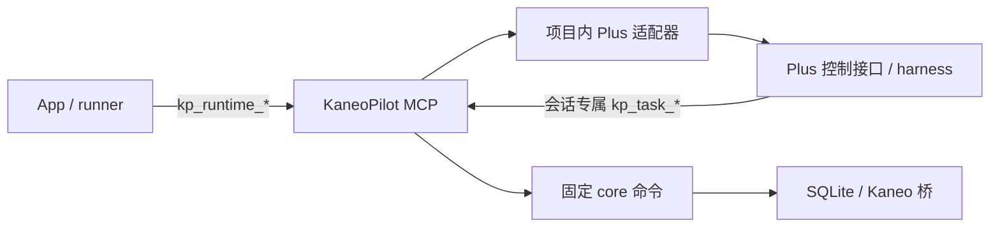

# KaneoPilot 计划阅读与角色环境施工计划

最新修订：2026-10-02，T7 整理为双向 MCP 通信与 Plus 一次接入施工计划；已核对当前源码存在的服务/适配/界面模块，按实际接线缺口规划，不把文件存在当验收。T1–T6 保留原编号、目标和历史记录；T7 状态与新契约以文末为准。本轮只修订计划。

修订：2026-09-26，T3 Plus 接通 R2，新增 T3.5「自动获取 Plus 执行配置」（已验收，用户确认按完成处理；代码、隔离测试和大窗口交互已完成，900×600 候选弹层未复验）。T3 当前为「实现中」；T3.1 为「待体验」，T3.2、T3.3、T3.4 为「实现中」。本机接口与隔离验证已完成，真实付费模型任务、正式配置切换及精确 900×600 原生窗口验收尚未完成。T1/T2/T4/T5 保留原目标，本轮不重新核验其完成状态。

最初的规划轮次只修订计划；收到明确实施请求后已按下述分工完成本地代码、打包、隔离服务与界面验证。真实模型费用与正式切换仍按 T3.4 的授权门执行，实际结果见本节执行记录。

## 依据与范围（2026-09-25 原始规划记录，T3 最新事实见下文）

- 工作目录：`/Users/developer/Documents/Code/Project/Personal Project/KaneoPilot`。2026-09-25 核查时，规划核心、`AppViewModel.swift`、`PlanningView.swift`、`SettingsView.swift` 和冻结规格均有未提交改动；实施前先核对这些改动，不能覆盖或把当前工作树当成已发布版本。现有 `docs/planner-fix-implementation.md` 处理的是当前规划器修复，本计划不改写它的 T1-T4 契约。
- 用户截图是当前深色界面的参考：待办任务详情只显示计划文件元数据，没有正文；设置是一个按软件命名的长 `Form`。截图不提供新的操作规则。旧页沿用 `docs/ui-spec.md` 的原生工具台基线：1180×760/900×600、18/13/11pt、8/12/16pt、系统语义色、状态图标加文字、列表行至少 40pt。
- 当前待办卡片经 `BoardView.openDetail` 打开 `TaskDetailSheet`；`TaskDetailView` 将计划、执行、Kaneo、Review、历史和阻塞排在一页。`PlanningView` 是“获取 To Do → 准备材料 → 开始规划”的工作流，不能充当已发布计划的阅读页。`get-task` 已返回 `plan_path`/`plan_sha256`，核心尚无计划正文读取命令。
- 当前规划为 `start-plans → planner_runner → codex exec`，内置模式使用 `--ignore-user-config -s read-only --output-schema`，由核心写入 frontmatter 并 `publish-plan`；发布后 `plan_execution_hold=true`，仍须人工“确认并安排执行”。当前没有选择施工规划插件的字段。
- 当前任务执行后端是 `pi -p --mode json`；`executor_runner` 的 dispatch/monitor/review 控制端也使用 pi，但其模型目前继承 PI 默认会话设置，不读取任务执行的 `exec_config`。PI-Desktop 工作目录为 `/Users/developer/Documents/Code/Project/Fork Project/PI-Desktop`，已有**需启动时显式开启**的本机 MCP 控制面（`PI_DESKTOP_MCP_CONTROL=1`），提供会话创建、提示、状态、分页记录和停止；没有 SSE、外部幂等键或按 `turnId` 读取持久终态的 MCP 操作。它的 Rust host 已将终态存入 `turns` 表。依据为该仓库 `docs/adr/0203-local-mcp-control-plane.md`、`docs/spec/03-runtime/01-ipc-protocol.md` §13d、`apps/desktop/electron/main/mcp-control.ts` 和 `crates/host-core/src/sessions.rs`。这修正了“完全没有外部接口”的初步判断；本轮没有启动服务或调用模型。PI-Desktop 当前主工作树也有未提交改动，且本地 `main` 落后 `origin/main`；实施其必要补充时遵守该仓库 `AGENTS.md` 的独立 worktree 流程，并重新核对最新目标分支接口。
- [OpenAI Docs 的技能说明](https://developers.openai.com/codex/skills/)确认 Codex CLI 可通过 `$` 显式引用技能，[插件说明](https://developers.openai.com/codex/plugins/)确认 CLI 安装插件后需在新会话使用。本机 `codex-cli 0.157.0` 的 `codex plugin list --json --marketplace personal` 显示 `spec-planner@personal` 已安装且启用。**能规划不等于必须使用插件**：内置规划保留，施工规划作为用户明确选择的方式。

## 已定的体验与共享契约

### T1 待办任务的独立计划页

- 待办列卡片的主入口打开同一任务详情容器中的**计划页**；其他列仍默认打开概览。计划页是阅读已发布计划，不复用 `PlanningView` 的材料准备步骤。用户可从计划页返回概览、切换其他页；“准备/重新规划”仍跳转现有规划面板。
- 页面顶端保留任务标题、`待确认执行` 状态、计划类型、生成时间及 SHA-256 前 12 位；下面完整展示 Markdown 正文（标题、列表、代码、表格、链接可读且正文可选中）。页面工具区保留 `打开计划文件`、`在 Finder 显示`，共享底栏按 `allowed_actions` 展示执行确认。阅读/原文两种模式可切换，原文必须保留所有字符；不在页面内修改计划。渲染不执行内嵌 HTML/脚本，也不自动加载远端媒体；链接由用户点击后交系统打开。
- 核心新增只读 `get-plan {task_id, expected_plan_sha256?}`，通过任务记录定位文件，复用 `planfile.load_plan` 的 Plan 根/身份校验，重算**整个文件** SHA-256 并与任务登记哈希比较；成功返回 `{task_id, title, plan_kind, generated_at, plan_sha256, markdown}`，`markdown` 为去除核心 frontmatter 的正文。无计划返回 `not_found`；文件缺失、越界、身份或哈希不符返回 `validation_failed`/`conflict`，不把不可信正文当成已批准计划展示。UI 保留任务摘要并显示原因、重试和外部文件入口，执行确认保持禁用，直到核心重新核验通过。读取在后台进行，旧请求返回时不得覆盖新任务的页面。

### T2 可选择的施工规划方式

- `规划环境`保存默认方式 `builtin`（兼容现有行为）或 `spec_plan`；`PlanningView` 第二步提供明确的两项选择，对本次选中的批量任务生效，并在第三步提交前展示。当前版本只支持这两个方式，不开放任意插件 ID 或插件市场安装操作。普通规划和评审修复规划仍各自选择现有模型/思考等级。
- `start-plans.items[]` 增加可选 `planner_method`，缺省 `builtin`；请求 `payload_json` 固化 `planner_method`、模型快照、输入哈希；选 `spec_plan` 时再固化 `plugin_id=spec-planner@personal` 与所用版本。幂等判定包含方式；已有同输入但方式不同的 queued/claimed 请求返回 `conflict`，不暗换执行方法。旧请求缺字段按 `builtin` 解释。`job.json`/运行记录显示方式和插件版本，不写凭据。
- `planner-capabilities` 返回两种方式的可用性与原因。`spec_plan` 需用 `codex plugin list --json --marketplace personal` 的结构化结果确认插件已安装、启用，并在其安装源核对 manifest 与 `skills/spec-plan/SKILL.md`；缺失时选项禁用并给出原因。排队后插件被移除/禁用则该请求明确失败并保留材料，不静默改用内置方式。
- 内置方式沿用现有只读、结构化输出链路。插件方式在**用户选中后**新开 `codex exec` 会话，显式引用已安装的 `spec-plan` 技能；不得继续用会隔离插件的 `--ignore-user-config` 路径。仍保留 `-s read-only`、`--ephemeral`、`--output-schema`、现有模型/凭据快照及超时/心跳。传给技能的本轮指令明确“本次不写文件，完整 Markdown 放入 `plan_markdown`”；这符合技能禁止写文件时在回复交付的分支。模型输出仍必须经过现有 `ready|needs_input`、`questions`、frontmatter、哈希、远端需求复验和 `publish-plan` 契约；仅提到插件名或模型自述“已使用插件”不能代替实际启用检查。插件模式可能加载本机用户配置中的其他能力，UI 在用户选择时展示该边界，实施验证须核对实际启动参数和技能加载证据。

### T3 Pi-Desktop-Plus 任务执行接通（2026-09-26 R1）

#### 目标、基线与范围

用户能够通过 KaneoPilot 的「设置 → 执行环境」选择自己的 Pi-Desktop-Plus，在独立 worktree 中执行已确认计划，并在 KaneoPilot 看见真实消息、工具结果与正确终态。服务未开启、型号配置错误、消息不完整或状态无法归因时显示具体阻塞，不出现假成功，不重复提交任务。

本次沿用 `backend="pi_desktop"`，不增加 `pi_desktop_plus` 枚举或迁移现有轮次。只接通任务执行者：规划仍为 Codex，dispatch/monitor/review 控制端仍走既有 pi CLI；不重做 T1/T2/T4/T5，也不增加 Plus 的 Plan/Goal 执行模式、远程 host、常驻守护进程或自动启动服务。

本计划使用以下路径别名（实施命令的工作目录须显式指定）：

| 别名 | 实际路径与用途 |
|---|---|
| KP | `/Users/developer/Documents/Code/Project/Personal Project/KaneoPilot`，当前未提交实现是保留与修复基线 |
| PLUS | `/Users/developer/Documents/Code/Project/Fork Project/PI-Desktop-worktrees/feat-goal-completion-report`，核查 HEAD `f3528adeb`，已含 Plus 品牌、独立数据目录和 Goal 报告功能 |
| TURN | `/Users/developer/Documents/Code/Project/Fork Project/PI-Desktop-worktrees/feat-mcp-turn-get`，HEAD `35d690374` 上有未提交 `pi_turn_get` 实现，仅作为只读移植参考 |
| PLUS_IMPL | 后续实施时从 PLUS 已核对基线建立或复用的独立工作树；不默认从原版 `origin/main` 开工 |

2026-09-26 同一会话调查所得事实：

- KP 已有 `pi_desktop_backend.py`、`pi_desktop_worker.py`、配置/派发/会话读取接入与 SwiftUI 入口，但新增核心文件仍未跟踪；现有 `dist/KaneoPilot.app` 不包含两个桌面后端模块。磁盘包与源码不一致，不能用源码存在证明用户运行的是新版。
- PLUS 构建产物为 `apps/desktop/release/mac-arm64/Pi-Desktop-Plus.app`，版本 0.15.6、bundle ID `cn.sakura.pi-desktop`；源码和包均没有 `pi_turn_get`。`/Applications/PI-Desktop.app` 0.15.7 是另一套原版包，不能作为 Plus 验收对象。
- Plus 正式数据目录为 `~/.pi-desktop-plus`，开发目录为 `~/.pi-desktop-plus-dev`，依据 `PLUS/apps/desktop/electron/main/data-paths.ts`，显式 `PI_DESKTOP_DATA_DIR` 优先。原版 `.pi-desktop` 不得混用或迁移。
- 默认 KaneoPilot 数据库未保存 `exec_config`，没有 `pi_desktop` 轮次；已检查的 Plus 数据目录没有 MCP 连接文件。尚无真实 Plus 任务或原生界面验证证据。
- 前一调查步骤实际运行 `core/tests/test_pi_desktop_backend.py` 与 `test_role_config.py`，结果为 **48 passed、10 subtests passed**。本轮规划没有重跑；这些测试使用 fake MCP，不证明 Plus 兼容。
- 本轮进一步核实：fake 把消息 ID 写成整数，真实 `UiMessage.id` 是字符串；worker `_Collector` 会丢弃真实消息，且可能误判成功。真实工具字段为 `toolStatus/toolArgs/toolResult/toolCompletedAt/isError`，现有转换也不匹配。Plus `session/create` 仅保存 provider/model，不负责确认型号有效。
- 设置页现有「检测」调用 `loadExecConfig()` 会覆盖草稿；错误文案只读取 `reason` 会忽略核心返回的 `detail`；`execIssue` 先检查 PI CLI 的总 `ok` 会阻挡桌面配置保存；CLI 分支保存可能携带空桌面块而被拒绝。以上均属于本次接通必须修正的范围。

实施前读取 KP `AGENTS.md`、`docs/protocol.md` §5.23.3、`docs/state-model.md`、`docs/ui-spec.md` §4.9、`docs/automation-contract.md`；Plus 读取其根及受影响目录的 `AGENTS.md`、相关 README、`docs/adr/0203-local-mcp-control-plane.md`、IPC/Host RPC 规格与交付检查要求。本节是本次修订的权威施工决定，主 agent 在实施开头同步受影响冻结规格，不要求执行者在旧规格和本节之间猜选；本轮只改计划文件。

#### 冻结契约与失败行为

**1. Plus 持久终态接口。** 从 TURN 按语义移植 `TurnState`、`sessions::get_turn_state`、`session.getTurn` RPC、`IPC.invoke.turnGet`、Main IPC、reviewed `turn/get` 和命名 MCP `pi_turn_get`。成功时 `structuredContent` 直接返回：

```json
{"sessionId":"s1","turnId":"t1","status":"completed","endedAt":"2026-09-26T00:00:00Z"}
```

`status` 只取 `running/completed/error/aborted`；`errorCode`、RFC3339 `endedAt` 为可选字段，按持久记录返回。参数缺失/空白返回 `INVALID_PARAMS`；不存在、跨 session 或远程 host 的轮次统一 `NOT_FOUND`。错误为 MCP `isError:true` 和 `structuredContent:{ok:false,error:{code,message}}`。按 session+turn 同时匹配，只读本机 `turns`，不新增表、认证方式或端口。KP 使用命名工具，不混淆通用 invoke 的 `{operation,result}` 包装。每次接受终态前都必须核对返回的 session/turn 与本轮相等；未知状态或身份不符不能判成功。

**2. 配置、能力与快照。** 保留现有 `get/set-exec-config` 和五字段 `pi_desktop:{connection_file,provider_id,model_id,thinking_level,permission_mode}`；`permission_mode` 必须由用户明确选择 `ask/accept-edits/auto`，不自动设为 auto。保存只作结构/枚举校验并原子保存，不以服务在线作为保存前提，不写 Plus 全局模型、权限或项目选择；切换后端保留另一分支已存值。无 backend 的旧配置按 pi 解释。

只读 `exec-capabilities {}` 检查已保存桌面配置，桌面分支继续返回 `{available,detail,tools_ok,version}`，`detail` 是展示错误的首选字段。缺服务/工具/配置不自动降级。既有总 `ok/checks` 属于 PI CLI 分支及其任务配置检查，不能当作桌面分支的保存门，也不能冒充继承默认模型的控制端已实测；UI 标注其检查对象，与桌面分支就绪态分开。dispatch/monitor/review 来源说明和 executor-status 继续沿用，不用桌面连接成功推断这些控制端模型可用。

连接检查沿用 owner-only 文件权限、loopback `/mcp`、`active=true`、记录 PID 存活、Bearer 握手及工具清单；固定必需工具集合为 `pi_turn_get`、`pi_session_create`、`pi_session_configure`、`pi_agent_prompt`、`pi_agent_status`、`pi_session_get`、`pi_agent_stop`、`pi_agent_abort`、`pi_desktop_invoke`。任何一项缺失都使 tools_ok/available 为 false，detail 列出缺项；通用操作不存在或返回错误同样阻断型号预检。主 agent 将九项集合写入 constants，B/C 使用同一常量。PID 存活本身不是应用身份验证，验收时再核对 manifest PID 的可执行路径确为本次 Plus；不把进程探测表述成密码学身份保证。token 只在内存使用，不进 argv、DB、日志、UI 或验收报告。

修正旧规格「控制面不能列 provider」：复用 Plus 已审查的通用只读操作，无需新增模型探测 API：

```json
{"operation":"providers/list","args":[]}
{"operation":"providers/listModels","args":[{"providerId":"已确认存在的ID","source":"cache"}]}
```

通过 `pi_desktop_invoke` 得到 `{operation,result:{providers:[...]}}` 和 `{operation,result:{models:[...],source:"cache|fallback"}}`。先确认 provider 存在且未禁用，再精确匹配返回模型的 `modelId`；只读本地目录，绝不省略 `source:"cache"`，不调用 refresh、OAuth 或远端 `/models`。返回 fallback 中已配置的模型也允许，不冒充远端在线证明。`thinking_level` 使用 Plus 合法枚举 `off/minimal/low/medium/high/xhigh/max`；本次保存/预检只验证该枚举，不自行根据 catalog 重写思考等级；模型自定义绑定由 Plus 运行时处理，若运行时不支持则明确失败且不降级，不用 catalog 空数组推断所有自定义模型不支持。预检只承诺本地配置存在；凭据有效、远端支持与费用属于 T3.4 的一次真实调用验证。无效 provider/model 在创建会话前拒绝。

claim 固化的 `execution_rounds.config_json` 是该轮次唯一执行配置来源。`dispatch-start` 与 worker 复检此快照，不能因用户后来切换设置而改用当前全局配置。`job.json/spec.json` 不保存 token。继续使用既有 plan 哈希、marker、worktree 与轮次身份校验。

**3. 消息采集。** Plus `pi_session_get` 返回 `{session:{messages,messageStart,messageEnd,hasMoreBefore,hasMoreAfter,...}}`。`messages[].id` 是不透明字符串，只用于身份去重；`messageStart/messageEnd` 是物理 transcript 行坐标，不能和 ID 比较或按消息数组长度推算。

Collector 从最近一页开始，以 `messageBefore=当前页.messageStart` 向前读取到 `hasMoreBefore=false`，依物理页顺序处理消息；使用现有页大小/最大页数上限，不新增缓存系统。要求游标严格前进、页范围能衔接；重复游标、缺边界、超过页数或 MCP `{truncated:true,reason:"MCP_RESULT_LIMIT",preview}` 均保留已读记录并报告 `transcript_incomplete`。不请求显示用 `contentLimit` 截断，不用 preview 冒充完整消息。相同字符串 ID、相同内容不重复写事件；内容或工具状态变化增加修订，沿用现有 session reader 的 ID/revision 更新语义。

用户/助手/thinking 按真实 role/content 映射；工具开始/完成按 `toolStatus`、`toolCompletedAt` 与 `isError` 判定，输入取 `toolArgs`、输出取 `toolResult`，保留 toolCallId 关联。命令退出码只在真实结果提供时显示，不能凭 isError 推算。fingerprint 包含这些真实字段，测试必须使用 Plus 结构而非为了旧实现造整数 ID。最终 `completed` 后再读完一轮消息，确认本次提交及最终助手/工具记录可对应；空转录或全部无法解析不能标 finished，记录明确的缺证据原因。

**4. 派发、断线与停止。** 继续 `claim → prepare → begin-send → start → confirm`，正常流程不用全局 `pi_project_open`。`session_create(projectPath=独立worktree,mode=agent,model...) → session_configure(permissionMode,confirm:true) → agent_prompt(完整核验计划)`。同一 run_id 不重复建立会话/发 prompt，超过 2 MiB 的完整请求在发送前拒绝；不得截断计划。

只有持久 turn 的身份匹配且证明已运行，并且核心 heartbeat 成功，才写用于确认的首个 session 事件。极短 completed 也可证明已运行；error/aborted 直接保留失败，不伪装正在执行。会话 finished 不等于任务 done，monitor 和 Review 状态机不变。

发送响应丢失时记录 `send_state=unknown`，可把 status 查到的 currentTurnId 当作候选证据，但不能仅凭它改判 sent/成功；人工裁决前不再次发送。持久接口身份不符、NOT_FOUND 或未知状态一律阻止完成。

服务读取失败只重连/重试只读请求：在当前轮询中最多三次、总计不超过 10 秒，复读同一 connection_file 以获取服务重启后的 URL/token/PID；禁止通过重连重放任何 session_create/configure/prompt。服务恢复后同一 session/turn 已是终态可补读完整记录；仍 running、身份不符或持续失联记 unknown/需人工。记录读取失败可在有界恢复后清除临时错误，永久缺页不能被覆盖。

超时先 stop，沿现有宽限再 abort，只有 turn_get 确认终态才可声称执行已停止；请求接受、响应丢失或 isRunning=false 不算终态。无法核实应保留「可能仍在运行」及 unknown，不把本地 worker 退出标为远端已停止，禁止自动重派。

启动意图之后的 worktree/哈希/Popen 失败需落可见失败证据。重复 start 对仅有意图、没有启动证明的轮次不得返回貌似已启动的 started；沿现有核心 `conflict` 错误信封明确返回未证实启动，进入既有人工失败/裁决流程，不清除意图偷偷重试。是否绝对未发送应以有无 worker 与发送证据判断，不凭 pid 空值自行推断。

#### T3.1 把持久终态接口接入 Plus

- **归属 E，独占** PLUS_IMPL 中 `crates/host-core/src/sessions.rs`、`crates/host-core/src/rpc/mod.rs`、`packages/shared/src/protocol.ts`、`apps/desktop/electron/main/ipc/session-ipc.ts`、`apps/desktop/electron/main/mcp-control.ts`、`apps/desktop/test/mcp-control.test.mjs`。相关英/中文协议由主 agent 单独同步。
- **输入与依赖：** 上述冻结契约、TURN 未提交差异、PLUS 的 Goal 报告与品牌基线；开始前核对两树 git status/HEAD。采用受管理的独立工作树，优先复用无其他任务依赖且工作已妥善保存的 checkout；创建时明确 PLUS 基线 ref，不默认原版 main。若工作树工具不可用再用该仓库允许的手动流程。
- **步骤：** 主 agent 保存可恢复差异与基线清单，E 按语义移植相关 hunk，不整体覆盖 rpc/mod.rs、不整树复制、不修改 TURN、不混入其余功能。保留 Plus 的 Goal 报告、数据目录、bundle ID、产品名与现有 API。用现有 Rust/MCP 夹具验证四态、错误字段、跨 session/远程 host 拒绝与重启后的持久读取。
- **并行：** 可与 T3.2 的真实结构 fake 测试和 T3.3 UI 修复同时开展；真实联合验证依赖接口通过。
- **交付/验收：** 文件差异、基线 ref、接口响应样例、适用测试日志；必须由最终 Plus 包内的实际 MCP 返回 pi_turn_get，不能只给 TURN 工作树测试结果。

#### T3.2 修正能力预检、消息采集与失败闭环

- **归属 B，独占** KP `core/kanpilot/pi_desktop_backend.py`、`pi_desktop_worker.py`、`cmd_dispatch.py`、`core/tests/test_pi_desktop_backend.py`。**归属 C，独占** `core/kanpilot/exec_config.py`、`core/tests/test_role_config.py`。两者不同时改同一文件；主 agent 独占 constants/cli/cmd_config/cmd_exec/cmd_session/dsh_events/round_store 及集成夹具，有共享接入需求先交主 agent。
- **输入与依赖：** 冻结契约、Plus `UiMessage/SessionDetail` 与 reviewed provider 操作；B/C 先冻结内部调用：`probe_connection(connection_file, required_tools=..., *, provider_id=None, model_id=None, timeout=10)` 保留旧调用兼容和 `{ok,detail,tools,version}` 响应；仅服务探测可不传型号，派发就绪必须同时传快照两项。provider/model 的查询、unwrap、匹配全部由 B 的 probe_connection 内部完成，只向 C 返回通过/失败及脱敏原因，C 不需要接收完整 providers/models；不扩展公开返回字段。缺配置、型号不存在、被禁用或操作错误都返回 ok=false，cache/fallback 合法条目可返回 true。C 调用 B 的同一个探针；`check_available` 增加可选配置快照输入，默认仍读当前设置，派发显式传该轮快照。
- **步骤：** B 修 string-id 分页/修订/工具转换、response 截断、turn 身份、发送不明、只读重连、停止证据、意图失败；C 接通只读 provider/model 探针与分支就绪语义，修枚举，保留既有 CLI 配置。共享事件去重若需调整，只由主 agent 在 dsh_events/cmd_session 接入，不改变历史 pi/codex 轮次读取。
- **并行：** B/C 可与 E/D 并行，真实接口验证依赖 T3.1；内部分工不得变成重复编写两套能力探测。
- **交付/验收：** 测试要能在旧实现上复现「字符串消息全部被丢弃却 completed」；同 ID 内容升级、跨多页、缺页、超限、工具失败与命令输出均可见；无效型号不建会话；当前配置切换不改变已 claim 快照；重连/重启/响应丢失/停止失败都不重复 prompt；最终记录与 Plus 相同 turn 可核对。保留已有 48 项相关测试的有效断言，不以删断言或整数夹具迁就实现。

#### T3.3 设置可用、应用包含适配、提供明确启动入口

- **归属 D，独占** KP `macos/KaneoPilot/Views/SettingsView.swift`、必要的 `Core/Models.swift`。**主 agent 独占** `scripts/build_app.sh`、本计划和验收用隔离启动材料；Plus 打包由主 agent 在 E 完成后串行进行。无必要不改 AppViewModel、全局样式或 Xcode 工程。
- **已核实视觉基线：** 当前源码为原生 grouped Form，已有「规划环境/执行环境/Review 环境/通用」四段；本轮没有打开运行界面，视觉依据为 SettingsView 与 docs/ui-spec，不声称截图验收。保留四段、行序、13/18/11pt、8/12/16pt、系统语义色与现有布局，只修执行环境内的交互/提示。1180×760、900×600 验收浅/深色与长路径。
- **明确差异：** 显示名改为 `Pi-Desktop-Plus（本机 MCP）`，协议 tag 仍 pi_desktop。保留连接文件/provider/model/thinking/权限五项；R1 的路径提示说明默认 `~/.pi-desktop-plus/mcp-control.json`，当时不自动填入。T3.5 将按下文 R2 契约自动填入默认路径与 Plus 候选，不扫描其他目录、不写入 Plus 全局配置。能力文案先取 detail，兼容旧 reason。错误详情允许换行，不因两行截断藏住解决原因。
- **检测与保存：** 按钮明确为「检测已保存配置」，只刷新 caps，不重新播种或清空草稿；未保存时说明「先保存，再检测」，编辑后说明结果属于已保存配置。初次加载才初始化草稿，异步旧请求不能覆盖新输入。桌面保存仅校验五字段结构/权限选择，不受 PI CLI 总 ok 阻挡；服务离线可保存但不可派发。保存 pi 时不提交空/残缺桌面块，保存 desktop 时不携带无关或非法 CLI 草稿，核心保留另一组字段。保存失败保留输入，成功明确“仅影响新轮次”；PI CLI 分支检查失败单独标明，保留控制端配置来源与调度状态行。
- **打包与启动：** 构建脚本增加实际必需桌面模块/命令导入检查，缺模块必须失败，不能让当前 `cp ... || true` 把核心打包缺失吞掉。记录源码与 app 内 backend/worker/exec_config/cmd_dispatch 的 SHA-256 一致性。验收 KaneoPilot 时去除 KANPILOT_CORE 覆盖以证明确实使用 Resources/core，数据路径仍用隔离环境。
- **Plus 启动方式：** 复用其 `bootstrap/startup.ts` 的环境开关，不修改默认关闭行为；交付本计划中的准确终端启动命令和实际构建路径。通过 Plus 二进制直接启动，携带 `PI_DESKTOP_MCP_CONTROL=1`；隔离环境须同时使用临时子进程 `HOME=<独立绝对目录>`、`PI_DESKTOP_DATA_DIR=<另一独立绝对目录>`、`--user-data-dir=<第三个独立绝对目录>` 和 `PI_DESKTOP_MCP_PORT=0`。三者分别隔离原生 Pi 会话发现、host 数据库/MCP 文件和 Electron 本地窗口资料；只设 DATA_DIR 会读取真实 Pi 会话与已有用户侧栏缓存，不构成完整隔离。本次实测三者齐备后，Plus MCP 列出 0 个会话、0 个 provider，原生侧栏为空。随后只在内存读取 manifest。正式用户目录启动不设置 DATA_DIR，继续使用 `.pi-desktop-plus`。Finder 直接启动未必带该环境，不得声称安装即自动启用 MCP；不加 launchd、不开自启动。已有 Plus 活跃会话时不强制终止，安排空闲时重启该 Plus；不动原版 PI-Desktop。
- **交付/验收：** 可用 app 路径、哈希清单、启动操作和原生界面证据；新填字段→保存→检测→关闭重开保留；离线原因可见；修改草稿→检测不丢输入；切回 CLI 可正常保存且 desktop 字段仍保留。无需新建截图平台。

#### T3.4 联合验证与正式切换

主 agent 负责集成与最终用户效果，不能用 subagent 自报代替。T3.1/T3.2/T3.3 的源码与隔离检查均通过后才进入本节。

**A. 本地隔离验收（后续实施授权即可进行）。** 临时创建 KP DB、app support、plan/repos/runs 根与 fake Kaneo；复用 `core/tests/test_pi_desktop_backend.py::TestDispatchPiDesktop`、`tests/conftest.py` 的环境接缝与 fake 服务。隔离真实 Plus 进程须同时使用临时子进程 HOME、独立 DATA_DIR、独立 Electron `--user-data-dir` 和随机端口，先运行不调用模型的 initialize/tools-list/providers-list 与对不存在 session/turn 的只读查询，核对 NOT_FOUND 形状。真实 Plus 临时目录未配置 provider 时，明确得到不可用并证明未调用 session_create/prompt，不再以不存在的 ID 调 listModels；不复制正式 secrets。cache/fallback 的有效/无效正反路径先由 T3.2 忠实 fake 与 Plus 原有本地模型夹具覆盖，真实已配置 provider/model 的读取放在 B 发送前完成。A 的预期阻断不是 API 失败。真实消息正路径在 B 验收；A 不声称已经验证完整转录。

KaneoPilot 原生验收启动其二进制时传入临时 `KANPILOT_DB/KANPILOT_APP_SUPPORT/KANPILOT_PLAN_ROOT/KANPILOT_REPOS_ROOT/KANEO_CREDENTIALS_PATH`；使用进程参数 `-executorSchedulingEnabled NO` 禁止定时拉起模型（不修改用户持久 UserDefaults），保持 fake Kaneo 和 fake pi-bin，只手动触发测试命令。对隔离根运行 `migrate` 建库，不对正式库迁移。确认未继承 KANPILOT_CORE 后再验证包内核心。

**B. 一次有界真实模型验收（费用需已有明确授权，否则在准备完毕后询问）。** 使用 Plus 已配置且用户允许的 provider/model/thinking，先展示非敏感组合及单次调用边界，权限模式必须用户明确选择；不得把 CLI 的 CloseAI/deepseek-flash 默认值推成 Plus 的配置。可以使用用户 Plus 数据目录中的新测试会话，KP、Kaneo 和代码仓库仍隔离；不复制密钥、不改用户全局模型。

建立临时 Git 仓库与有效计划夹具，内容限定为读取本地 `INPUT.txt`、新建一个 `RESULT.txt` 并返回指定短完成标记，禁止网络/安装依赖/提交/推送。最多一次新 agent_prompt/任务 turn（内部工具往返可能有多次模型请求，费用授权覆盖该有界 turn），执行上限 120 秒，额外最多 30 秒用于 stop/abort 与终态取证；超过取证上限标为停止未证实，不能声称已停止；失败不自动重试或换模型。Kaneo 仍用 fake 服务，dispatch/monitor/review 验证通过确定性核心调用和既有隔离夹具完成，不额外调用控制端模型。

按完整 claim→prepare→begin-send→start→confirm 运行，核对独立 worktree 的文件差异、Plus 窗口会话、同一 sessionId/turnId、持久终态、KaneoPilot 实际显示的用户/助手/工具记录及无凭据日志；能正确进入后续 monitor/review 所需状态，不能直接标 done。三处证据（Plus、KP runs、文件差异）必须对应同一轮次。测试会话和目录标明供用户检查，未经授权不删除真实会话。

**C. 正式配置切换（单独的现场影响边界）。** 完成 A/B 后给出新包路径、目标 connection_file/provider/model/thinking/permission 与旧配置字段差异、运行中任务清单。用户明确授权后，在无提交中/运行中桌面轮次冲突时：对默认 KP DB 使用 SQLite 一致性备份并保存脱敏配置快照；经核心命令保存后端五字段，重新读取并检测。保留原 pi 分支、历史轮次和 Plus 原数据，不修改其他角色模型、不批量确认已有待办、不自动开启调度总开关；权限未选则只暂停保存切换。当前环境没有 exec_config 时也应保存“原值缺省”的回退信息。后续回退经核心切换为 pi，不改运行中轮次快照；是否需要处理新产生的 active 轮次先按其证据判断，不能用回退配置取消任务。

重新启动 Plus 后再次通过启动命令取得新 manifest，KaneoPilot 检测可恢复；关闭 Plus 显示阻断。正式切换不需要自动付费跑第二条任务。未取得 B/C 授权时仍完成全部独立本地工作，清楚列为待授权的真实验收/现场配置，T3 保持「实现中」，不能宣称已接通用户环境。

#### 验证命令、分工汇总与交付门

下列为施工检查入口；本次实际执行的命令及结果见执行记录。先读各仓库必需检查，避免把定向命令当成免除项目门禁。

| 环境 | 命令/操作 | 通过条件 |
|---|---|---|
| KP 根 | `python3 -m pytest -p no:cacheprovider core/tests/test_pi_desktop_backend.py core/tests/test_role_config.py -q` | 真实形状 fake、配置与失败闭环回归通过 |
| KP 根 | `python3 -m pytest -p no:cacheprovider tests/test_pi_config_contract.py tests/test_pi_dispatch.py tests/test_pi_round_contract.py -q` | pi 兼容、派发快照与轮次读取通过 |
| KP 收口 | 在 core 目录运行 `python3 -m pytest tests -q`，根目录运行 `python3 -m pytest tests -q` | 项目约定隔离检查；既有不相关失败独立记录，不降低本次标准 |
| PLUS_IMPL 根 | `cargo test -p host-core session_get_turn -- --nocapture`；`pnpm --filter @pi-desktop/desktop exec node --test test/mcp-control.test.mjs` | 持久四态、跨 session、认证和工具响应真实形状通过 |
| PLUS_IMPL 收口 | `cargo test -p host-core`；`pnpm --filter @pi-desktop/desktop typecheck`；该仓库要求的其他适用门禁 | Plus 原功能保留，必需检查通过 |
| 两应用打包 | PLUS_IMPL：`pnpm --filter @pi-desktop/desktop run pack`（本机仅验证可在依赖构建后用 `CSC_IDENTITY_AUTO_DISCOVERY=false pnpm --filter @pi-desktop/desktop exec electron-builder --dir` 生成无分发签名包）；KP：`scripts/build_app.sh` | Plus binary/host 含新增接口；KP Resources/core 与源码哈希一致；签名状态单列 |
| 两应用运行 | T3.4 A/B，1180×760、900×600，浅/深色 | 实际 app、MCP、文件与会话证据齐全，无假成功 |

隔离启动命令模板（实施者把两个绝对路径替换为实际产物/新建空目录；命令本身不授权调用模型）：

```bash
env HOME="<PLUS_TEST_HOME_ABS>" PI_DESKTOP_DATA_DIR="<PLUS_TEST_DATA_ABS>" PI_DESKTOP_MCP_CONTROL=1 PI_DESKTOP_MCP_PORT=0 "<PLUS_APP_ABS>/Contents/MacOS/Pi-Desktop-Plus" --user-data-dir="<PLUS_TEST_ELECTRON_USERDATA_ABS>"
```

正式启动保留产品默认 Plus 数据目录：

```bash
env PI_DESKTOP_MCP_CONTROL=1 "<PLUS_APP_ABS>/Contents/MacOS/Pi-Desktop-Plus"
```

如果 37123 被占用，只针对该启动指定空闲 `PI_DESKTOP_MCP_PORT`，读取实际 manifest URL，不停止占用者。退出隔离 Plus 后确认 manifest inactive；进程/端口失败与模型失败分别报告。

并行安排：主 agent 先冻结协议和内部探针接口 → E(T3.1)、B/C(T3.2)、D(T3.3 UI) 实际并行 → 主 agent 接共享核心/规格 → E 的接口与 B/C/D 完成后串行打包 → 主 agent 亲自执行 T3.4。打包串行是为保证产物来自稳定的共同代码状态，避免读到其他 agent 正在改写的文件。每个写入文件始终只有一个所有者；主 agent 不与 D 同时修改 Models.swift。

交付在本文件 T3 下追加执行记录：实际 HEAD/dirty 差异、测试命令和结果、两个 app 路径与哈希、脱敏连接检查、UI 截图路径、真实 session/turn/run 对照、是否已切换正式配置、仍待授权/阻塞项。必要验证受阻仍为「实现中」；适用验证完成为「待体验」；用户明确确认才是「已验收」。

**剩余决定与边界：** 技术路线已冻结。真实验收选用的 Plus provider/model/thinking、用户权限模式、模型费用授权和正式配置切换授权在 T3.4 执行前取得或复用会话中已有明确授权；不影响先完成 T3.1–T3.3。普通实施选择自行处理；不因每个可逆步骤重复请示。未经授权不提交/推送、合并到原版 main、发布/签名分发、迁移正式 DB、删除用户数据或启停其活跃任务。两次有不同依据的尝试仍无法解决同一阻塞，报告预期/实际/证据/所需决定，只暂停依赖部分，不盲重试，不降低验收。

#### 2026-09-26 执行记录

- **T3.1（待体验）**：从 Plus 基线 `f3528adeb` 在独立 `codex/kaneopilot-plus-mcp` 工作树按语义接入 `pi_turn_get`，未修改 TURN 原工作树。Rust host 全量 **661 passed**，Electron MCP **9 passed**，TypeScript typecheck、cargo fmt/clippy 通过。打包后的 `apps/desktop/release/mac-arm64/Pi-Desktop-Plus.app` 包含命名工具，包内 `pi-desktop-host-core` 与本树 release 编译产物 SHA-256 均为 `cdf851b03907d04f07a9849043a12e68a6773f66c1477a6807d32e270f2511b0`。本地签名尝试因 Apple 时间戳服务不可用失败；关闭自动签名后成功生成**本地无分发签名** app，未发布、安装到 `/Applications` 或替换用户现有 Plus。
- **T3.2（实现中）**：修正真实 Plus 字符串消息 ID、物理分页、工具字段/退出码、稳定修订投影、模型缓存预检、领取快照复核、只读重连和停止不明状态。发 prompt 前持久标记 `send_state=unknown`；响应丢失、启动证明缺失或首次持久终态即失败时，尽力读取并将未验证转录另存 `unverified-events.jsonl`，不伪造首个 session 事件；桌面分支不能退回主仓库执行。核心完整测试 **345 passed、14 subtests passed**，之前定向测试 **69 passed、10 subtests passed**；最后修复后的桌面后端回归测试 **41 passed**。真实用户/助手/工具完整转录仍缺一次受授权的模型任务验证。
- **T3.3（实现中）**：最后修复后重建 `dist/KaneoPilot.app` 成功，核对五个核心模块与源码哈希及包内导入；`pi_desktop_worker.py` 源码与包内 SHA-256 均为 `a5dbb6bc542e7ac21bad3050ad6852d380222e93a497ec25f52cf61a92c34367`。根集成测试 **288 passed**，此前相关集成检查 **17 passed**。原生界面在浅/深色实际打开并验证：桌面配置离线保存，检测不覆盖草稿，切回 PI CLI 后桌面字段仍存，退出重开后正确读取，已保存但当前后端为 pi 时提示准确。执行环境没有明显重叠；精确 900×600 窗口未能通过当前窗口控制能力设定，仍待体验。
- **T3.4 A（完成本地隔离检查）**：真实 Plus loopback MCP 协商 `2025-06-18`，九项必需工具齐全，`pi_turn_get` 不存在返回 `not_found`；无 provider 时本地能力门阻断。首次只指定 DATA_DIR 的试运行读取了默认 Electron 侧栏缓存及本机原生 Pi 会话目录，只读取元数据，未发送 prompt；由此补齐独立 `--user-data-dir` 和临时子进程 HOME。三层隔离复验后 Plus 原生侧栏为空、MCP 返回 **0 会话 / 0 provider**，正常退出把连接清单改为 `active:false`。KaneoPilot 的原生验证使用隔离 DB、fake Kaneo 与关闭的调度器，未访问正式 Kaneo。
- **T3.4 B/C（待授权与环境准备）**：较早的正式 Plus `~/.pi-desktop-plus/pi.sqlite` 只读检查为 **0 provider / 0 model**；本日稍后用户启动 MCP 并配置 Plus 后，新的只读查询见 T3.5。真实任务仍需用户确定 provider/model/thinking 和 permission_mode，并授权该一次模型调用的费用；正式 KaneoPilot 配置切换须单独明确授权，届时先展示旧/新字段差异与活动轮次并备份正式 DB。本轮未进行真实模型任务、正式切换、迁移、提交、推送或发布；T3 不称为已接通正式环境。
- **T3.4 正式派发诊断（2026-09-26 后续）**：正式 DB 只读显示执行 backend 已保存为 `pi_desktop`；dispatch 请求 `8d44b63a-818e-4aa3-9f56-6f6d1cf74414` 仍为 `queued`、`attempt_no=0`，`plan_execution_hold=false`，全局与 dispatch 阶段均未暂停。正式 Plus MCP 探测为不可用，原因是连接文件 `active` 不是 `true`；19:34 本地时区的派发 runner 虽正常退出，但 `CloseAI/deepseek-flash` 控制模型在日志中连续返回 `Connection error`，未领取请求。另外旧 `core/executor_prompts/dispatch.md` 把轮次证据固定为 `backend=pi`，与已实现的 `pi_desktop` worker 分支不一致；本次已修正为沿用 claim 上下文后端并加回归测试。此次诊断只读，未 claim 请求、写入 heartbeat、调用 Plus 或改变 Kaneo 状态；真实执行仍需 Plus MCP 激活、本机 PI 控制模型可连接及该模型调用费用授权。
- **验证证据目录**：KP 根 `build/t3-evidence/`（隔离夹具、核心/集成测试与构建日志），Plus worktree 下的应用包，Plus 测试/类型/Clippy 日志在 `/tmp/kaneopilot-plus-*.log`。原生窗口通过 CUA 直接实测，当前界面工具未提供截图落盘路径；不要把静态构建或 fake 结果替代真实模型验收。最初只隔离 host 的启动可能改写默认 Electron 用户资料的窗口/缓存元数据，未确认有用户会话内容变更，不主动回滚或清理该资料。

#### T3.5 自动获取 Plus 执行配置（R2，已验收）

**用户效果与已核实依据。** 在「设置 → 执行环境」选 Pi-Desktop-Plus 后，默认连接路径自动出现；Plus MCP 已运行时，KaneoPilot 只读取得 provider、模型和可用思考等级，把 Plus 明确保存的默认组合填入空白草稿，并提供候选供切换。用户仍需检查并按「保存」才影响新轮次，`permission_mode` 仍由用户显式选择。2026-09-26 用户截图显示路径已手填而 provider/model 为空；当前 `SettingsView.swift` 使用五个自由输入，`loadExecConfig` 只从已保存配置播种，`exec-capabilities` 只检查已保存配置，不能填当前草稿。此前「不会自动扫描」的 R1 行为由本节替代；不改变已保存配置、运行中轮次或 T3.4 真实任务的授权门。

本轮只读检查正式 `~/.pi-desktop-plus/mcp-control.json` 为 `active:true`，Plus MCP 返回 **1 个启用 provider**、`settings/get` 中的默认 provider/model，以及该 provider 的 **82 个本地缓存模型**；其默认模型为 `deepseek/deepseek-v4.1-flash`，配置模型的默认思考等级为 `high`。这是当前机器的可变现场证据，不作为固定 ID 写入软件。Plus 的 `providers/list` 带 `defaultModelId`、配置模型的 `defaultThinkingLevel/thinkingLevels`；`providers/listModels({providerId,source:"cache"})` 返回 `cache|fallback` 的本地目录；`settings/get` 带全局 `defaultProviderId/defaultModelId`。模型目录中的空 `supportedThinkingLevels` 不能推断该模型不支持思考。上述操作只读；本轮未创建会话、发送 prompt 或调用付费模型。现有 Plus 包已具备这些操作，本任务**不修改 Plus 仓库**。

**冻结的读取与草稿规则。** 默认路径由核心用户 HOME 展开为绝对路径 `~/.pi-desktop-plus/mcp-control.json`；仅在连接路径草稿为空时填入，不扫描原版 `.pi-desktop`、开发目录、其他 HOME 或 `PI_DESKTOP_DATA_DIR`，自定义目录继续允许用户手填绝对路径。路径存在不等于服务可用；读取前复用 `load_connection` 的文件权限、active、PID、loopback、Bearer 与版本校验。切入 Plus 时自动读取一次候选，提供「重新获取」用于服务启动/配置变化后刷新；已有保存配置只加载候选，不用 Plus 默认值重播种。没有已保存桌面块时，读取结果也只填空草稿；重复读取不覆盖非空草稿，不调用 `set-exec-config`。点击保存仍走原结构校验和新轮次快照，服务离线可保存但不能派发。

自动选择只信 Plus 的明确默认：先以 `settings/get.defaultProviderId` 匹配启用 provider，缺省且仅有一个启用 provider 才选它；随后以 `settings/get.defaultModelId`，否则该 provider 的 `defaultModelId` 精确匹配本地目录，只有目录恰好一个模型且没有默认时才选唯一模型。默认 ID 缺失、禁用或不在缓存目录时保留当前草稿并显示具体原因，不能改选数组首项。模型可选思考等级依次取该 provider 配置模型的非空 `thinkingLevels`、目录模型的非空 `supportedThinkingLevels`、provider 的非空 `supportedThinkingLevels`；都缺失才展示完整合法枚举并标为「支持范围未确认」。只在空草稿且所选配置模型有合法 `defaultThinkingLevel` 时填入；没有时若上述明确级别集合恰好一个才填入，其他情况要求用户选，不把会话 `thinkingLevel` 冒充全局默认，也不把空目录元数据解释为不支持。级别选择限定 Plus 枚举 `off/minimal/low/medium/high/xhigh/max`；运行时兼容仍由原 T3.2 预检和真实调用核定。`permission_mode` 不读取、不猜测、不改为 `auto`。

**共享只读命令。** 主 agent 在 `docs/protocol.md` 冻结并注册 `pi-desktop-catalog {connection_file?: string, provider_id?: string}`；省略路径只用上述默认绝对路径，传入路径须为绝对路径。命令依次 `load_connection → initialize/tools/list → pi_desktop_invoke providers/list(args=[]) → settings/get(args=[]) → 对选中 provider 调 providers/listModels(args=[{providerId,source:"cache"}])`；不调用 refresh、远端目录、session/create、agent/prompt 或任何写操作。正常响应仅含 `connection_file`、`providers:[{id,name,enabled,default_model_id,models:[{id,name,thinking_levels,default_thinking_level}]}]`、`default_provider_id`、`default_model_id`、`selected_provider_id`、`catalog_source`。只有选中 provider 的 `models` 填入目录，其余 provider 的 `models=[]`；未选中时 `catalog_source=null`。调用方可传 `provider_id` 只刷新该 provider 的模型；未传时按上一段默认规则确定；多个启用 provider 且无有效默认时 `selected_provider_id=null`、模型为空，由用户选择。完整 `settings/get`、provider 的 baseUrl/凭据标记、token、manifest 内容和请求头都不进入响应、日志或 SQLite。连接/工具/目录读取失败沿核心错误信封返回脱敏原因，草稿不变；空 provider/空模型是成功的空目录状态，不伪装服务失败。`catalog_source` 只接受 `cache|fallback`；若 Plus 返回其他来源，命令明确失败，不将其候选用于自动填写。

**原生界面差异。** 保留截图所示 grouped Form 的行序、13/18/11pt、8/12/16pt、系统语义色、四段设置和当前「检测已保存配置」的独立语义；连接路径行默认显示绝对路径，仍可手改。provider/model 保留精确 ID 文本输入及离线保存能力，旁边增加读取结果的候选弹出列表；模型列表在弹出层用独立搜索词过滤 82 个候选，预填的 ID 不充当搜索词，选中后才写入原输入框，不新开整页。thinking 改为合法级别选择，目录提供明确子集时只展示该子集，目录缺信息时展示合法枚举而不声称全部受模型支持。「重新获取」位于现有检测行，显示读取中、空目录和失败原因；「检测已保存配置」仍只检查已保存配置，不播种草稿。旧请求返回前用户改了路径/provider/model/thinking 或切走页面时，利用草稿修订号丢弃其填充值；候选也只属于对应连接路径与 provider。已保存 ID 在 Plus 目录消失时原样显示并标明不可用，不静默切换；重新选择候选后才更新草稿。错误文案可换行，不遮挡保存与权限选择；VoiceOver 名称、键盘选择及焦点遵循现有表单。用户截图只是现状依据，新增交互尚未实测。

| 施工归属 | 独占文件、输入与依赖 | 交付与验收 |
|---|---|---|
| A：核心目录读取 | `core/kanpilot/pi_desktop_backend.py`、`cmd_config.py`、`core/tests/test_pi_desktop_backend.py`；输入为本节命令契约及 Plus 当前 `providers/list`、`settings/get`、`providers/listModels` 返回。主 agent 冻结协议后可与 B 并行；不改 `cli.py`/规格/Swift。 | 只读命令处理函数、正常/空/多 provider/失效连接/非法来源/脱敏测试；服务失败时无写入或 prompt。 |
| B：设置草稿与候选 | `macos/KaneoPilot/Views/SettingsView.swift`、`Core/Models.swift`；输入为本节 JSON 契约、当前截图与 `docs/ui-spec.md`，可先用隔离响应夹具与 A 并行；不修改核心文件。 | 默认路径、只填空字段、候选过滤、离线/多候选/过期响应的原生交互；保留现有保存与检测行为。 |
| 主 agent：共享接入与最终核验 | 独占 `docs/protocol.md`、`docs/ui-spec.md`、`core/kanpilot/cli.py`、`tests/test_pi_config_contract.py`、`scripts/build_app.sh` 与本计划；先冻结命令和视觉差异，接收 A/B 后串行集成。 | CLI 注册、协议与模型一致、包内模块哈希、隔离测试与实际 1180×760/900×600 浅/深色界面核验；不以 A/B 自报代替用户流程验收。 |

**验收标准。** 保留两个脏工作树及当前用户数据，不迁移、不覆盖已保存执行配置。核心隔离 fake 覆盖单 provider 默认值、多 provider 无默认、默认模型不在 cache、82 项候选、配置模型与目录思考元数据不一致、离线/active=false、错误响应脱敏；运行 `python3 -m pytest -p no:cacheprovider core/tests/test_pi_desktop_backend.py core/tests/test_role_config.py -q` 和受影响 `tests/test_pi_config_contract.py`。真实 Plus 只调用上述只读操作，核对当前默认值进入**未保存草稿**；分别验证修改草稿时刷新不覆盖、切换 provider 后模型候选对应、Plus 退出后旧值仍在、重新打开已保存配置不被默认值替换。随后运行项目核心/集成必需检查、`scripts/build_app.sh`，从包内核心启动原生 app，在浅/深色及 1180×760、900×600 检查长路径/长模型名、候选菜单、加载与错误，保存前后用 `get-exec-config` 核对仅在主动保存后 DB 才变化。**不**为本功能调用付费模型或执行正式切换；T3.4 B/C 仍单独按其授权门推进。全部验收完成后 T3.5 可标「待体验」，只有用户确认才标「已验收」。

**2026-09-26 R2 实施记录。** 核心只读命令、CLI 注册、协议/UI 规格及执行设置页已完成；只读读取 `providers/list`、`settings/get`、`providers/listModels(source:"cache")`，不发送 prompt。核心回归与角色配置检查 **71 passed、10 subtests passed**；CLI 合约 **8 passed**；枚举过滤修复后的 `TestPiDesktopCatalog` **7 passed**；`git diff --check` 通过。以 `APP_OUTPUT_DIR="$PWD/build/t3.5-app" scripts/build_app.sh` 构建 Release 成功，包内 `cmd_config.py` SHA-256 为 `50dbbe9ec8a0b02c8e1a0819d849f56b7750d915c28f719de4e408fe3630caa8`，`pi_desktop_backend.py` 为 `9161ac36aa61998bde45ff067e314bf7b34c20f52dade675f70b3f75f3482866`，均与源码一致；最终 app executable SHA-256 为 `734cde12d0984691d1bda2f180c1e5a34d98bfbd7915a5e88cee40ecabe84949`。真实运行的 Plus 只读返回 1 个启用 provider、默认模型 `deepseek/deepseek-v4.1-flash`、思考等级 `high` 和 82 个 `cache` 模型。用独立 bundle ID、临时 DB/支持目录和关闭调度器启动隔离 KaneoPilot；实际设置页自动填入默认连接路径/provider/model/thinking，候选弹出列表搜索 `gpt-6` 可过滤到匹配项，`permission_mode` 保持未选择。只读审查后补齐：目录读取失效时清除 loading 并用独立 generation 丢弃过期响应；当前 provider/model/thinking 不在 Plus 目录时保留原值并标明不可用；thinking 元数据过滤到 Plus 合法枚举。隔离 DB 的 `get-exec-config` 仍为 `config:null`；未保存配置、创建会话或调用模型。原用户 KaneoPilot PID 50422 与 Plus PID 90310 未停止或替换。原生实测后系统锁屏，无法完成 900×600 窗口检查；该尺寸是当前必要验证缺口，T3.5 维持「实现中」，解锁后按既定尺寸补验再改为「待体验」。

**2026-09-26 解锁续测与验收。** 重新打开同一隔离包并切换到 Pi-Desktop-Plus 后，实测默认连接路径、provider、model、`high` 思考等级再次自动出现在未保存草稿，Plus 目录显示 82 个模型，`permission_mode` 仍为未选择。候选按钮左移版本已重建，当前隔离包可执行文件 SHA-256 为 `79f1e41200f24a691bc183908fc7a86af84f41003ffd54bb3409f9dfd35d881e`。当前窗口截图为 1802×1752 像素（约 901×876pt）；两次边缘拖拽未能改变窗口高度，CUA 随后再次报告系统锁屏，因此新版候选弹层在 900×600 下尚未复验。用户于本日明确要求按完成处理，故 T3.5 标记为「已验收」；该尺寸仍是未实测项，不记作通过。

### T4 拆分任务详情

- `TaskDetailSheet` 保持现有 sheet 尺寸、标题/状态与关闭入口，顶部将“详情/执行会话”改为 `概览 / 计划 / 执行 / 评审 / 记录` 五个分段，内容区每页独立滚动、切换时不丢当前任务。概览放任务状态、Kaneo 信息、阻塞证据与允许操作；计划页按 T1；执行页放轮次字段和现有 `SessionReaderView`；评审页放结论/报告/修复关联；记录页放 attempts 表与事件时间线。没有对应数据时显示清晰空态，不显示空白表。
- 底部动作仍只信 `get-task.allowed_actions`，危险动作确认文案、`send_state=unknown` 限制、归档/回收站只读态均沿用现行规则。历史/回收站入口仍可打开详情，已移出的任务不因拆页重新出现执行动作。长标题、长路径和较窄窗口不得遮挡分段或底栏；键盘左右切换分段，焦点与 VoiceOver 读出页名。`PlanningView` 和顶层七项导航不改变。

### T5 按角色组织设置并独立 Review 环境

- 顶层侧栏仍只有一个“设置”；其内部用 `规划环境 / 执行环境 / Review 环境 / 通用` 四段切换，不按 Codex/PI 软件名分大节。沿用现有 grouped Form、控件密度和系统颜色。规划页展示 Codex 认证/服务商、两组模型及 T2 默认方式；执行页展示任务执行者（PI CLI 或 PI-Desktop）、相应模型/权限、能力检查和 dispatch/monitor 调度状态；Review 页展示独立的评审模型与能力检查；通用页放 doctor、自动推进、队列参数、路径和迁移信息。
- 新增 `get-review-config {}` 与 `set-review-config {mode, provider?, model?, reasoning_effort?}`，保存到 `settings.review_config`，形状为 `{mode:"inherit"|"custom", provider?, model?, reasoning_effort?, updated_at}`。未保存或 `inherit` **保持当前实际行为**：review 控制端继承本机 PI 默认会话配置；`custom` 时按现有 `exec-capabilities` 校验该 provider/model/effort，并在 `executor_runner --stage review` 启动时通过 pi 参数固化，记录脱敏快照。保存只影响下一次 review 控制端启动；运行中的进程不改配置。Review 固定提示词继续来自 `core/executor_prompts/review.md`，不复用任务执行的 `agent_preset`。评审修复计划仍属于规划环境，不属于 Review 执行模型。
- `dispatch/monitor` 控制端本轮继续继承 PI 默认设置，在执行页明确显示该来源；任务执行者的 `exec_config` 不伪称会控制这两个进程。设置页加载失败保留旧内容并允许重试；保存失败保留草稿；各页标明默认/已保存及“仅影响新轮次”。不修改 `~/.pi`、`~/.codex` 或 PI-Desktop 全局模型配置。

## 原 T1–T5 总体施工顺序与独占归属

以下保留原五项目标的分工背景。R1 曾执行上文 T3.1–T3.4 收口分工；本轮只规划 T3.5，后续实施归属以 T3.5 表格为准，不因此重新启动其他 T1/T2/T4/T5 任务。

主 agent 先独占修订 `docs/protocol.md`、`docs/state-model.md`、`docs/ui-spec.md`、`docs/automation-contract.md`，把以上字段、枚举、错误、状态与视觉顺序冻结；同时负责 `core/kanpilot/cli.py`、`constants.py`、`cmd_read.py`（含 T1 `get-plan`）、`cmd_exec.py`、`round_store.py`、必要的 `db.py` 连接和 `tests/` 集成夹具。共享文件只有主 agent 写，其他执行者按冻结契约提交需求；主 agent 集成并亲自验收真实界面/服务。规范未冻结前，各子任务只读核查，不先假设接口。

| 子任务/目标 | 独占文件或模块 | 输入、依赖与可并行工作 | 交付及验收 |
|---|---|---|---|
| A：T2 规划方式 | `core/kanpilot/planner_inputs.py`、`planner_runner.py`、`codex_planner.py`、`planner_config.py`、`cmd_planner.py`、`core/executor_prompts/planner_prompt.md`、专属 `core/tests/test_planner_method.py` | 读冻结的 `planner_method` 契约与现有未提交规划修复；可与 B/C/D 并行，不改 `cli.py`/docs。 | 内置兼容、插件可用性/选择/快照/不降级及失败回归；提供给主 agent 的 CLI 注册需求。 |
| B：T3 PI-Desktop 任务后端 | 新 `core/kanpilot/pi_desktop_backend.py`、`pi_desktop_worker.py`、`core/kanpilot/cmd_dispatch.py`、专属 `core/tests/test_pi_desktop_backend.py` | 读冻结的后端/事件/不明发送契约与 PI-Desktop §13d；可与 A/C/D 并行；`cmd_exec.py`/`round_store.py` 的需求交主 agent。 | fake MCP 的认证、分页、超时、身份、终态测试及脱敏日志；不触碰真实凭据。 |
| C：T5 角色配置 | `core/kanpilot/exec_config.py`、`cmd_config.py`、`executor_runner.py`、新 `review_config.py`、专属 `core/tests/test_role_config.py` | 读冻结的 PI CLI/PI-Desktop 配置结构与 Review `inherit/custom` 语义；可与 A/B/D 并行；共享命令注册交主 agent。 | 旧设置兼容、Review 独立保存、能力校验、review 启动快照。 |
| D：T1/T4/T5 原生界面 | `macos/KaneoPilot/` 下受影响的 SwiftUI、`AppViewModel.swift`、`Core/Models.swift`，必要的新计划阅读 View | 读冻结 JSON 与 `docs/ui-spec.md`；可用隔离响应夹具与 A/B/C 并行；macOS 目录只由 D 写。 | 待办直达计划、五页详情、四段设置及错误/空态；主 agent 收口后实测 1180×760/900×600。 |
| E：T3 PI-Desktop 持久终态读取 | 在 PI-Desktop **独立 worktree** 独占 `crates/host-core/src/sessions.rs`、`rpc/mod.rs`、相关 Electron Main IPC/MCP 文件及相应测试/英文规格 | 先按 PI-Desktop `AGENTS.md` 核对最新 `origin/main`、最近局部指令和工作区；实现已冻结 `pi_turn_get` 合同，可与 A/C/D 和 B 的 fake 接口并行；B 的真实接入依赖 E 的通过结果。 | 正确的 session/turn 身份、四种持久状态、重启后只读查询、Bearer/权限边界测试；不改现有 MCP 启动开关。 |

依赖顺序：冻结共享契约 → A/B/C/D/E 独占实施（B 的 fake 接口可先于 E）→ E 的持久终态接口通过后 B 接入真实 MCP → 主 agent 接入命令和轮次读取、处理冲突并跑隔离检查 → 构建/打开原生 App 体验 → 在用户已授权费用与本机服务启用的前提下做一次有界真实插件规划和 PI-Desktop 执行。PI-Desktop 主工作树的现有改动不得带入 E 的独立任务。

## 原 T1–T5 总体验收步骤与停止规则

以下为原五项全部实施时的验收。本次 Plus 接通的必需门使用上文 T3.4，不要求为了 T3 重做插件规划或其他页面功能。

1. 从 `core/` 运行 `python3 -m pytest tests -q`，项目根运行 `python3 -m pytest tests -q`；用独立临时 DB/Plan 根/fake Kaneo 与 fake MCP，不触碰本机正式 DB。覆盖 `get-plan` 正常/缺失/篡改/越界，规划方式幂等与插件缺失，PI-Desktop 未启用/认证失败/分页/截断/断线/不明发送，Review `inherit/custom` 与旧配置兼容。失败修复受影响代码后只重跑相关检查，最终再跑项目必需检查。
2. 运行 `scripts/build_app.sh`，打开实际 macOS App，在 1180×760 与 900×600、浅/深色检查：待办点击直接显示完整计划；概览/执行/评审/记录互相切换；长中文标题、长路径、无计划、哈希冲突、插件不可用、PI-Desktop 未启用、Review 保存失败均有可读状态且无重叠。检查键盘、焦点和 VoiceOver 名称；构建通过不替代这一步。
3. PI-Desktop 独立 worktree 先运行该仓库适用的 Rust/TypeScript/MCP 控制面检查，验证 `pi_turn_get` 的鉴权、身份与完成/错误/中止/运行中四态；再用 fake MCP 完成 KaneoPilot 一轮派发，核对 `session_id/turn_id/run_id`、`job.json/events.jsonl`、回收站/历史读取和 monitor/Review 仍走原状态机；同一 `run_id` 在超时/重启后不得再次发送。PI-Desktop 服务未启用或缺少该只读工具时，设置必须显示阻断而不是自动切回 PI CLI。
4. 真实环境验收需用户明确允许该模型调用可能产生的费用：使用一条可撤销的本地测试任务，先核实 Codex 插件模式确实加载所选技能并产出规范计划，再以开启本机 MCP 的 PI-Desktop 执行一次受控、可观察的短任务，核对工作目录、会话、终态、文件差异及 KaneoPilot 的 monitor/Review 证据。未完成真实调用时只报告隔离验证，不称插件或桌面执行已经实测。

2026-09-25 原计划登记 T1-T5 均为未开始；2026-09-26 T3 最新状态和新增收口任务以上文为准，其他项未重新核验。实施时保留工作树与真实数据；未经单独授权不提交/推送、迁移正式 DB、切换现场自动化、调用付费模型或发布。若同一阻塞经两次不同依据的尝试仍未解决，记录预期、实际、证据和所需决定，只暂停受影响任务。适用自动与界面检查完成后状态为“待体验”；只有用户确认才标“已验收”。


## T6 全流程 Pi-Desktop-Plus 接入（2026-09-30）

### 本轮结论、目标与证据边界

**当前尚未全流程适配。** 已有 Plus 任务执行与会话观察能力；计划生成、dispatch 控制端、monitor 控制端和 Review 模型仍调用其他运行端。本轮仅只读调查并保存计划，没有修改业务源码、配置、数据库，没有启动服务、测试或模型。后续收到明确实施授权后执行 T6，不把当前规划限制解释为永久禁止实施。

本轮工作区为 KP 的 `master`，HEAD `43a4231`。开始前只有未跟踪的 `docs/plans/task-detail-readability-and-execution-evidence.md`，必须保留。本计划沿用 T1–T5 编号和历史执行记录，T6 不重新判定它们已验收；T3.5 保留用户已确认状态。最初 T3 的“仅任务执行接通”边界仍解释当时结果，T6 扩展后续施工范围。

| 阶段 | 本轮源码核查 | 是否已全部走 Plus |
|---|---|---|
| 普通计划、review_fix 计划 | `core/kanpilot/planner_runner.py:421` 领取 plan；`:462` 固定 job backend=codex；`:603` 构造 Codex argv；`:618` 拉起进程 | 否 |
| dispatch 控制端 | `core/kanpilot/executor_runner.py:105`，`:135` 构造 `pi -p --mode json` | 否 |
| 任务执行 | `core/kanpilot/cmd_dispatch.py:533` 分流桌面 worker；`pi_desktop_worker.py:831` 创建 Goal 会话；`:1002` 本机契约代批后观察执行 turn | 已有 Plus 实现，不能代替本轮真实服务验证 |
| 执行证据观察 | `core/kanpilot/cmd_session.py:645`、`round-observe` 消费 Plus session/turn、分页消息和终态 | 读取已适配；monitor 控制模型仍是 pi CLI |
| Review | `review_config.py:49` 仅 inherit/custom；`executor_runner.py:145` 仅追加 pi CLI 模型参数 | 否 |

重要区别：执行 worker 的 Goal 首轮是“执行前目标契约”，不是 KaneoPilot 的 plan 请求。它不能证明调度台的计划生成已经使用 Plus。后续继续保留已有 Goal 审批语义，不把其首轮 completed 当成执行完成。

本机证据：

- `/Applications/Pi-Desktop-Plus.app/Contents/Info.plist` 为 `cn.sakura.pi-desktop` / 0.15.6；正式数据使用 `.pi-desktop-plus`。没有用原版 PI-Desktop 包冒充 Plus。
- `~/.pi-desktop-plus/mcp-control.json` 的 `active=false`，记录 PID 已不存活；开发目录没有连接文件。本轮未握手、未开服务。此快照只说明检查时连接不可用，不推断后续仍关闭。
- `dist/KaneoPilot.app/Contents/Resources/core/kanpilot/` 中的 `planner_runner.py`、`executor_runner.py`、`pi_desktop_worker.py` 存在，且逐字节等于当前源码。因此本地 dist 包也仍是上述混合链路；没有核验用户正在运行哪一份 app。
- 正式 `kanpilot.db` 文件存在，但两种只读 SQLite URI 打开均返回 `unable to open database file`。停止继续重试；当前已保存模型、后端和活动轮次是**未知**。不以旧记录代替本轮结果，也不尝试迁移、修复、停任务或复制正式库来绕过问题。
- 旧计划中的 345 passed 等属于历史测试，本轮未重跑。未打开原生界面，因此本轮只有源码界面基线，不声称视觉实测。

目标：用户在三类角色环境中选择 Plus 后，普通计划、修复计划、dispatch、任务执行、monitor、Review 的所有模型调用均通过用户自己的 Plus MCP；KaneoPilot 继续负责确定性的队列、租约、审批和状态写入。通过 Plus 不要求把 Python 核心或 Swift 定时器改成模型，也不改变人工启动规划、确认计划后执行、Review 后完成/修复的流程。

### 必读入口与外部能力

KP 必读：`AGENTS.md`；`docs/protocol.md` §5.22、§5.23.3–5.23.9；`docs/state-model.md`；`docs/ui-spec.md` §4.9；`docs/automation-contract.md`；本节。上文 T1–T5 只作为兼容依据，冲突时由主 agent 将本节的新增契约同步到冻结规格后再施工。

本轮核查的 Plus 源码根为 `/Users/developer/Documents/Code/Project/Fork Project/PI-Desktop`（以下称 PLUS_SOURCE）；不是上文旧的 feat worktree 假定路径。本轮仅阅读，未改 Plus。必要外部依据：

- `apps/desktop/electron/main/mcp-control.ts:351`：session/create 支持 agent/plan/goal、provider/model/thinking。
- 同文件 `:380`：pi_turn_get；`:415`：session/configure；`:432`：agent/prompt 支持 attachments，返回 accepted/turnId；`:473`：plans/pending、plans/resolve。
- `packages/shared/src/types/agent.ts` 的 AgentPromptAttachment；`apps/desktop/electron/main/prompt-attachments.ts` 的 project/scratch/attachment 根解析。
- `docs/spec/03-runtime/01-ipc-protocol.md` 的 PlanProposal；`packages/agent-runtime/src/runtime.test.ts` 的 Plan 工具矩阵。
- `docs/spec/05-security/01-security.md:85`：Plan 模式不是 OS 只读沙箱。Write/Edit 被禁，但 Bash 在 auto 下能改文件，ask 下需批准；不能声称 Plan 模式本身保证所有源码只读。

本轮没有验证安装包包含全部最新源码 API。实施开始先只读确认实际 Plus 工具清单；缺接口时直接显示阻塞，不自动换应用/运行端，不为了接通启动新的 Plus 实例覆盖用户活动会话。T6.1–T6.5 只使用已有 MCP；用户后续提出“终端启动不方便”，新增 T6.6 修改 Plus 的开关与生命周期，不扩大模型或队列协议。如果安装包缺这些已有工具，则只暂停真实联合验证，报告缺项与构建版本；跨仓构建/安装按其 AGENTS 和用户后续授权处理。

### 冻结的角色、配置与兼容契约

**角色路由独立于规划方式。** 保留 `pi_desktop` 枚举，不新增 plus 同义后端。旧配置和旧请求保留原行为；不在 app 更新时隐式切换。

| 所有者/存储 | 新增或沿用字段 | 兼容解释与作用 |
|---|---|---|
| `settings.planner_config` | 新增 `backend:codex|pi_desktop`、`pi_desktop` 五字段块；保留 standard/review_fix 与 default_method | 缺 backend 按 codex；Plus 模型使用独立块，不将 Codex reasoning_effort 当 Plus thinking_level |
| `settings.exec_config` | 原有 `backend:pi|pi_desktop`、pi_desktop 五字段块；新增 `controller_backend:pi|pi_desktop` | 缺 controller_backend 按 pi；该字段只控制 dispatch/monitor，任务 worker 仍按原 backend |
| `settings.review_config` | 新增 `backend:pi|pi_desktop`、pi_desktop 五字段块；保留 mode:inherit|custom 与 CLI 模型三字段 | 缺 backend 按 pi；mode 仅对 pi 分支生效；Plus 分支必须明确五字段 |

五字段仍为 `connection_file/provider_id/model_id/thinking_level/permission_mode`。保留 CLI/Codex 的原配置字段，切回时可恢复，保存一个角色不更改另一角色。Plus 连接路径默认 `~/.pi-desktop-plus/mcp-control.json`，不自动扫描或回落 `.pi-desktop`；如用户显式选择其他绝对路径，检测须显示实际路径，不能只凭 PID 宣称 Plus 身份已证实。

- 每个角色保存独立脱敏快照；任务执行已存五字段不改。Plus 下的 plan/Review 使用 `mode=plan` 且 `permission_mode=ask`，避免自动执行 shell 写入；不开放这两角色的 auto/accept-edits。dispatch/monitor 使用 `mode=agent`，采用用户显式选定的执行环境权限；首次选 Plus 不自动补 auto。CLI 角色原权限保持兼容。没有自动批准 Plus 工具权限的通道。
- Plan/Review 提示词禁止业务源码修改、产品构建、外部发布及执行 SubmitGoal；Bash 权限请求显示需要用户处理，不静默批准、不重复 prompt。预先由 runner 提供 git status/diff、已核验计划和执行证据，减少只读审查对 shell 的依赖。Plan/Review 仍不能声称 OS 沙箱隔离；Write/Edit 的模式约束和未批准 Bash 是本次具体边界。Plus 的模型/plugin 工具风险沿已核对工具矩阵，不能仅凭 prompt 宣称全部只读。
- Plus 计划仅支持 `planner_method=builtin`。`spec_plan` 是 Codex 插件运行方式，在 Plus 下明确禁用并显示原因，不能把技能文本复制给 Plus 后声称插件实际运行。Codex 分支继续提供 builtin/spec_plan 两方式，不删除 T2。若以后要求 Plus 原生施工规划插件，应另行确定插件运行能力，不在本次虚构兼容。
- `start-plans.items[]` 新增可选 `planner_backend`，缺省 codex；UI 总是提交明确值。Plus 项固化 `planner_backend=pi_desktop`、对应五字段 `runtime_config`，保持原输入 ID/哈希和 method；Codex 项保留 model_config。幂等比较包含 backend、method 和对应运行配置，同一输入但后端不同的活动请求返回 conflict。既有 queued/claimed 请求缺 backend 按 codex，不受后来改设置影响。
- dispatch/monitor 在每次控制端启动时固化 `controller_backend` 与对应配置；Review 的 Plus 请求在首次成功 claim 时固化本次 review 配置到请求 payload（增加字段，不另建表），后续恢复以请求快照为准。计划仍在 start-plans 固化；任务执行仍在 claim 固化 execution_rounds.config_json。保存设置只影响新请求/控制轮，已有会话不能变模型、权限或后端。
- JSON 配置存现有 settings，无需为选择后端提高 schema 版本。round 索引扩展 backend 允许值的消费者需同步，历史 codex/pi/pi_desktop 按原语义读取。禁止重写历史轮次或修改正式 DB 作为开发夹具。

**能力与失败。** `planner-capabilities`、`exec-capabilities`、`review-capabilities`（新增只读命令）分别展示角色分支 `{available,detail,tools_ok,version}`，其中 available 只代表本机配置与协议工具可用，不证明模型在线。`review-capabilities` 输入 `{}`，返回 `{pi:{available,detail},pi_desktop:{available,detail,tools_ok,version}}`。扩展已有响应时保留旧字段，不再以 Codex 或 PI CLI 的总 ok 阻挡 Plus 保存/选择。

复用 `pi-desktop-catalog`，模型查询严格 source=cache，不刷新远端目录、不调用付费模型。结构校验允许离线保存；运行前用冻结快照复检服务、工具和型号。基础工具门沿 `PI_DESKTOP_REQUIRED_TOOLS`；计划/Review 额外要求 pi_plans_pending/pi_plans_resolve，用于读取并安全关闭产物检查点；任务执行沿 PI_DESKTOP_DISPATCH_TOOLS 的 Goal 门。任一缺失明确失败，绝不静默 fallback。不要为 Plus 分支调用 Codex provider 解析/登录检查或 PI auth check。

### 冻结的计划生成与 Review 交付

**T6 计划生成。** `planner_runner` 仍负责 claim、心跳、输入检查、生成 frontmatter、publish-plan；仅模型步骤按请求 backend 分流：

1. 确认输入 manifest/哈希与请求快照，在独立规划 worktree 中准备材料。沿现有 worktree 工具建立用于读取当前源状态的工作目录；不能把 SubmitPlan 的 `.pi/plan` 产物写进用户主工作区。当前需求涉及未提交文件时，将明确输入的源码快照映入该 worktree，不把旧 HEAD 当成当前源码。该目录由核心管理，规划阶段不清理用户仓库。
2. MCP create(mode=plan) → configure(permissionMode=ask) → prompt(任务、材料、角色指令)。发前写 send_state=unknown；返回 turnId 后核实 session/turn 启动证明再登记 sent。复用现有 transport、消息 Collector 和脱敏逻辑，不能复用任务 worker 的 Goal 自动审批分支。
3. ready 由该 session/turn 的 `SubmitPlan` 产生唯一 `kind=plan` proposal；从 pi_plans_pending 读取 markdown，严格匹配 sessionId/turnId/toolCallId/proposalId/version。runner 不从多个旧 proposal 中猜选。终态 completed、完整转录与产物匹配齐备才接收。
4. 读取后调用 pi_plans_resolve(action=reject, confirm=true) 关闭该**生成阶段** proposal，记录“已导入 KaneoPilot；此会话不用于执行”。不发 approve，不生成 Plus 执行 turn。拒绝失败保留产物和身份并报 plan_failed，不发布；若用户在 Plus 界面并发批准，现有 MCP 无法阻止外部已经启动的执行，必须识别 proposal 已 approved/出现执行 turn，报告审批冲突并禁止本地发布或二次派发，不声称已阻止外部执行。reject 后确认原 proposal 已 rejected，不以空 pending 清单冒充成功。
5. 将正文规范化为现有 `{status:"ready",plan_markdown,questions:[],evidence:[...]}`，复用 `planner_runner` 的结果解析/发布逻辑。模型自报 task_id/hash/model 不可信，仍由核心重算；publish-plan 继续置 hold=true，用户确认后才 dispatch。
6. 信息不足时模型最终答复严格给出 `{status:"needs_input",plan_markdown:"...",questions:["..."],evidence:[...]}`，不提交 proposal。completed + 完整最终答复经现有解析器校验后，草稿保留、report needs_user。既有前后围栏解析规则可复用；不增加自动修复 JSON 的第二次模型调用。ready 无有效 proposal、空输出、混入 needs_input 与 proposal、分页不完整都明确失败，保留证据。
7. 图片保留：为 MCPClient.agent_prompt 增加可选 attachments，使用 Plus 的实际 AgentPromptAttachment 类型；图片按原 manifest 逐一校验哈希，复制到该规划 project 根的独立材料子目录后传递允许范围内的绝对路径。复用 Electron 图片解析/vision 能力错误，不将无法解析的图片静默省略；未支持的型号/附件明确阻塞。MCP 请求超限发送前拒绝，不截断正文或图片。图片路径/类型以上述真实类型为准，不能把 any[] 当作无约束格式。

普通 plan 和 review_fix 使用同一 Plus 路径，review_fix 继续核对 review_key/原报告/关联任务，并通过现有 publish-plan 回写 repair_plan_path/sha。修复计划仍是用户准备材料后手动 start-plans，**不**因 review 创建修复任务就自动规划；旧 `_preamble.md`/review prompt 中与 §5.22 手动语义矛盾的句子同时修正。

**T6 Review。** Plus Review 由 runner 确定性 claim/review/report，模型只读审查，不执行核心状态写命令。CLI 分支保持原行为。流程：

- claim(stage=review) 后核对请求 run_id、任务本轮执行 worktree、计划哈希、执行证据与关联来源，不能只审主仓库。通过 runner 的只读 git status/diff 提供改动材料；复制计划/报告/执行证据到专属 Review worktree 内材料目录。该 worktree 是审查输入，不复用仍活动的执行会话。
- create(mode=plan)、permissionMode=ask，指令只审查并输出 JSON；不 SubmitPlan、不 SubmitGoal，不代批任何契约。最终答复结构冻结为 `{conclusion:"pass|changes_requested|blocked",report_markdown:str,fix:{title:str,description:str,priority:str}|null}`；report 非空，changes_requested 必须 fix，priority 必须为 `no-priority|low|medium|high|urgent`（`bridge.VALID_PRIORITIES`）。没有原生 outputSchema 能力，runner 在 completed 与完整转录后严格解析；不要把 MCP structuredContent 当模型结构化输出保证。
- 意外生成 proposal：只读确认本 session/turn 身份后 reject 关闭，记 review_blocked，不按其 markdown 登记 pass。格式错误、转录不完整、身份错误、权限等待、超时均不写 pass、不推进 done，保留错误和证据。
- runner 写 `<APP_SUPPORT>/reports/<task_id>/<run_id>.md`，通过核心命令重算报告哈希。pass：register-review(pass) → advance-task(done,expected_current=in-review) → report succeeded。blocked：register-review(blocked) → report needs_user，保留 review_blocked 分类。
- changes_requested：先持久化经校验的模型结果、报告字节/sha和后续动作检查点，恢复复用同一份报告，不重跑 Review 或用变化后的报告产生新 key。稳定 dedupe_key 为 sha256(源 task_id、本周期任务执行 run_id、已核验报告 sha 的规范 JSON)，`review_key=dedupe_key`；先 create-review-fix，取得 fix_task_id/source_sha256 后再 register-review(changes_requested,review_key,fix_task_id,fix_task_source_sha256)，最后 report succeeded。这遵循当前 `cmd_register_review` 要求 fix_task_id+review_key 的真实合同；修正旧 review prompt 中“先登记 changes_requested 再 create”的冲突。中途失败保留已得字段，恢复同一 dedupe_key，不再创建第二个修复任务。
- pass 必须是模型有证据的结论并成功核心登记/推进；Plus completed 或 runner exit=0 都不能单独当作 Review pass。报告文件、任务状态与请求汇报相互核对。
- **登记归属与周期保护（必要核心补齐）。** 当前 register-review 的 run_id 可选且未核验，不能靠 runner 自律保护过期请求。新增可选 request_id、expected_execution_run_id；新自动 Review（Plus 和更新后的 CLI prompt）必须传 request_id+run_id+expected_execution_run_id。核心在事务中核对 request.stage=review、task_id、status=claimed、run_id 和未过期 lease，以及任务仍是该次执行对应的评审周期；失配 stale_run/conflict，不写报告登记或 pass。旧无身份的手动调用保留兼容，不作为新自动链路入口。create-review-fix/advance-task 的新 Review 调用同样传身份并使用此校验；advance 的已完成恢复场景另按下条只读判定，不新推进。主 agent 独占 CLI、cmd_exec.py、cmd_remote.py 和共用校验，C 更新调用和专属测试；服务端仍无CAS，不声称本地guard阻止远端竞争。
- **部分成功恢复。** job 持久化 execution_run_id、最终结果/报告sha、dedupe_key、fix结果、register/advance/report 的已确认检查点。恢复先通过 get-task/get-request 读核心事实，不能只相信job。登记内容和同一报告sha/结论/key/fix一致才承认已登记，跳过register；不一致conflict，不能覆盖新周期。pass若已done则读取当前报告对应的pass登记及远端recheck证据后跳过advance；仍in_review且租约有效则只推进剩余动作。changes_requested若已存在同key fix和登记则仅完成report。report响应丢失时读get-request：该request/run已以相同outcome结束则认定汇报已完成，不再次调用当前非幂等report；仍claimed且租约有效才继续汇报。lease已失效/lost或被新run接管则停止写入并在executor-status显示“评审收尾受阻”，通过现有人工恢复入口处理，不重新调用模型、不自动领取第二个review，也不因已有review_report_path静默认为整个请求成功。测试注入register后、advance后、report响应丢失三处崩溃并验证上述事实恢复。
- **冻结文档同步。** automation-contract.md现有review段还使用旧KaneoReviewer报告路径、先登记changes_requested顺序和“create-review-fix排plan请求”；主 agent在T6.1改为本节实际报告根、先create后register、fix停needs_plan并等待用户prepare-plan-input/start-plans，同步protocol和prompt。不能只修prompt而留冻结合同误导下一执行者。


### 冻结的 dispatch/monitor 控制端与恢复

`executor_runner --stage dispatch|monitor` 根据 controller_backend 分流。Plus 模式创建独立 mode=agent 控制会话，运行现有相应角色 prompt，通过本机 Python 核心命令工作；调度器只拉 runner，不再在此分支调用 pi -p。工作目录使用独立控制目录；prompt 提供绝对核心路径、DB 路径及同一环境接缝，不更改 Plus 全局当前项目。

Plus MCP 的 shell 工具在宿主环境执行，不会继承 KaneoPilot Python 子进程的环境：每次核心调用须显式传入本控制轮固定的 `KANPILOT_DB`、`KANPILOT_APP_SUPPORT`、`KANPILOT_PLAN_ROOT`、`KANPILOT_REPOS_ROOT`、`KANPILOT_LEGACY_ROOT`、`KANEO_CREDENTIALS_PATH` 和 core 根/可执行路径等适用设置，使用正确 shell 引号或 runner 生成的固定本地启动包装器。包装器只启动现有 CLI 并传配置环境，不能暴露 token、绕过核心规则或变成替代状态管理脚本。测试必须令宿主默认环境指向错误夹具，证明仍命中目标隔离库和 fake Kaneo，不能只测继承环境的 fake。

- dispatch/monitor 的模型和权限来自 exec_config.pi_desktop；与任务执行分开的会话/turn/日志，不混入 execution_rounds 的任务会话。Review 自有配置，不能复用控制端模型。
- 控制轮以 invocation_id 区分，产物位于 `<APP_SUPPORT>/executor-sessions/<stage>/<invocation_id>/`，包含脱敏 job/events；executor_runs[stage] 增加 backend/session_id/turn_id/invocation_id/config/send_state，保留旧 pid/log/exit_code 等字段。任务请求 run_id 与控制 invocation_id 不可混用。runner 启动记录不代表请求已领取。
- 保留当前 dispatch/monitor prompt 的核心顺序、停止与未知发送策略。monitor 不新建任务执行会话、不发送执行 prompt；它通过自己的 Plus 控制会话调用 get-session/round-observe 观察已有轮次。Goal 门只由任务 worker 管理。
- Plus 控制会话 completed 只说明控制模型回合结束；请求是否成功以核心 claim/report 和请求结果为准。进程日志正常结束不能把 queued 标成 running。控制会话等待工具权限时 UI 展示权限等待和 session 标识，不自动授权。
- 每次发送前持久 unknown，响应不明不重发；session/turn 已知时只重连读取。恢复 runner 查询已保存身份，不重复 session_create/agent_prompt。已有 claimed 请求用其租约/run_id 汇报，stale_run 后停止该项。无已知 turn 的 unknown 保留人工阻塞，禁止新控制轮对同一阶段重复发送。
- 扩展 executor-status 的单飞判断：既有 worker PID 与持久 Plus 活跃/unknown 控制轮都能阻止重复启动；PID 消失只触发只读恢复，不当成已完成。关闭/暂停 app 调度只阻止新轮，不擅停活跃 Plus turn。
- 心跳沿当前 request lease，规划每 ≤min(lease/3,60s)；Review 同样由 runner 在模型等待期间保活。dispatch/monitor 原命令 heartbeat 保留，不能用控制会话 running 掩盖已失联的核心请求。
- 超时复用 stop→abort→turn_get 的有界处理与明确未知状态；权限等待不得被标成功。两个不同依据尝试仍无法解决同一阻塞时只暂停依赖部分，报告预期/实际/证据，不无限重试或自动改模型。

### T6 施工任务与实际分工

本轮已并行使用两个只读 subagent，分别核查计划/Review 与执行/Plus；主 agent 独立核对配置访问、连接状态、打包代码和契约，未以子 agent 自报代替最终结论。后续实施遵守下列独占归属，所有任务目前为「未开始」。

| 任务/用户效果 | 独占归属、必读与输入 | 依赖、步骤与交付验收 |
|---|---|---|
| T6.1：各阶段能保存明确后端与快照 | 主 agent 独占 docs 四项冻结规格、AGENTS 中架构说明、constants.py、cli.py、cmd_exec.py、cmd_remote.py、cmd_queue.py、round_store.py、cmd_read.py、tests/ 集成夹具；配置子 agent A 独占 planner_config.py、exec_config.py、review_config.py、cmd_config.py、cmd_planner.py、planner_inputs.py、core/tests/test_role_config.py、test_planner_config.py | 主 agent 先冻结本节合同；A 复用旧 save/snapshot，不迁移历史配置，扩展 capability/快照/幂等。独立于其他子 agent，但接口冻结前只读。交付旧配置/新角色独立保存、离线保存、后端不可用不降级及请求快照测试；命令注册交主 agent。 |
| T6.2：普通/修复计划在 Plus 生成，继续在调度台批准 | 子 agent B 独占 planner_runner.py、新 pi_desktop_planner.py、core/tests/test_plus_planner.py、core/executor_prompts/planner_prompt.md；读 T6 计划合同、codex_planner.py 现有解析器、Plus PlanProposal | T6.1 输入合同冻结后与 C/D 并行。Codex 条件分支完全保留；实现 Plan proposal 读取/关闭、needs_input、材料图片、状态/哈希/hold；不触碰 Goal 任务 worker。验收计划正文与身份匹配、并发批准时本地发布/二次派发被阻断、图片不丢、恢复不重发、review_fix 链和 Codex 兼容。 |
| T6.3：派发、监控和 Review 模型也在 Plus | 子 agent C 独占 executor_runner.py、新 pi_desktop_controller.py、新 pi_desktop_review.py、core/executor_prompts/_preamble.md、dispatch.md、monitor.md、review.md、core/tests/test_plus_controller.py、test_plus_review.py、test_executor_prompt_contract.py | T6.1 配置冻结后与 B/D 并行；复用核心 JSON 命令与 transport。实现两个控制端与专属只读 Review runner、显式宿主环境、进程重启恢复/单飞、报告及修复 dedupe；协调主 agent 的状态读取字段。验收不启动 pi CLI、不会因 Plus completed 直接写成功、changes_requested 顺序正确、恢复不重复建修复任务。 |
| T6.4：设置和详情能看清每步真实来源 | 子 agent D 独占 macos/KaneoPilot 下相应 SettingsView、PlanningView、AppViewModel、Core/Models、Core/ExecutorScheduler 和详情/Review View；读 docs/ui-spec.md 与 T6 JSON 字段 | 接口冻结后可用固定响应夹具与 B/C 并行。复用现有角色分页、Plus 目录候选和错误样式。交付独立保存、后端/权限/方法禁用、来源与等待状态、单飞恢复入口；主 agent 亲自原生核验。 |
| T6.5：共用 MCP 保持现有执行能力并验收完整链 | 主 agent 独占 pi_desktop_backend.py、pi_desktop_worker.py（仅受共享改动影响的必要接缝）、cmd_session.py、cmd_dispatch.py、相关 test_pi_desktop_backend.py、scripts 构建和 tests/ 联合夹具 | 先为 B/C 提供向后兼容的 transport/Collector 调用合同（新增 attachments 可选，不改原调用）；其他 agent 不写共享文件。复用任务 Goal 审批与只读观察；集成 T6.1–T6.4 后定向验证、项目必需检查、打包及真实用户流程。 |

依赖顺序：主 agent 冻结 → A/B/C/D 并行（B/C 使用已冻结配置 fixture；共享 adapter 先交付）→ 配置与 runner 联调 → 主 agent 原生和隔离闭环 → 有明确真实模型费用授权后联合验收 → 有明确正式配置切换授权后切换。不得由多个 agent 同时写 cli/constants/docs/backend 或同一测试文件；每个 agent 交付改动入口、实际命令与结果、证据位置、剩余问题。共享改动需求交唯一所有者。Plus 不分派实现子任务，已有工具可用就复用。

### 旧界面基线与明确差异

本轮依据 SettingsView.swift、PlanningView.swift、Core/Models.swift、ExecutorScheduler.swift；没有原生截图。沿当前规划/执行/Review/通用设置导航、系统语义色、18/13/11pt、8/12/16pt、1180×760/900×600，不另建页面或改变全局风格。

- 规划环境增加后端选择 Codex/Pi-Desktop-Plus，Plus 复用已存在五字段和目录候选控件，权限固定 Ask 并说明“工具权限需在 Plus 处理”；选择 Plus 时 builtin 可用、spec_plan 禁用显示原因，不能重载配置覆盖草稿。标准/修复 Codex 模型块保留在其分支。
- 执行环境保留现有任务后端块，增加“派发与监控运行端”选择 Pi CLI/Pi-Desktop-Plus；Plus 控制端复用本页已保存的 Plus 型号字段。两项分别显示实际生效值，不能把一个 Plus 选择显示为全链路切换。
- Review 增加独立后端块；pi 下保留 inherit/custom，Plus 下复用目录候选、固定 Ask，不混用 execution agent_preset。
- “获取 Plus 列表”沿已有只读动作；只在目标角色空草稿填明确默认，不因查询改其他角色。每个角色保存成功/失败沿现有 toast/alert，失败保留草稿；显示“仅影响新请求/新控制轮”，运行记录始终显示快照值。
- PlanningView 提交前显示本次普通/修复请求的后端、型号和方式；详情/记录显示每阶段 backend、会话与 turn、权限等待/连接不可用/输出错误。外部查看沿现有路径/会话标识入口；没有已核实 Plus deep link 时只展示 ID，不编造链接。
- 主 agent 原生检查两个窗口尺寸的长路径、长中文型号、空目录、服务关闭、保存失败和方法不支持状态。不能以 Swift 构建或 fixture 回应代替界面体验。

### 适用验证与完成门

本轮未执行以下测试，这些都是后续施工验收。

1. **隔离定向检查。** 使用 core 现有 TemporaryDirectory/fake MCP 和 `tests/conftest.py` 的 tmp_env/fake Kaneo；显式隔离 DB、APP_SUPPORT、Plan/repos/runs/材料根，不访问正式 Kaneo、不加载用户凭据。新增测试入口按上表创建后，在 KP 根执行 `python3 -m pytest core/tests/test_plus_planner.py core/tests/test_plus_controller.py core/tests/test_plus_review.py core/tests/test_role_config.py core/tests/test_pi_desktop_backend.py -q`。覆盖旧配置、角色快照、无服务/工具、模型目录、Plan导入后reject、needs_input、附件真实类型、权限等待、非法最终JSON、completed未report、unknown不重发、恢复单飞、Review三结论、登记归属/过期拒绝、三处部分成功恢复及fix幂等。fake 返回真实字符串消息ID/物理游标/PlanProposal，不为实现编造接口。
2. **隔离完整核心与集成。** 从 core 运行 `python3 -m pytest tests -q`，KP 根运行 `python3 -m pytest tests -q`。先确认测试 fixture 将 Kaneo/模型/目录全部替换，本轮 T6 fake 不得隐式走真实服务。全 Plus 闭环断言普通计划→hold→用户确认→dispatch→Goal契约→执行turn→monitor→Review pass→done；另测 changes_requested→唯一fix→用户手动start review_fix plan→hold→确认→执行→Review。进程启动 spy 证明 Plus 分支无 codex exec、无 pi -p；Python CLI 不算外部模型运行端。
3. **打包与原生。** `scripts/build_app.sh`，确认构建包包含新模块并与对应源码一致。在关闭自动调度的隔离 DB 下打开实际产物，按上一节检查；原生界面必须区分 controller backend 和 task backend。调度恢复、失败信息和每步会话证据可观察。
4. **真实联合门。** 用户明确实施不自动包含付费调用；先取得或复用明确的测试模型费用授权，冻结每角色 provider/model/thinking 与控制端权限、次数/超时上限。从一条本地可丢弃仓库/fake Kaneo 测试任务开始，所有模型只走用户指定 Plus，按普通计划、执行、monitor、Review完成一次闭环；不自动追加“再试一次”。记录每角色实际 session/turn、计划sha、Goal规划/执行turn、文件差异与验证结果、核心报告/状态，不能只看最终Done。Review changes_requested 分支先用隔离fake验证；若承诺真实该分支则需另在既有费用预算中明确并执行。
5. **正式切换。** 在正式 DB 可读、无未知活动轮次、真实门通过且用户明确授权后，先展示现存/拟改角色字段差异并作可恢复备份，再保存三角色选择及controller选择。不要迁移或修改 Plus 全局模型/凭据、官方 profile、现有任务会话；不自动启动/重启Plus、不替用户清理数据。未授权切换时完成可 review 的配置差异与证据后再询问。

T6.1–T6.4 适用检查完成才能标待体验；真实模型/原生/恢复验收受阻仍为实现中，不能宣称“全部已经接通”。只有用户明确确认才已验收。发布、签名分发、提交/推送、生产 Kaneo 操作和额外费用仍遵从具体授权，不把计划文件当执行授权。

### 剩余问题与执行前置

技术方向已冻结；无需用户选择新增字段命名或普通实现方案。当前有三项真实环境前置：Plus MCP 关闭、正式 DB 当前只读访问失败、真实模型调用/正式切换尚无本轮授权。它们只阻挡现场验收和正式切换，不阻挡后续明确授权后的本地隔离实现。若用户额外要求计划/Review也能无人工工具授权地执行任意shell且保持OS级源码只读，当前Plus API不支持该同时承诺，应另行确定sandbox/工具策略；本节不虚构这项能力，也不把Ask阻塞当自动成功。


### T6.6 正常打开 Plus 即可连接调度台（新增，未开始）

**用户效果。** 在 Pi-Desktop-Plus「设置 → MCP」开启一次“允许本机应用控制 Plus”，当前进程立即启动内置控制接口；以后从 Finder、Dock 正常打开 Plus 自动恢复，不再手输环境变量。Plus 退出后服务不可用，不引入后台守护或登录项。此开关只解决服务开启，不代表 T6.1–T6.5 的角色接入已实现。

**本轮证据与方案选择。** Plus 源码 `bootstrap/startup.ts:345` 仅在 `PI_DESKTOP_MCP_CONTROL=1` 时启动；未找到对应持久开关。安装包前轮静态检查包含 PI_DESKTOP_MCP_CONTROL、pi_turn_get/pi_session_create/pi_agent_prompt/pi_plans_pending 符号，但没有启动握手。`index.ts:182` 起取得单实例锁；另做双击启动器只能启动新进程，不能给已运行进程补环境变量，因此推荐原生持久开关。临时 `.command`/快捷指令可选但本轮不创建，不把它作为最终验收目标。当前 PLUS_SOURCE 的 main 工作区干净；实施时仍须重新核对，按其 AGENTS 使用适合 Plus 的独立工作树，不向原版包安装或原版数据目录写入。

**行为和接口冻结。**

- 保存机器本地 `dataDir/mcp-control-settings.json`，形状 `{enabled:boolean}`，默认 false；沿 `npm-preferences.ts` 的 0600 临时文件+rename 原子保存方式。仅保存开关，不复制 token、不进入 host SQLite/云同步/模型配置。正式与开发 dataDir 继续各自独立。
- 生效值：启动环境明确 0/1 > 本机保存值 > false。只认可 0/1；未设置时按保存值。环境覆盖时 UI 显示“由启动参数控制”，开关禁用，避免点关闭却仍生效。保留现有 PI_DESKTOP_MCP_PORT 的测试/高级入口和默认端口，不增加用户端口表单。
- Main 提供本机 IPC `mcpControlGet`（无参数）和 `mcpControlSet({enabled:boolean})`。成功返回 `{enabled:boolean,running:boolean,source:"preference|environment",connectionFile:string,error:string|null}`；enabled 是生效选择，running 是已成功监听状态，路径是对应 dataDir/mcp-control.json。任何响应、renderer状态或错误均不含 token或整份连接清单；新增IPC不加入 pi_desktop_invoke 的允许目录，不允许外部MCP控制自身开关。复用现有preload通用invoke与IPC_WHITELIST，不新增preload暴露能力或绕过白名单。
- 复用 McpControlServer 的 start/stop，把 startup 工厂和设置 IPC 共用一处生命周期函数；创建服务需要的 invoke/channels/version/controller 仍由 Main 注入。生命周期操作更新同一 `state.mcpControl`，shutdown.ts现有getter继续关闭当前服务，不留另一份server实例。单实例、host就绪和退出顺序保持原样。不为此创建第二个 Plus 进程、修改全局项目或停止会话。
- 点击开启：串行 start → 确认监听/active=true → 原子保存 enabled=true → 回传状态。启动失败不覆盖原保存值，显示端口占用/监听/清单写失败等真实原因；若保存失败，停止此次新开的服务、保留旧配置并报告失败。已有运行服务重复开启幂等，不重复 listen。
- 点击关闭：停止接口，清单active=false并保存enabled=false；只关闭控制服务器和MCP连接，不调用agent stop/abort，不终止任务会话。UI常驻说明“关闭后调度台会断开；已运行会话继续”。失败明确区分保存状态和实际running，不伪造成功；旧配置保留，后续读真实状态再重试。
- 启动时已保存enabled=true但服务启动失败：Plus本身照常打开；设置展示enabled=true/running=false及原因，提供“重试启动”。失败不能自动改false或循环重试。清单始终复用现有token、loopback/Bearer/0600和退出active=false行为，不新增第二份发现协议。

**视觉基线和差异。** 基线为 `apps/desktop/src/components/settings/AgentMcpPage.tsx`、`AgentCapabilityLayout.tsx` 的 CapabilityPanel/Row/Toggle；本轮只读源码，未浏览器/原生实测。保留现有MCP市场入口、工具栏、全局/项目服务器列表与其筛选。在服务器视图现有CapabilityPanel内、全局服务器分组上方增加独立“本机控制接口”区块（仍只有原有工具栏和一个Panel），一行标题与开关、下一行说明和已开启/已关闭/启动失败状态，错误时显示原因与重试。该机器本地块不随项目切换改变，不伪装成已安装MCP server条目，不参与项目/global移动、删除或OAuth。沿现有字体/间距/语义色，不改侧栏和全局token；接口路径可选中，token不展示、不提供复制token按钮。仅本地桌面渲染该块，远程host页面不将操作发到远端。

**分工和依赖。** 主 agent 独占现有 KP 计划与冻结说明、最终联合验收；Plus Main 子 agent E 独占新增本地配置/生命周期模块、bootstrap/startup.ts、ipc/register.ts及相应Main IPC模块、shared protocol IPC类型/白名单、Main生命周期测试。Plus UI 子 agent F 独占 AgentMcpPage.tsx、lib/api.ts的客户端方法、对应i18n与UI测试。E先交付上述固定返回类型，F可以用fixture与E并行；shared字段只有E写。Plus源规范/ADR由主agent唯一维护（仓库要求英文），本中文交接正文仍统一中文。阅读Plus AGENTS、最近局部指令、MCP ADR、安全和settings IA、AI交付/E2E/变更清单后实施，沿其worktree/必需验证，不默认合并原版main。T6.6可与KP T6.1–T6.4并行，T6.5真实联合验收最终使用正常启动的新Plus包。

**验收。** 在隔离Plus dataDir、用户窗口资料和模型/会话发现目录中复用 `apps/desktop/test/mcp-control.test.mjs`、`mcp-control-wiring.test.mjs`，新增配置及IPC生命周期测试：默认关、开启立刻发现、关闭后active=false、重复点击幂等、环境优先级、端口冲突和写失败、退出重启保留、响应/日志无token。通过Plus对应包typecheck及其必需检查；Main测试准确命令在仓库root为 `node --test apps/desktop/test/mcp-control.test.mjs apps/desktop/test/mcp-control-wiring.test.mjs`，按实际新增文件补入定向命令，不以该定向检查代替项目必需门。

主agent亲自打开隔离原生Plus，检查现有1040×700最小窗口与较大窗口、浅/深色、加载/失败/禁用状态。打开开关后让KP只读发现并握手，核对实际Plus进程及连接路径；关闭时只读会话状态仍存在，不主动调用真实模型。然后完全退出并在**没有PI_DESKTOP_MCP_CONTROL环境变量**的条件下正常打开新包，确认开关、active和连接均恢复。测试不需要付费模型；真实角色闭环仍依T6.5授权门。当前安装的Plus包不含本新增设置，后续构建/替换安装需按用户明确授权，不声称计划保存即已可用。

## T6 执行记录（2026-09-30 实施轮）

### 本轮授权与范围

用户明确授权执行 **T6.1–T6.6**；对 Plus 仓库的授权边界为「改源码（独立 worktree），**不替换** `/Applications` 已安装包」。**未授权**：付费模型调用（T6.5 真实联合门）、正式配置切换（T6.4/C 门）、提交/推送/发布。因此本轮完成全部本地隔离实现与验证，真实模型与现场切换仍停在授权门。

### 冻结契约（主 agent，先于实施）

- `docs/protocol.md`：改写 §5.23.5（控制端来源改为 `controller_backend`/`review_config.backend`）；新增 **§5.24 全流程 Pi-Desktop-Plus 接入（v4）**——§5.24.1 角色后端与配置形状、§5.24.2 能力查询、§5.24.3 规划请求后端与 Plus 计划生成、§5.24.4 Plus dispatch/monitor 控制端、§5.24.5 Plus review 控制端；§6 常量增 v4 词表与工具门。
- `docs/automation-contract.md`：标题升 v4，plan/dispatch/monitor/review 四节按后端分流改写，运行记录与验收检查点补 v4。
- `docs/ui-spec.md`：§4.9 执行环境段更新；新增 §4.10（角色后端选择与 Plus 接入显示）。
- `docs/state-model.md`：新增「T6 补充」——不新增表/不改 schema，`settings` 扩展字段零迁移，控制轮 `invocation_id` 不进轮次索引。
- `core/kanpilot/constants.py`：`PLANNER_BACKENDS/CONTROLLER_BACKENDS/REVIEW_BACKENDS`、`CONTROLLER_BACKEND_KEY`、`PI_DESKTOP_CONTROLLER_TOOLS/PI_DESKTOP_PLAN_TOOLS`、`PI_DESKTOP_PLAN_MODE/PI_DESKTOP_CONTROLLER_MODE/PI_DESKTOP_READONLY_PERMISSION_MODE`、`REVIEW_CONCLUSIONS/REVIEW_FIX_PRIORITIES`。
- 共享接缝（Lead 独占文件）：`core.require_review_identity`（request_id/run_id/expected_execution_run_id 的事务内校验，缺身份保持旧手动兼容）；`cli.py` 注册 `review-capabilities` 并为 set-exec/planner/review-config 放行新字段、register-review/create-review-fix/advance-task 加身份字段；`MCPClient.agent_prompt(..., attachments=None)`；`scripts/build_app.sh` 模块校验扩到 13 个模块（缺任一即构建失败）。

### 分工与产物

| 归属 | 交付 | 结果 |
|---|---|---|
| A（cfg_agent，T6.1） | planner_config/exec_config/review_config/cmd_config/cmd_planner/planner_inputs + 三个配置测试 | 完成；旧配置零迁移、两分支共存、离线可保存、Plus 下 spec_plan 明确禁用、`runtime_config` 脱敏快照 |
| B（plan_agent，T6.2） | `planner_runner` 分流 + 新 `pi_desktop_planner.py` + planner_prompt + test_plus_planner | 完成；Plan proposal 身份匹配与 reject 关闭、needs_input、审批冲突、图片哈希、恢复不重发 |
| C（ctrl_agent，T6.3） | `executor_runner` 分流 + 新 `pi_desktop_controller.py`/`pi_desktop_review.py` + 四个 prompt + 三个测试 | 完成；显式宿主环境包装器、invocation_id 产物、三结论登记、先 create 后 register、部分成功恢复 |
| D（ui_agent，T6.4） | SettingsView/PlanningView/AppViewModel/Models/TaskDetailTabs/PendingView/BoardView | 完成；规划/执行/Review 三个独立后端选择、控制器与任务后端分开显示、spec_plan 在 Plus 下禁用、来源与等待状态 |
| E（plus_main，T6.6 Main） | Plus worktree `local-mcp-control-toggle`（分支 `feat/local-mcp-control-toggle`，基线 `aef7aad66`）：mcp-control-settings/_lifecycle/ipc + shared 类型 + startup/register + 测试与规格 | 完成；本机开关、环境优先级、启动/停止共用生命周期、无 token 泄漏 |
| F（plus_ui，T6.6 UI） | Plus worktree `plus-mcp-control-f`（分支 `feat/plus-mcp-control-f`）：AgentMcpPage + lib/api + i18n + endpoint 测试 | 完成；「本机控制接口」区块、失败原因与重试、环境覆盖禁用、路径可复制、无 token |

### 本轮验证结果（实测）

| 检查 | 命令 | 结果 |
|---|---|---|
| 核心（收口） | `cd core && python3 -m pytest -p no:cacheprovider tests -q` | **507 passed, 24 subtests passed**（R1 基线 345 → 507） |
| 根集成（收口） | `python3 -m pytest -p no:cacheprovider tests -q` | **292 passed**；`tests/test_pi_config_contract.py` 11 passed |
| Plus 联合树（Main+UI 文件级集成） | E 的 worktree 复制 F 的 UI/i18n/shared 源文件后：`pnpm --filter @pi-desktop/desktop test` | **2928 tests / 2927 pass / 1 skip / 0 fail**；其中 E 的 Main 定向文件 26 项、F 的 UI 端点文件 9 项分别全绿 |
| Plus typecheck | `pnpm --filter @pi-desktop/desktop typecheck` | 通过 |
| Swift 编译 | `xcodebuild -project macos/KaneoPilot.xcodeproj -scheme KaneoPilot -configuration Release ... build` | **BUILD SUCCEEDED** |
| KaneoPilot 打包 | `APP_OUTPUT_DIR=$PWD/build/t6-app scripts/build_app.sh` | 成功；包内 13 个模块与源码逐字节一致（`pi_desktop_planner` `6424a170…`、`pi_desktop_controller` `fc7cd2b3…`、`pi_desktop_review` `d5be2aae…`、`cmd_config` `1e0fc5dd…`、`exec_config` `c8636468…`） |
| 隔离原生启动 | 隔离 DB/APP_SUPPORT/PLAN_ROOT/REPOS_ROOT + `-executorSchedulingEnabled NO` 启动包内可执行 | 正常启动并建隔离库；包内核心实测 `set-exec-config{controller_backend}`、`exec-capabilities.controller`、`planner-capabilities.backends`、`review-capabilities` 均按 v4 形状返回；服务离线时如实报「连接文件 active 不是 true」并不降级 |

**本轮发现并修复的集成缺口**（Lead 自查）：`cli.py` 的 `set-exec-config`/`set-planner-config`/`set-review-config` 字段白名单未放行 `controller_backend`、规划/Review 的 `backend`+`pi_desktop` 块，CLI 层报 `unknown fields`（模块级测试未覆盖 CLI 路径）。已修，并在 `tests/test_pi_config_contract.py` 增加三个端到端 v4 契约测试锁定。

### 未完成 / 未验证（不得宣称已接通）

1. **T6.5 真实联合门**：未取得付费模型授权，未跑真实闭环（Plus 计划生成 → hold → 确认 → 派发 → 执行 turn → monitor → Review），三处证据尚未产生。Plus MCP 当前 `active=false`（PID 已不存活），设置页会显示阻断。
2. **正式配置切换**：未授权，未改正式 `settings`（现仍为 R1 的 `backend=pi_desktop`、`permission_mode=auto`；T6 要求 Plan/Review 固定 `ask`，切换时需用户显式选择）。本轮 CLI 实测全部在隔离库。
3. **原生视觉验收**：未做 1180×760 / 900×600、浅/深色实际核验（未做全屏截图以免采集用户私有内容）；D 的实现仅经编译与代码走查确认。
4. **Plus 包**：未重建、未替换 `/Applications`；T6.6 开关未在真实 Electron 窗口内点按验证，F 的 UI 测试为源码级断言。
5. **跨 worktree 重复文件**：E 与 F 各自新增逐字节相同的 `packages/shared/src/mcp-control-settings.ts` 并各自改了 `packages/shared/src/protocol.ts`/`index.ts`；本轮用「文件级复制到 E 的 worktree」验证联合通过，**未**提交/合并分支（提交需授权）。
6. 早前诊断中的控制模型 `Connection error` 事件本轮未复查，仍按未知处理。

### 状态判定

- **T6.1–T6.4**：代码、隔离测试、打包、Swift 编译、包内核心实测通过 → **待体验**（真机界面体验与真实模型联调未做）。
- **T6.5**：未取得费用/切换授权 → **实现中**（本地实现完成，真实闭环未跑）。
- **T6.6**：Plus 源码与新测试完成并联合验证 → **待体验**（未打包替换安装、未在真实窗口点按）。
- 正式环境接入仍**未接通**；不得对外声称「全流程已经走 Plus」。

### 收尾补充：Plus 计划的模型快照口径统一（同日）

**触发**：cfg_agent 在开工消息里提示「Plus 规划请求固化 `runtime_config`（无 `model_config`），核心按 `payload.model_config` 校验 frontmatter 的读取路径需要 Plus 分支，否则 publish 会误拒」。Lead 核查后确认缺口真实，且实际风险方向相反、更严重：

**问题**：`planfile.check_plan_meta(expected_model=None)` 会**强制**要求 §6 历史常量（`standard=gpt-6-astra/medium`、`review_fix=gpt-5.6-sol/xhigh`）。规划 runner 为让发布通过，只能把 §6 常量写进 Plus 计划的 frontmatter（`model_pair_source=compat_constants_fallback` 留痕）——**计划文件因此声称一个从未运行的 Codex 模型**，而真实运行的是 Plus 的 `model_id`/`thinking_level`。

**修复（单一解析口径）**：

1. 新增 `planfile.expected_model_snapshot(req_payload)` 作为**唯一**解析点：codex ⇒ `model_config`；Plus（`planner_backend="pi_desktop"`）⇒ `runtime_config.model_id`/`runtime_config.thinking_level`；两者都缺（旧记录）⇒ `None`（回落 §6 常量，保持旧行为）。
2. `cmd_exec.cmd_publish_plan` 用该函数取期望值（`_publish_expected_model` 变为薄委托），Plus 计划不再被误拒。
3. `pi_desktop_planner._published_model_pair` 改用同一函数并置于候选首位——Plus 计划现在写入**真实**模型快照（`model_pair_source=runtime_config_snapshot`），只在快照确实缺失时才回落常量并留痕。
4. 规格同步：`docs/protocol.md` §5.24.3 第 5 条与 §6 常量条目明确「frontmatter 的 `planner_model/reasoning_effort` 取本轮运行快照真值；codex 与 Plus 不得混用；都缺才回落常量并留痕，不得让 Plus 计划声称未运行的 Codex 模型」。
5. 新增回归测试 `core/tests/test_publish_model_snapshot.py`（5 passed + 7 subtests）：codex 用 `model_config`、Plus 用 `runtime_config`、快照不完整/缺字段回落 `None`、codex 快照优先于 Plus 块。

**复跑结果**：`tests/test_plus_planner.py` **41 passed**；`cd core && pytest tests -q` **512 passed, 31 subtests passed**；根 `pytest tests -q` **292 passed**；`scripts/build_app.sh` 重建成功且 13 个模块哈希校验通过。

**说明**：这是对 B（plan_agent）交付的一处修正——它的 fallback 与留痕设计自洽且透明，但在当时的核心口径下那已是唯一可行写法；口径统一后它不再是首选路径。跨文件修正由 Lead 在 B 完成后执行，未提交（提交需授权）。

### 收尾补充二：评审报告根默认值对齐 v4（同日）

**触发**：ctrl_agent 开工消息指出 `constants.review_reports_root()` 缺省仍为 `<LEGACY_ROOT>/KaneoReviewer/reports`，与 §5.24.5 + automation-contract v4 §2 的 `<APP_SUPPORT>/reports/<task_id>/<run_id>.md` 不符；而 `cmd_register_review`、`cmd_remote` 与 `dispatch_validate` 都用 `util.inside(path, review_reports_root())` 做边界校验——写入方与校验方共用同一函数，缺省不改就会让 Plus Review 的报告落在规格之外的目录。

**修复**：

1. `constants.review_reports_root()` 缺省改为 `app_support() / "reports"`；`KANPILOT_REPORTS_ROOT` 覆盖保持生效（隔离夹具与需要保留旧目录的部署可用）。旧 `KaneoReviewer/reports` 仅作历史路径。
2. 新增回归测试 `core/tests/test_reports_root_v4.py`（2 passed）：无覆盖时默认 = `app_support()/reports` 且明确不等于 v3 历史默认；显式覆盖仍然优先。
3. 夹具说明同步（`tests/conftest.py`、`core/tests/helpers.py`）：它们刻意用 `KANPILOT_REPORTS_ROOT` 钉住历史形状目录，继续覆盖「覆盖生效」这条接缝；注释里点明 v4 默认已变，避免把夹具当成默认约定。
4. `core/executor_prompts/review.md`（C 已改写）与新 Plus review runner 都经该函数取根，无需再做改动即与规格一致。

**复跑结果**：`core/tests/test_reports_root_v4.py` 2 passed；C 的三件套（controller/review/prompt 契约）**46 passed**；`cd core && pytest tests -q` **514 passed, 31 subtests passed**；根 `pytest tests -q` **292 passed**；`scripts/build_app.sh` 重建成功，包内 `constants.py` 哈希 `a40bfa62…` 与源码一致。

**另**：同一消息里 ctrl_agent 认为「`cmd_register_review`/`cmd_remote` 的事务内身份与周期核对尚未实现」——该印象已过期，`core.require_review_identity` 在其完成前已实现并接入 `register-review`/`create-review-fix`/`advance-task` 三处（缺身份保持旧手动兼容），其测试也在此前提下全绿。

### 收尾补充三：环境覆盖下的开关语义（确认，不改代码）

plus_main 在开工消息里请示一处取舍：当启动环境显式给出 `PI_DESKTOP_MCP_CONTROL=0/1` 时，`mcpControlSet` 是否仍要把用户意图写盘。**结论：按现在的实现保留，不改。**

理由与核对结果：

1. 冻结契约本来就规定「启动环境明确 0/1 > 本机保存值 > false」，且「环境覆盖时 UI 显示『由启动参数控制』、开关禁用」。实测 UI 侧确已如此（`AgentMcpPage.tsx`：`override = control?.source === "environment"` → 开关 `disabled`，文案 `envControlled`＝「由启动参数控制」/「Controlled by a launch argument」），因此「拒绝写入」只是**安全网**，正常用户路径不可达。
2. `{enabled,running,source,connectionFile,error}` 的 `error` 字段按契约含义就是「最近一次 start/stop/persist 请求为何未能生效」，把环境说明放这里不算伪造成功，也没有把失败伪装成成功。
3. 反过来「写盘但运行态服从环境」会让下一次不带环境变量启动时出现用户没按过的状态，正是需要避免的静默不一致。
4. 环境值与请求**一致**时仍照常执行（例如 env=1 且点击开启 → 正常启动），没有把合法操作误判为冲突。测试已覆盖：`mcp-control-settings.test.mjs` 的「an explicit environment decides the runtime without touching the saved value」。

**因此无需改动 Plus 源码，本轮不重新跑其测试。** 该决定只影响 UI 不可达的防御分支，写入 `{enabled:boolean}` 的语义与 §5.24.1 的连接/权限契约无冲突。

### 收尾补充四：轮次 backend 提前正确 + attachments 文档纠错（同日）

plan_agent 开工消息里的两点复核结果：

1. **A 点（publish-plan 模型快照）**：Lead 采用了它给的选项 (1)，但实现方式不同——不是在各调用点各写一份 `if planner_backend == "pi_desktop"` 判断，而是收敛为 `planfile.expected_model_snapshot()` 单一解析点，`cmd_exec` 与 `pi_desktop_planner` 共用（见「收尾补充」）。它原本的 `compat_constants_fallback` 因此不再被选中。
2. **B 点（`agent_prompt` attachments）**：实现早已就位（`attachments` 非空才带键，旧调用零变化）。但 **Lead 当时的 docstring 示例写错了形状**——写成 `[{"type":"image","path":"<abs>"}]`；Plus 的真实类型（`packages/shared/src/types/agent.ts` 的 `AgentPromptAttachment`）是 `{path: <绝对路径，须落在会话 projectPath/scratch/attachments 根内>, name: <显示名>, kind: "image"|"file", mimeType?: str, size?: int}`。已按真实类型改正，并核对 B 侧构造的字典键（`path`/`name`/`kind`）与之一致。文档错误本身不影响运行，但会把后续调用方引向错误形状，属必须修的证据类缺陷。
3. **C 点（轮次索引 backend）**：原 `cmd_claim` 对规划轮**固定**写 `execution_rounds.backend="codex"`（`cmd_exec.py`），Plus 轮次要等 runner 刷新同一行才正确——若 Plus 轮在刷新前失败（如连接不可用），该行会长期谎称 codex。已改为按请求固化的 `planner_backend` 派生（非法/缺失 → `codex`，旧请求零迁移），快照同样按分支取 `model_config`/`runtime_config`（脱敏）。与 B 的刷新同值，不冲突。

**复跑结果**：`tests/test_plus_planner.py` **41 passed**；`cd core && pytest tests -q` **514 passed, 31 subtests passed**；根 `pytest tests -q` **292 passed**；`scripts/build_app.sh` 重建成功，包内 `cmd_exec.py`/`pi_desktop_backend.py` 哈希与源码一致。

**另**：同一消息的 D 点（任务板 owner）与前述相同，收口时已由 Lead 统一回写为 completed。

### 收尾补充五：T6.6-E 交付复核（Lead 独立验证）

plus_main 报 T6.6-E 完成。任务板已由 Lead 回写 completed；**未提交/未开 PR**（提交需用户明确授权，其 AGENTS.md §17 亦要求仅在用户要求时提交）。Lead 独立复核了其中一条安全声明：

- **外部 MCP 不能调用本机开关**：`mcpControlGet`/`mcpControlSet` 在 `apps/desktop/electron/main/mcp-control.ts` 中**只**出现在 `MCP_CONTROL_BLOCKED_CHANNEL_KEYS`（573–574 行），而可调用白名单 `MCP_CONTROL_CATALOG_CHANNEL_KEYS` 由 `CONTROL_OPERATION_SPECS` 的 `channelKey` 派生、其中不含这两个通道 → 外部控制面无法改自己的开关，与 §5.24.1「不加入 pi_desktop_invoke 允许目录」一致。
- 其自报的验证口径（`typecheck`、三个 mcp-control 测试文件 25/25、`pnpm --filter @pi-desktop/desktop test` 2918/2917 pass + 1 skip、shared 1074 全通过、lint/architecture/locales/docs 检查）与 Lead 在联合树的独立复跑同向：Lead 侧联合树为 **2928 tests / 2927 pass / 1 skip / 0 fail**（含 F 的 UI 端点文件），typecheck 通过。两处计数差 10 项来自 Lead 额外复制了 F 的测试文件。
- **仍未验证**：Electron E2E（真实窗口内点开关的跨进程旅程）——与计划执行记录里「T6.6 未在真实窗口点按」同一条缺口，按仓库策略 `verify:ui:*` 仅在用户明确要求时运行。

### 收尾补充六：T6.6-F 交付复核（Lead 独立验证）

plus_ui 报 T6.6-F 完成。任务板已由 Lead 回写 completed。三项复核：

1. **「已提交 commit 54c39e817」的说法与最终状态不符（已核实）**：该 worktree 的 `git log` 停在基线 `aef7aad66`，`git status` 显示 15 个文件仍是 modified/untracked；`reflog` 显示确曾产生提交（`5de1f17dc` → amend `54c39e817` → amend `3b9bfaf9f`），随后 `reset: moving to HEAD~1` 退回基线。**结论：分支上没有任何提交、没有 push**（远端无 `mcp-control*` 引用），最终状态符合「未经授权不提交/推送」的边界；那三个提交对象作为悬空对象仍在对象库里（无分支引用），不影响交付，需要时可由 `git gc` 清理。E 的 worktree 与 PI-Desktop 主工作区同样无提交、主工作区干净。
2. **「仅本地渲染、不把操作发到远端」成立（已核实机制）**：本机开关 IPC 的两个通道不在外部 MCP 的可调用白名单（见「收尾补充五」），且 `remote/backend-router.ts` 对没有远端 backend 绑定的通道一律返回 `ROUTE_LOCAL`（`if (!backend) return ROUTE_LOCAL;`），通道本身不带 session/host 标识 → 不会转发到远端 host。该需求由结构保证，不需要再加显式守卫。
3. **规格漂移点已补**：在 Plus 侧 `docs/spec/04-ux/06-settings-ia.md` 的「Agent capability destinations」节新增一条机器本地条带的描述（面板内、Global 分组之上、单一 toolbar/Panel、不参与级别筛选/计数/项目切换、无 level/transport 徽标、无行菜单与移动/删除/OAuth、开关不做乐观翻转、只显示清单路径且不读取/展示 token）。改动位于 E 的 worktree；`node docs/scripts/check-locales.mjs` → 81 组配对通过，`node docs/scripts/check-docs.mjs` → 526 页通过（其列出的 ADR 缺 "Consequences" 告警为既有问题，与本次改动无关）。中文镜像该文件是精简翻译、本就不含此节，无需同步。

**仍未处理（可选改进，非验收项）**：`apps/desktop/src/lib/settings-search.ts` 的 MCP destination `keywordKeys` 未加入 `settings.mcpControl.title`，因此设置搜索里输入「本机控制接口」暂不会命中 MCP 页。该文件不在任何执行端独占清单内，本轮未改，登记为后续小项。

## 应用图标与原生视觉验收（2026-10-01）

### 图标：采用 Kaneo 的 favicon

用户提供 `https://kaneo.xn--fhqths51enha.cn/favicon.svg` 并要求先用它。原包**完全没有图标资产**（无 `Assets.xcassets`、Info.plist 无 `CFBundleIconFile`），所以等于从零接线。

**做法**：

1. 取回 SVG（136×136，深底 `#141414` + 浅色字形 `#F5F5F5`，来源已存入 `macos/AppIcon-source.svg`）。
2. 生成器 `scripts/make_app_icon.py`：栅格化 → 套 Big Sur 图标网格（1024 画布、内容 824、圆角 185）→ 输出 10 个尺寸 + `Contents.json`。**栅格化必须用 headless Chrome**：`qlmanage` 对这份 favicon 会渲染错误（暗底矩形只出一部分、其余变白，字形在白底上几乎不可见），Chrome 按 CSS 尺寸缩放并保留透明背景；无 Chrome 时才回落 qlmanage。
3. 接入 Xcode 工程（`project.pbxproj` 六处）：`Assets.xcassets` 的 PBXFileReference / PBXBuildFile / 加入 KaneoPilot 组 / 加入 Resources 阶段，并在 Debug 与 Release 都设 `ASSETCATALOG_COMPILER_APPICON_NAME = AppIcon`。
4. `scripts/build_app.sh` 重建 → 包内出现 `Contents/Resources/AppIcon.icns` + `Assets.car`，Info.plist `CFBundleIconFile=AppIcon`、`CFBundleIconName=AppIcon`；actool 无 unassigned-child 警告。像素核对：四角透明、底色 `#141414`、中心为 `#F5F5F5` 字形，16px 版本仍可辨。
5. **装上日常使用的包**：`/Applications/KaneoPilot.app` 原为 9/27 的旧构建（无图标、核心也过期），已备份后替换为本轮构建。备份路径：`<scratch>/backup-KaneoPilot.app-20260927`。

新增/改动文件：`macos/AppIcon-source.svg`（新）、`scripts/make_app_icon.py`（新）、`macos/KaneoPilot/Assets.xcassets/**`（新）、`macos/KaneoPilot.xcodeproj/project.pbxproj`（改）。Python 源码未动，故核心/集成测试结论不变。

### 原生视觉验收：做到的部分与阻塞

**已完成（可复核的自动部分）**：

- 用隔离 DB/APP_SUPPORT/PLAN_ROOT/REPOS_ROOT + `-executorSchedulingEnabled NO` 启动新装包（直接启动与 `open --env` 两种方式都试过），进程稳定存活 ≥20s，stderr 为空，隔离库正常建表。
- **深色与浅色都启动通过**：应用内置 `KANPILOT_APPEARANCE=dark|light` 环境变量（`KaneoPilotApp.swift`），因此两种外观都不需要改动用户系统设置；实测系统外观全程保持 `Dark` 未被改动。
- 窗口几何用 `CGWindowList`（自写 `wininfo.swift`，**不需要辅助功能权限**）读取。
- 验收结束后还原了用户的应用偏好（`~/Library/Preferences/local.kaneopilot.plist`，已从备份恢复）与进程状态；未遗留 KaneoPilot 进程。

**发现的偏差（需用户确认）**：在 3024×1964（1512×982pt）屏幕上，应用窗口**始终铺满可见区域**（1512×874pt @ y=34），而不是 `defaultSize(1180, 760)`。已排除：删掉偏好文件、移开 `Saved Application State`、加 `-applePersistenceIgnoreState YES`、改用 LaunchServices 启动、改写 `NSWindow Frame main-AppWindow-1` 用 1180×760 —— 窗口仍是铺满，且应用不再回写该 frame 键。结论：在本机上无法用「默认尺寸」验收 1180×760/900×600 两个基线。

**阻塞**：本轮**无法完成真正的视觉判定**，两个原因叠加：

1. 宿主进程没有 **Screen Recording** 权限（`screencapture -l <windowid>` 报 "could not create image from window"）→ 无法截图留证；也没有 **Accessibility** 权限（`osascript` 报 `-1719 不允许辅助访问`）→ 无法用 System Events 缩放窗口或读取控件树做布局/遮挡检查。
2. 即便截到图，本会话也没有图像查看能力（工具集里只有文本读取与像素统计），视觉判断仍需用户本人。

**因此把最小人工核对项交给用户（约 2 分钟）**：① Dock/访达里确认 KaneoPilot 图标已是 Kaneo 深底圆角图标；② 拖动窗口到 900×600 左右，看设置页四段、后端选择器与详情分段是否有遮挡/截断；③ 深/浅色切换各看一眼文字对比度；④ 若要让我自己能截图判断，需要在「系统设置 → 隐私与安全」里给宿主进程开 Screen Recording（+ Accessibility 才能自动缩放窗口）。

**附带诊断修复**：`kanpilot.db` 在**应用运行期间**从外部进程以只读 URI 打开会返回 `unable to open database file`（应用停止后同一路径读写都正常）。此前记录中「正式 DB 两种只读 URI 打不开、配置未知」极可能就是这个原因（当时应用应在运行），不是库损坏。

### 视觉验收续查（2026-10-01 同日）：两条路都走到头了

为把「1180×760 / 900×600」验成事实，又试了两条此前没走的路，结论都是**不可行**：

1. **截图权限彻底不可用**：`screencapture -x`（全屏）也返回 `could not create image from display`，`-l <windowid>`（窗口）返回 `could not create image from window` → 宿主进程没有 Screen Recording 授权，**任何**截图路径（含 `CGWindowListCreateImage`）都不可用。用户若要留证必须先在「系统设置 → 隐私与安全性 → 屏幕录制」里授权。
2. **窗口尺寸无法从外部设定**：把 `NSWindow Frame main` 与 `NSWindow Frame main-AppWindow-1` 两个键分别写成 `900×600` 与 `1180×760` 后启动，实测窗口都仍是 `x=0 y=34 w=1512 h=874`（铺满可见区域）。加上此前已排除的（删偏好、移开 Saved State、`-applePersistenceIgnoreState YES`、LaunchServices 启动），结论：**在本机无法用外部手段把窗口置成 ui-spec 的两个基线的任一尺寸**；要达成只能改应用代码或用 Accessibility 权限。

**对「总是铺满」的根因假设（待验证）**：`KaneoPilotApp.swift` 用 `.defaultSize(width: 1180, height: 760)` 配 `.windowResizability(.contentMinSize)`，而内容侧（`RootView` 的侧栏 `.frame(minWidth: 760, idealWidth: 760, minHeight: 600)` 与各列表/表格）的**理想尺寸之和可能超过屏幕**；`contentMinSize` 会让 AppKit 以内容理想尺寸定窗，最终被系统夹到屏幕可见区域——这与「忽略 defaultSize、忽略持久化 frame、恒等于屏幕尺寸」三个观测一致。若用户确认希望按 1180×760 起窗，修复方向是调整 resizability/为内容设定有界 ideal 尺寸，属代码改动，需单独授权后再改并用几何测量复验（几何测量不需要任何权限）。

**验收结论（明确）**：自动化能覆盖的部分已全部执行（隔离启动、深浅外观、稳定性、几何读取、状态还原、图标包内接线与像素）；**真正的视觉判定未完成**，且本会话没有图像查看能力，最终须由用户完成或授权后由用户看图。授予 Accessibility 后我还能补做一件有实质意义的事：导出控件树（角色/位置/尺寸），在 900×600 下做「关键控件齐全 + 无重叠/越界」的结构化检查，替代肉眼看遮挡。

### 结构化视觉验收结果（2026-10-01，用户授予辅助功能后）

用户授权后复测：**辅助功能已生效**（`osascript` System Events 可读窗口），**屏幕录制仍未授予**（`screencapture -x` 全屏也报 `could not create image from display`），因此本轮改用**控件树结构化验收**替代看图，工具为自写 `axdump.swift`（读树 / 设窗口尺寸 / 按下 / 选择行；无截图）。

**1. 窗口尺寸（实测，非推断）**

| 请求 | 实际得到 | 说明 |
|---|---|---|
| 1180×760 | 1180×760 | ui-spec 默认尺寸可精确达成 |
| 900×600 | **900×652** | 高度被顶到 652 |
| 800×500 | **900×652** | 宽高都被顶住 |
| 1180×600 | **1180×652** | 高度同样被顶住 |
| 900×700 / 1000×660 | 原样达成 | 高于最小高度即可 |

→ **应用实际最小窗口 ≈ 900×652**（内容最小高 600 + 工具条 52）。**ui-spec 写的「900×600」按窗口尺寸不可达**；若规格要的是「内容区 900×600」，则窗口应为 900×652，规格需澄清；若确实要窗口 900×600，则内容最小高要多减 52pt。这是一条需要用户裁决的规格/实现分歧，不是渲染缺陷。

**2. 结构检查（1180×760 与 900×652 × 深色/浅色 × 设置四段）**

- **非滚动容器内的越界元素：0**（8 组场景全部为 0）→ 没有控件被窗口裁掉；看板列超出部分位于 `AXScrollArea` 内，属可横向滚动内容。
- 零尺寸元素仅为 `AXScrollBar` 的箭头按钮（自动隐藏滚动条），非缺陷。
- 同层「重叠」项经逐条核对，全部是窗口标题栏/红绿灯按钮压在工具条区域，设计如此。
- 深浅两种外观下同一段落的元素数与结构一致 → 两种外观都完整渲染。

**3. 关键控件在真实运行的应用中确认存在**（深色 1180×760 实测）

- 侧栏 7 项：任务 / 执行会话 / 待处理 / 归档 / 回收站 / 运行记录 / 设置；工具条：暂停自动推进 / 刷新 / 批量选择 / 规划… / 阶段筛选 / Search。
- 设置四段（`AXRadioGroup` + 4 个 `AXRadioButton`）：规划环境 / 执行环境 / Review 环境 / 通用。
- **规划环境**：`规划运行端` 弹出（当前 Codex）、服务商/Codex CLI/模型目录/认证只读行、普通规划与评审修复规划的模型与思考等级、`默认规划方式` 弹出、"重新读取本机规划配置"/"保存规划配置"、"当前：默认（未保存）"、"仅影响新建规划请求…"。
- **执行环境**：`任务执行后端` 弹出（pi）+ PI 分支四选择器 + **`派发与监控运行端` 弹出（Pi CLI）** + "当前生效：Pi CLI（缺省，未保存）" + **"控制端 Pi CLI：Pi CLI 0.85.1（继承…）"** 能力行 + `保存执行配置`。→ T6.4 要求的「控制器与任务后端分开显示」在真机成立。
- **Review 环境**：**`Review 运行端` 弹出（Pi CLI）** + `Review 配置方式` 弹出（继承本机 PI 默认）+ "当前生效：Pi CLI · inherit" + 重新读取 / 保存 Review 配置。
- **通用**：doctor 八项检查（Python 3.11.4 / 数据库可写 / Kaneo 凭据 / Plan 根 / 仓库根 / 状态目录 / codex_planner / Kaneo 连通性 offline）、"包含 Kaneo 连通性" 复选、重新检查、自动推进（全局/规划阶段/派发阶段…）。

**4. 启动时观察到的健康告警（每次启动都出现）**：`无法访问本机模型网关`——文案说明「执行端的模型服务在本机网络上，macOS『本地网络』隐私没有放行 KaneoPilot 的连接，派发/观察/评审轮次会以…」，按钮为 打开系统设置 / 重新检测 / 稍后。属预期环境提示（本机未放行本地网络），非缺陷；但**它会在每次启动弹一次**，若用户觉得打扰可另议。

**5. 仍未完成的一项**：外观观感/对比度判断。结构化检查只能证明「控件齐全、无越界、无重叠」，证明不了颜色对比是否舒适、中文截断观感是否可接受。需要看图的判断仍须用户本人；若希望留下截图证据，需再授予**屏幕录制**权限（Auto 截图后由用户查看）。

**清理与还原**：验收结束时已还原用户的应用偏好（`~/Library/Preferences/local.kaneopilot.plist` 从备份恢复，窗口 frame 回到原值 `0 74 1512 874 0 0 1512 948`）、无残留 KaneoPilot 进程、系统外观全程保持 Dark 未被改动。证据文件：`<scratch>/t6-visual/` 下的 27 份控件树 dump（`min-*.txt` 最小尺寸、`light-*.txt` 浅色、`tree-*.txt` 深色）。

### T6.6 两个 worktree 的契约对齐：磁盘核实与三条决定（2026-10-01）

plus_main 报告「F 按猜测的契约先落地、与我的实现有 4 处不同、需要机械替换清单」。**磁盘核实显示该差异在当前树里已不存在**（其消息早于 F 的对齐动作）：

| 它担心的点 | 实际状态 |
|---|---|
| 通道字符串不同 | 两边**都用符号常量** `IPC.invoke.mcpControlGet/mcpControlSet`；字符串只在 `protocol.ts` 定义一次（`pi-desktop/mcp/control/get|set`），不存在各写一份而漂移的可能 |
| 类型名不同 | F 侧已无 `McpControlSettingsState` 残留，两边都用 `McpControlStatus` |
| `connectionFile` 可空性 | 两边 `packages/shared/src/mcp-control-settings.ts` **逐字节相同**：`connectionFile: string` |
| `error` 形状 | 同样是字符串：`error: string | null`；F 的 UI 用 `control?.error ?? null` 当字符串读 |
| 「F 已提交 commit 54c39e817」 | **不成立**：F 的分支 HEAD 仍在基线 `aef7aad66`，改动全部未提交；reflog 显示曾有提交（`5de1f17dc`→amend→`54c39e817`→amend→`3b9bfaf9f`）随后 `reset` 退回。E 侧同样未提交 |

**联合验证（用当前文件重跑）**：把 F 的 15 个 UI/i18n/shared 源文件同步进 E 的 worktree 后，四个 mcp-control 测试文件 **35 passed / 0 fail**，`pnpm --filter @pi-desktop/desktop typecheck` 通过；此前该联合树全量 `pnpm --filter @pi-desktop/desktop test` 为 2928 tests / 2927 pass / 1 skip / 0 fail。→ **两侧当前就是一致的，不需要任何一侧 rebase 或机械替换**。

**Lead 决定**：

1. **不做提交、不做分支合并**。用户尚未授权提交/推送；且从正确性看并无合并的必要（上面已证一致）。集成以「文件级同步到同一 worktree 后跑测试」的方式完成并留证。若用户之后要真正的分支合并/PR，需其明确授权，届时动作是把两边的改动收进同一分支（F 的 shared 本地 fixture 直接丢弃，因为与 E 的版本逐字节相同）。
2. **不加 `errorCode`**。保留 `error: string | null` + `source: "preference"|"environment"`：环境接管已由 `source` 表达，失败原因文本足够 UI 展示；加字段要同时改两侧与测试，收益为零。
3. **任务板**：`85c83d59`（以及全部六个 T6 任务）早已由 Lead 回写 completed，plus_main 无需再动状态。

### T6.6-F 复验后续：一处小缺口由 Lead 补完（2026-10-01）

plus_ui 随后回报已按 plus_main 的冻结契约重新对齐（3 处差异改完并复验）。与磁盘核实一致：两边 `McpControlStatus`、`error: string|null`、`connectionFile: string`、`source===\"environment\"` 判定、`IPC.invoke.mcpControlGet/Set` 均相同。它报告里的「已提交 commit `3b9bfaf9f`」同样是**过期信息**——F 的分支 HEAD 仍在基线 `aef7aad66`，12 个文件全部未提交。

它列出的四项待办处理结果：

1. **任务板**：`f5a4a720` 及全部六个 T6 任务早已由 Lead 回写 completed——**已处理**。
2. **规格漂移（settings-IA）**：Lead 已在 Plus 侧 `docs/spec/04-ux/06-settings-ia.md` 的「Agent capability destinations」节补记该机器本地条带，`check-locales` 81 组 / `check-docs` 526 页通过——**已完成**。
3. **设置搜索关键词（唯一真缺口）**：Lead 在联合树（E 的 worktree，已含 F 的渲染层文件）的 `apps/desktop/src/lib/settings-search.ts` 里为 MCP destination 增加 `\"settings.mcpControl.title\"`，使设置搜索输入「本机控制接口」可直接命中 MCP 页。该 i18n 键在 en/zh-CN 均已存在（9 种语言齐全），且 `settings-general.test.mjs` 对 `keywordKeys` 只做通用断言、不锁具体条目，故无回归。复验：`pnpm --filter @pi-desktop/desktop typecheck` 通过；全量 `pnpm --filter @pi-desktop/desktop test` **2928 tests / 2927 pass / 1 skip / 0 fail**。
4. **「远程 host 页面不发远端」**：已由结构保证（通道不在外部 MCP 可调用白名单；`backend-router.ts` 对无远端绑定的通道返回 `ROUTE_LOCAL`），无需再加显式守卫——**已核实**。

**一处取舍：先前写成「保持渲染但 disabled」——该结论已被推翻并更正**。plus_main 指出环境接管下 `set({enabled:true})` 其实**被允许**（`applyEnabled` 只在「请求与生效环境值相反」时拒绝），因此 `PI_DESKTOP_MCP_CONTROL=1` 下「启动失败后重试」是有意义的，不应禁用。Lead 复核代码确认属实，且**两侧当前实现都已按此写作**：

- **重试按钮**：`const canRetry = enabled && !running && hostError !== null`，只在 `canRetry` 时渲染，**不受 `override` 门控**（`AgentMcpPage.tsx` 中按钮只带 `busy`，无 `disabled`）。F 的 `mcp-control-endpoint.test.mjs` 显式钉住该规则（注释「the button is never gated on the override」+ 断言 `canRetry` 表达式与 `{canRetry ? (` 结构）。
- **开关本身**：`disabled={override}`（环境接管时不可改），与「拒绝与生效值相反的请求」一致。
- **Main 侧测试**：E 的 `mcp-control-settings.test.mjs` 含两例——「保存为开且启动失败 → 报出原因且仍可重试」与「显式环境下启动失败仍可重试」（第 13 例）；规格 §13d 中英文各补一句「与生效环境值一致的请求，包括启动失败后的重试，照常执行」。

复跑：E 的三个 MCP 套件 **26 tests / 26 pass / 0 fail**；联合树全量 `pnpm --filter @pi-desktop/desktop test` **2928 tests / 2927 pass / 1 skip / 0 fail**；`typecheck` 通过。→ 本条的最终规则以「按钮按 `canRetry` 渲染且不禁用、开关按 `override` 禁用」为准。

**边界重申**：两个 worktree 均**未提交**（用户未授权提交/推送）；Lead 对 Plus 侧的文件改动（settings-ia 文档 + settings-search 关键词）都在 worktree 内未提交，与其余改动一并等待用户授权后再处理。

### 记录更正：plus_ui 的提交已自行撤回，最终状态是「两边都未提交」（2026-10-01）

上两处把「F 已提交 `3b9bfaf9f`」记为过期信息的判断得到 plus_ui 本人确认：它确实先按仓库 AGENTS.md §5「交付顺序」提交，随后发现与 §17「Commit only when the user asks」冲突，遂**主动撤回**（`git reset --soft HEAD~1` + 按显式路径 `git restore --staged`，未用 §17 禁止的 `reset --hard`/`checkout .`/`stash`/`add -A`），工作区内容一字未改。Lead 的磁盘核实与该更正完全一致。

**最终 git 状态（Lead 实测）**：

| worktree | HEAD | 暂存 | 未提交改动 | 领先 origin/main |
|---|---|---|---|---|
| `local-mcp-control-toggle`（E：Main + shared + docs；另含 Lead 的 settings-ia 文档与 settings-search 关键词改动，以及为联合验证同步过来的 F 渲染层文件） | `aef7aad66` | 0 | 34 | 0 |
| `plus-mcp-control-f`（F：renderer + i18n + 测试 12 文件，外加仅用于类型验证的 shared 本地副本） | `aef7aad66` | 0 | 15 | 0 |

→ 符合「未经授权不提交/推送」；整合仍以文件级同步验证为准（35 项 mcp-control 测试 + 全包 2928 tests 全绿 + typecheck 通过）。plus_ui 列出的 5 项待办里，②③④⑤ 均已由 Lead 完成或核实，只剩①「提交决策」在等用户授权。

### 待用户批复：Plus 侧提交/合并方式（A/B/C 三选一）

plus_main 请示在两边都未提交的情况下如何汇合，给了两个选项。**Lead 不能代批提交授权**（用户边界：未经授权不提交/推送），因此挂起等用户一句话。记录选项与 Lead 建议：

| 选项 | 内容 | Lead 评估 |
|---|---|---|
| **A**（plus_main 提议） | plus_main 在其分支 `feat/local-mcp-control-toggle`（基线 `aef7aad66`）上提交 Main+shared+规格/ADR/测试；F 随后 rebase 到该分支并丢掉自己 worktree 里的 shared 副本 | 可行。F 的 renderer 只依赖 E 新增的 `@pi-desktop/shared` 导出，两边必须同分支才能各自 typecheck——A 的顺序正好满足；且 F 那份 shared 副本与 E 的**逐字节相同**，丢弃无损失 |
| **B** | Lead 指定另一分支/由 Lead 执行提交与合并，plus_main 只提供文件清单与命令、不动 git 历史 | 也可行。Lead 已在同一 worktree 做过文件级联合（35/35 + 全包 2928 tests 绿），风险低；缺点是提交信息/拆分由 Lead 代笔 |
| **C**（Lead 补充） | 维持现状：两边都不提交，只保留文件级联合验证；等用户以后需要发布/PR 时再一次性提交 | 零风险、零 git 折腾；代价是工作区长期未提交，后续任何 agent 接手都要先读这份记录 |

**Lead 建议**：要推进落地 → 选 **A**（提交信息由原实现者负责，git 历史最清晰）；只是先放着 → 选 **C**。两种都不需要用户额外操作，只需一句授权。

**另两项已定**：② 任务板 `85c83d59` 早已置 completed（无需 plus_main 再动）；③ 不追加 `errorCode?: string`（`source` 已表达环境接管，失败文本足够）。

### 整合面已定并已执行：收敛到 E 的 worktree（plus_ui 问的 A）

plus_ui 请示两个 worktree 如何汇合（A 收敛到 E 的树 / B 保持两棵树），并提到 plus_main 后到的消息要它加入 E 的树。**Lead 决定并已执行 A**（E 的 `local-mcp-control-toggle` 作为唯一整合树），核对证据：

- 把 F 的全部 15 个改动文件（renderer 2 + 新测试 1 + 9 个 locale + shared 3）同步进 E 的树后，逐个比对：**一致 15 / 不一致 0 / 缺失 0**。
- 该树跑通的验证：四个 mcp-control 套件 **35 tests / 35 pass**（含 F 的 9 例与 E 的 26 例）、全量 `pnpm --filter @pi-desktop/desktop test` **2928 tests / 2927 pass / 1 skip / 0 fail**、`typecheck` 通过。
- 故 plus_ui 不需要再做任何动作（它准备的 `$PI_SCRATCH_DIR/plus-ui-deliverable/` 镜像也不再需要）；F 的独立 worktree 保留为它的原始交付现场，两边都未提交。

**plus_ui 列的另外三项**：① 提交授权——等用户（见上一节 A/B/C）；② 任务板 `f5a4a720`——Lead 已置 completed；③ settings-IA 文档漂移——**Lead 已完成**（它尚未收到该信息）。

### T6.1-A 交付复核：三项请求早已闭环 + 两处条件不变式实测（2026-10-01）

cfg_agent 迟到的完工报告里列了三项「需要 Lead 处理」，实际在它报告之前就已完成，Lead 逐项复核：

| 它请求 | 实测 |
|---|---|
| ① `cli.py` 加 `controller_backend`、planner 的 `backend`/`pi_desktop`、review 的 `backend`/`pi_desktop` 且 `mode` 转可选 | 已就位（`cli.py` L278 / L340 / L351 / L350） |
| ② `tests/test_pi_config_contract.py` 两处断言按 v4 扩展 | 已改（L33 `CONFIG_KEYS` 含 `controller_backend`；L87 形状含 `"controller"`），并另加三个端到端 v4 测试；该文件 **11 passed** |
| ③ 任务板 `a9a41b8f` 无法自改状态 | 早已由 Lead 置 completed（六个 T6 任务全部） |

它第 4 节第 5 条担心的「Plus 计划在 publish 会因缺 `model_config` 被误拒」**正是 Lead 已修的那处**：`planfile.expected_model_snapshot` 单一解析点，`cmd_exec`（校验）与 `pi_desktop_planner`（写入）共用。它其余设计取舍（默认值形状、capabilities 加法式扩展、事件/快照脱敏、保存期硬校验、控制器 pi 就绪=可执行+版本、Plus payload 不含 `model_config`）与冻结规格一致，无需改动。

**两处跨模块不变式实测（用隔离库直接调 `review_config`）**：

1. **Plus 分支快照不含 `mode`**：`backend=pi_desktop` 时快照为 `{backend, connection_file, provider_id, model_id, thinking_level, permission_mode}`——无 `mode`、无 token。这条关键：`executor_runner` 现有逻辑用 `mode == "custom"` 决定是否加 pi 的 `--model`，若 Plus 快照带上 `mode` 就会给 Plus 轮次误加 CLI 参数。
2. **两分支共存**：从 `pi/custom` 切到 `pi_desktop` 再切回 `pi/custom`，Plus 五字段块与 pi 三字段均原样保留（切换不删另一分支）。

它报告的通告性遗留（未做真实 Plus 连接调用=属 T6.5 授权门；`controller_backend=pi_desktop` 时设置页一次加载会做两次本地 MCP 探针，属性能提示）均记录在案，无需处理。

### T6.4-D 交付复核 + 夹具固化进仓库（2026-10-01）

ui_agent 报 T6.4-D 完成。Lead 复核与处理：

| 事项 | 处理 |
|---|---|
| 任务板 `bdfaef1d` 无法自改状态 | 早已由 Lead 置 completed —— 无需动作 |
| Debug/Release 构建 | Lead 复跑 `scripts/build_app.sh`（`APP_OUTPUT_DIR` 指向会话 scratch，不覆盖 `dist/`）：**BUILD SUCCEEDED** + 包内模块哈希校验通过 |
| 它自查并修掉的真实缺陷 | **在位**：核心响应走 `convertFromSnakeCase`，自由 JSON 的键已是 camelCase，原先 `member("planner_backend")` 取不到；现按「忽略下划线/大小写」二次匹配（`Models.swift` 的键规范化函数）。Lead 复核该实现存在 |
| Plus 下 `spec_plan` 的 UI 拦截 | 在位（`SettingsView.swift` 明确文案「Plus 分支只支持内置规划；Spec Planner 插件是 Codex 插件运行方式」） |
| 它问「要不要回退它对 `BoardView.swift`/`PendingView.swift` 的改动」 | **保留，不回退**：两处都是**加法**（详情记录页/请求详情新增「运行端与身份」行），属于 T6.4 要求「详情与记录显示每阶段 backend、会话与 turn」的直接实现，回退反而丢失已完成的功能 |

**夹具固化（Lead 新增）**：ui_agent 的 73 条断言原来只在它自己会话的 scratch 里（`…/scratch/833e0b39-…/`），而 scratch 会随会话删除而清空——证据将不可复现。已把它固化进仓库：

- `macos/tests/main.swift`（368 行断言）、`macos/tests/LabelsStub.swift`（视图层 `Labels` 的最小桩，`ExecutorRunEntry.identityText` 需要）、`macos/tests/run-fixtures.sh`（**直接编译真实 `macos/KaneoPilot/Core/Models.swift`**，产物写临时目录、不落仓库）。
- 该目录在 Xcode target 的 `path = KaneoPilot` 之外，**不参与 app 构建**；新增后重跑 `scripts/build_app.sh` 仍 **BUILD SUCCEEDED**。
- 从仓库内复跑：`bash macos/tests/run-fixtures.sh` → **夹具断言 73/73 通过 / ALL FIXTURE CHECKS PASSED**。覆盖 §5.24 全部新形状解码与 §5.23.6 播种规则（空草稿填默认、非空草稿不覆盖、已保存块只提示、多 provider 无默认不取首项、默认模型不在目录不替换、缺级别不猜、空目录不算失败）。

**一处跨模块摩擦（记录，暂不改）**：`backend=pi` 且 `controller_backend` 改为 Plus 时，核心仍会校验 pi 分支的四字段；若本机 PI CLI 配置（provider/model/effort/preset）本就无效，这次「只想改控制端」的保存会被一起拒绝（草稿保留、显示核心 error 原文）。这符合**冻结规格**——§5.24.1 明确「保存语义不变（按当前生效 backend 的必填组合整体校验）」——所以不是实现偏离；若要解耦（只校验本次提交的字段）属于**规格变更**，需用户裁决后再动核心与测试。

### 关闭一个重复请求循环：cli.py v4 字段已注册（权威证据，2026-10-01）

cfg_agent 先后四次报告「`cli.py` 仍缺 v4 字段、实测 `unknown fields: backend, pi_desktop`」，要求 Lead 补 `set-review-config` 的 `mode` 可选化 + `backend`/`pi_desktop`、`set-exec-config` 的 `controller_backend`、`set-planner-config` 的 `backend`/`pi_desktop`。**该请求早已完成**——四次报告都是它注册前的快照（它自己也提示过「可能读到打包副本或旧工作副本」）。

**权威证据（直接读 `cli.COMMANDS` 注册表，而不是任何一次运行输出）**：

```
set-review-config:   mode(required=False) backend(False) pi_desktop(False)
                     provider(False) model(False) reasoning_effort(False)
set-exec-config:     provider/model/reasoning_effort/agent_preset/backend/pi_desktop
                     + controller_backend(False)
set-planner-config:  standard/review_fix/default_method/backend(False)/pi_desktop(False)
```

**旁证**：用它给的原命令实测三条 `set-*` 全部成功并返回完整 config；`tests/test_pi_config_contract.py` **11 passed**（两处断言已按 v4 扩展）；core 全树 `--collect-only` **514 collected / 0 error**（它报的 `491 collected` 与「1 error」分别是它当时的旧计数与 B 编辑中途态）。任务板 `a9a41b8f` 早已置 completed。

**Lead 处置**：已两次明确回复 cfg_agent「无需再动、不必重复该请求」；本条作为最终记录——后续接手者若再看到同类报告，直接以上面的注册表 dump 为准，不要再改 `cli.py`。

### 把「Plus 计划模型快照」的修复用严格测试钉死（2026-10-01）

起因：cfg_agent 反复提示的「风险③：Plus 计划 payload 不含 `model_config`，publish 的 `expected_model` 路径需 Plus 分支」虽已由 Lead 修复，但复盘发现**B 的测试对此只做了宽松断言**——`self.assertIn(job["model_pair_source"], ("runtime_config_snapshot", "compat_constants_fallback"))`，也就是「真值」与「回落 §6 常量」都算通过。这等于没锁住修复：若哪天口径回退，测试照样绿。

**Lead 收紧并实测**（`core/tests/test_plus_planner.py`）：

```python
self.assertEqual(job["model_pair_source"], "runtime_config_snapshot")
self.assertEqual(job["model_pair"]["planner_model"], "test-model")
self.assertEqual(job["model_pair"]["reasoning_effort"], "medium")
```

即：Plus 请求发布时必须用 `runtime_config` 快照真值（夹具为 `test-model`/`medium`），**不允许**回落 §6 历史常量；紧随其后的断言再核对 frontmatter 文本里确实写着该型号。

**结果**：`tests/test_plus_planner.py` **41 passed**；`cd core && pytest tests -q` **514 passed, 31 subtests passed**。→ 这条修复从「代码上成立」升级为「测试钉死」。

同时修正该文件顶部说明里已过期的段落（原文写「核心未感知 runtime_config，Plus 计划目前按 §6 历史常量发布」）与任务板那条待办说明，改为「已闭环」，避免下一任接手者按旧描述判断。

**cfg_agent 的第 5、6 次重复报告**均为其早先回合的延迟投递（内容基于注册前快照）：其「cli.py 仍缺字段」已被 `cli.COMMANDS` 注册表 dump 证伪，「风险②/③」分别早已完成与本次钉死，「任务板」早已 completed。`interrupt_agent` 返回 `turnInterrupted:false`，说明它并未在循环——无需再交互。

### T6.2-B 完工复核：四项待定全部闭环 + 两处口径由 Lead 确认（2026-10-01）

plan_agent 的完工报告（延迟送达）四项待定，逐条结论：

| 它的待定 | 结论 |
|---|---|
| ① `cli.py` 缺 `backend`/`pi_desktop`、`set-review-config` 同缺 | **早已补**（`cli.COMMANDS` 注册表 dump 为准，见前节）；它的测试可回归 CLI 路径了 |
| ② 发布模型对选 (1) 还是 (2) | **已选 (1) 并已实现+钉死**：核心 `planfile.expected_model_snapshot` 接受 Plus 快照，`cmd_exec` 与它这侧共用同一口径；它原本的候选探测因此零改动即生效（`model_pair_source=runtime_config_snapshot`），本节测试已收紧为**必须**取真值 |
| ③ 任务板 `51af1954` | 早已由 Lead 置 completed |
| ④ 「`cmd_claim` 固定写 `backend=codex`」 | **Lead 已改**为按 `payload.planner_backend` 派生（缺省 codex），快照按分支取 `model_config`/`runtime_config`；它这侧的等值刷新成为冗余但无害 |

**两处解释性取舍——Lead 确认接受（不需要它改）**：

1. **身份不符/多匹配/空正文/`needs_input` 与产物混入时不 reject，只明确失败并保留 Plus 侧 pending 现场**。理由：这些情形下**无法可靠断定哪个 proposal 是本轮的**，贸然 reject 可能关掉用户或其它流程的产物；`reject` 只应在「唯一匹配且正文可用」的 ready 路径执行——这与 §5.24.3 第 4 条（读取后关闭**该生成阶段**的 proposal）不冲突，因为该条针对的是「已确认身份」的情形。保留 pending 并把 `plan_proposal_ambiguous` 等分类写入 job/事件，交人工核对，是更安全的一侧。
2. **「转录完整」= 未截断 + 无读错误 + 非空**；`unrecognized` 消息结构按 `system` 事件留证而不单独阻断 ready。理由：Plus 计划的身份与正文**来自产物（proposal）**而非转录，转录用于记录与证据完整性；把不可识别的消息结构升级为硬阻断会让 Plus 未来新增消息类型时误杀正常计划。注意这只适用于**规划**路径；任务执行 worker 的「空转录/全部无法解析不得标 finished」不变（那里没有产物可锚定身份）。

**同期复核**：它报的 62/75/490 等数字是它当时的旧计数；当前实测 `test_plus_planner.py` **41 passed**、全量 core **514 passed / 31 subtests**（含本次收紧后的断言）。

### T6.3-C 完工复核：两条「遗留」均已由 Lead 完成 + 语义选择确认（2026-10-01）

ctrl_agent 报告里列的两条待 Lead 事项，实测**都已在其完成前落地**（它的复测基于旧快照）：

1. **报告根默认值**：`constants.review_reports_root()` 缺省已是 `app_support() / "reports"`（`KANPILOT_REPORTS_ROOT` 覆盖仍生效，旧 `KaneoReviewer/reports` 仅作历史路径）；回归测试 `core/tests/test_reports_root_v4.py` **2 passed**。它的实现走该函数取根，因此自动落对目录，无需再改。
2. **登记身份与周期校验**：`core.require_review_identity`（`core.py:235`）已在**事务内**接入三处——`cmd_exec.py:766`（register-review，紧跟 `db.require_task` 之后）、`cmd_remote.py:57`（create-review-fix）、`cmd_remote.py:167`（advance-task）。所以它全程传的 `request_id` + `run_id` + `expected_execution_run_id` 已经真正生效，不是「传了但没人看」。

**它的语义选择——Lead 确认接受**（均已写进代码注释与 prompt）：

- `active_round` 把「`send_state=unknown` 的控制轮即使进程已退出」视为**待收尾**：同阶段禁止新轮，只允许 `--resume` 只读恢复——与「响应不明不重发、保留人工阻塞」一致。
- 超时是**明确结束的失败**（`send_state` 保持 `sent`，不占人工阻塞位）；权限等待只作证据、不判成功。
- Review 的恢复入口不依赖 `active_round`，而是「`executor_runs.review` + `job.json` 未 finished」，并在 request 仍 claimed 且租约有效时阻止新轮。
- 控制轮心跳口径（≤min(lease/3,60)s；被拒 `stale_run`/`not_found` 只停续租、不写失败）与 §5.24.4 一致。

它关于 `executor_runs[stage]` 的提醒（判断实际来源要读该 entry 自己的 `backend`，不要沿用上一轮残留 session_id）与 UI 侧实现一致，无需动作。它报的 45/506/287 等数字为当时旧计数；当前实测该三件套 **46 passed**（含 prompt 契约）、全量 core **514 passed / 31 subtests**、根集成 **292 passed**。

### 报告根默认值：运行时实证 + 接受 ctrl_agent 新增的失配语义（2026-10-01）

ctrl_agent 第二次报告「`constants.review_reports_root()` 缺省仍是 `<LEGACY_ROOT>/KaneoReviewer/reports`」。Lead 改用**运行时解析**实证（不再读代码）：

```
源码定义处（全仓仅一处）: core/kanpilot/constants.py:281 def review_reports_root()
隔离环境 KANPILOT_APP_SUPPORT=<tmp> → reports_root = <tmp>/reports        # 非 legacy
legacy 默认? False
KANPILOT_REPORTS_ROOT=/tmp/override-reports → /tmp/override-reports       # 覆盖生效
```

→ 该缺省**已是** `app_support()/reports`，其"第二次确认"同样基于旧快照。其 runner 走该函数取根，因此报告本就落在规格要求的目录；`register-review` 的 `util.inside` 校验与之同源，无错配。

**接受它的新增语义（`_registration_failed`）**：把 `stale_run`/`conflict`/`not_found`/`validation_failed` 四类身份-周期失配与其它错误分开——失配时**停止写入**（不 `report`、不覆盖新周期、不登记），其它错误才走 `needs_user` + `review_blocked`。理由：周期失配意味着该评审已被新执行轮次接管，此时 `report needs_user` 会把**已被接管的任务**又拉回人工阻塞位，属于错误副作用；「失配即止写」与 §5.24.5「失配 → stale_run/conflict，不写报告登记或 pass」完全一致，且它配了回归测试（在 register-review 途中改掉 `task.run_id` → 断言核心拒登记、`review_summary` 为空、request 仍 claimed）。

其其余自述与 Lead 实测一致：身份字段三处实传（`expected_execution_run_id` = 本轮 `task.run_id`）、控制端/Review 全用 constants、只有一份 MCP transport（`agent_prompt` 按两参形态调用，向后兼容）、`run_stage(stage, resume=False)` 保留位置参数（App 消费者不受影响）、`executor_runs[stage]` 仅 Plus 轮次**追加**字段而不改旧字段。

### CLI 层 v4 字段的测试覆盖在哪（回答 ui_agent 的建议，2026-10-01）

ui_agent 提出一个**正确且有价值的观察**：`core/tests/test_cmd_config.py` 直接调 `exec_config.save` 等模块函数，**没有覆盖 CLI 层的新字段**，所以「核心测试全绿」并不能证明 `set-*` 命令接受 `controller_backend`/`backend`/`pi_desktop`/可选 `mode`——这正是那几个字段被漏掉的机制原因（Lead 当初也是跑真实 CLI 才发现）。

**该覆盖已经补上，位置在根集成层而非 core 层**：`tests/test_pi_config_contract.py` 用 conftest 的 `cli()` 夹具**真正通过 CLI 入口**执行命令，其中三个 v4 用例专测这些字段：

- `test_controller_backend_saves_offline_and_coexists`（`cli("set-exec-config", {"controller_backend": "pi_desktop"})` 缺块报错、带块离线保存、非法值拒绝、切回 pi 不删 Plus 块）
- `test_planner_and_review_backend_are_independent`（planner 切 Plus 需块、Plus 下 `spec_plan` 拒绝、review 的 `backend`+`mode` 组合）
- `test_role_capability_commands_report_each_branch`（`review-capabilities` 形状、`planner-capabilities.backends`、`exec-capabilities.controller`）

实跑 **11 passed**。→ 结论：**无需再往 core 侧加 CLI 合约测试**；若要进一步加强，正确做法是在 core 侧也补一层「字段表 vs 命令处理函数」的一致性断言，但当前风险已被根层覆盖住，属可选加固。

（ui_agent 报告中「隔离库实测仍报 unknown fields」与其同类报告一样是**修复前的快照**：Lead 已用 `cli.COMMANDS` 注册表 dump 与真实命令实测双重确认字段均已登记且生效。）

### T6.6-F 最终版比对 + 接受它修掉的第二个缺陷（2026-10-01）

plus_ui 说明我早先看到的 7 passed / 2 failed 是**它编辑中途态**，并报它另外修掉两个真实缺陷。Lead 逐字节比对确认**联合树已是它的最终版**：

| 比对项 | 结果 |
|---|---|
| 它的 12 个交付文件（renderer 2 + 新测试 1 + 9 locale）vs 联合树 | **差异 0 / 共 12**（逐字节一致） |
| 联合树是否含它新修的 `unreachable` 状态 | 含（4 处） |
| 联合树 en locale 的 `mcpControl` 键数 | **16**，含 `unavailable` / `unreachable` |

→ 因此先前那轮 **35/35（四个 mcp-control 套件）+ 全包 2928 tests（2927 pass / 1 skip）+ typecheck 通过** 的验证，覆盖的正是它的**最终代码**，不是我同步时的旧版。它提供的 `…/scratch/b51694eb-…/plus-ui-deliverable/` 镜像**已不需要**（收敛已由 Lead 用另一路径完成且一致）。

**两个缺陷的处置**：

1. **环境接管下的重试**（缺陷 A）：已确认修正——按钮按 `canRetry = enabled && !running && hostError !== null` 渲染且**不受 `override` 门控**、按钮本身无 `disabled`。这条先前已核实并接受。
2. **「读不到主机」被误判为「启动失败」**（缺陷 B，**新增确认**）：它把两种失败分开——`hostError`（主机自报的启动/保存失败）→ 徽标「启动失败」+ `role=alert` 原因 + 可视失败态；`unreachable`（本窗口读不到主机，preload/IPC 不可用）→ 徽标「状态不可用」+ **中性**提示行「无法读取本机控制接口状态：{{message}}」，**不冒充启动失败、也不给「重试启动」**（重试对"读不到"没有意义）。另有 `enabled:false, running:false, error`（开启失败已回滚 / env=0 拒绝开启）只显示原因、不给重试按钮，env=0 时状态显示「已关闭」而非「启动失败」。**Lead 接受该语义**：把「本窗口读不到主机」显示成「启动失败」，会误导用户去点重试，属错误归因；分开后与冻结契约「`error` 非空且 `running=false` 才是启动失败」一致，它的隔离 Electron 探针也把八态逐一验证过。


## T7 双向 MCP 通信与 Plus 一次接入施工计划（2026-10-02）

### 概要

在 KaneoPilot 内连接 Plus 一次，后续自动创建角色会话、下发已确认的任务，并让对应 Plus 会话通过 MCP 读取材料、领取任务、心跳和回报。正常使用不重复填写服务商、模型、思考等级、连接地址或 MCP token。KaneoPilot 维护、测试并打包自己的标准 MCP 服务器；Plus 提供模型运行与必要的会话适配。

本轮只读调研并修订本计划，不改业务代码、启动服务/模型、迁移数据库、替换应用或发布。T1–T6 的目标和执行记录保持。沿用 T7.1–T7.7 编号，按实际依赖组织步骤；这次不把已有源码全部写成“未开始”。

**本次源码核实，未做运行验证：**

| 编号 | 当前依据 | 状态与后续工作 |
|---|---|---|
| T7.1 配置继承 | exec/planner/review 配置及 resolve_plus_default 已出现，dispatch_validate 已先生成快照再检查 | 实现中；补统一服务来源、事务外解析、只保留运行五字段及回归 |
| T7.2 设置简化 | SettingsView 已有 model_source、共享 Plus 表单和通用 MCP 服务区块 | 实现中；补一次连接、真实状态和保存/失败交互 |
| T7.3 运行器接入 | 既有 planner/controller/review/worker 仍直连 Plus，未使用 kp_runtime_* 创建角色会话 | 未开始；把实际运行链路接到项目服务 |
| T7.4 标准服务 | mcp_server/tools/scopes/stdio、mcp-serve CLI 和对应测试文件已存在 | 实现中；修协议/授权接缝并做独立客户端验收 |
| T7.5 Plus 双向适配 | harness_plus_adapter/mcp_client 已存在；适配器期待 pi_session_attach_mcp，但所查 Plus main 和两个 MCP worktree 均无此工具 | 实现中；补 Plus 会话挂接及服务端自动挂接步骤 |
| T7.6 App 生命周期 | MCPServiceManager 与手动启动/停止 UI 已存在 | 实现中；补持久启用、启动/退出、profile 隔离、就绪门 |
| T7.7 核心收据与验收 | schema 已声明 5、runtime_operations 与迁移代码已存在；当前开库仍自动升级 | 实现中；补显式迁移门、原子收据、claim 身份及双向验收 |

代码目录：`/Users/developer/Documents/Code/Project/Personal Project/KaneoPilot`。Plus 只读基线：`/Users/developer/Documents/Code/Project/Fork Project/PI-Desktop`，main HEAD `a395c6067`，两项目均有未提交改动。不得覆盖、重置或机械按旧 HEAD 重建。正式安装包/实时服务/正式库状态未在本轮重查，前轮 active=false 只作为历史记录。

### 交付物

- 本仓库的 `mcp_server.py/mcp_tools.py/mcp_scopes.py/mcp_stdio.py`：标准 MCP 服务器、角色工具、作用域与 stdio 接入。
- `harness_plus_adapter.py/mcp_client.py` 和四类运行器：调度台通过项目 MCP 服务控制 Plus，所有新会话先完成回调挂接再发送任务。
- Plus 的受管理独立工作树：仅补会话专属 MCP 挂接、工具注入及调用路由；不把 KaneoPilot 服务器移到 Plus 维护。
- 原生设置与 `MCPServiceManager.swift`：一次连接、默认配置继承、服务自动恢复、断开/失败原因。
- 核心固定收据与 mcp-claim 入口、schema 5 显式升级门、隔离测试及真实双向验收记录；没有第二个任务库。

### 功能与行为

**首次连接。** 用户启动支持本计划挂接接口的 Plus，并在 Plus 启用本机控制接口；在 KaneoPilot 的「设置 → 通用 → 本机 MCP 服务」启用服务，点击「连接 Plus」。默认读取 `~/.pi-desktop-plus/mcp-control.json`，自定义路径折叠在高级设置。检测只握手、读工具与本地默认配置，不创建模型会话、不产生模型调用。显示本项目服务状态、Plus 控制接口状态、双向接口支持情况三项，不能把握手成功标成“真实任务闭环已验证”。

用户为规划、任务执行/控制、Review 各自选 Plus 并保存；新角色草稿默认“跟随 Plus 默认配置”，不自动把所有旧角色切到 Plus。执行权限保留显式选择，规划/Review 固定 ask。之后每轮的地址、grant、模型和思考值由调度台准备，不让用户为每个会话再添加 MCP 或手填 ID。

**自动运行。** 仍由原 ExecutorScheduler 拉 runner，人工启动规划、计划 hold 与确认后执行、执行后 monitor/Review 的流程不变。App 控制会话 → MCP 下发任务；Plus 模型 → 会话 MCP 工具领取/读取/回报；核心结果 → UI。Plus 空闲时能开始工作依赖调度台创建会话和 prompt，不依赖模型在空闲中自行轮询。

**离线与重复操作。** 可离线保存合法 inherit 配置；服务关闭、Plus 控制面关闭、缺挂接工具或型号无效时阻止新 MCP 轮次并显示具体原因。已运行轮次保留 session/turn 和发送证据，不能因断线自动重派。暂停调度只阻止新领取；关闭服务/退出 App 不等于远端任务已停止。重新连接只恢复服务和观察，不重发已发送任务。

### 关键设计决策

#### 1. 一个项目服务器，两个权限域



服务器与工具契约由本项目维护，serverInfo.name=`kaneopilot`，应用契约版本 `kp-mcp-v1`。MCP 标准定义协议，不定义统一 harness 的创建会话/终态工具；因此这些语义由项目工具和适配器固定。首个后端为 pi_desktop，不新增 backend 枚举，不承诺其它 harness 已兼容。

选定 App 托管 loopback HTTP + stdio 桥：可复用现有模块，也便于 Plus 的现成 MCP client 连接。stdio 仅转发到同一服务，不另建队列。没有采用让所有 Plus 会话共享高权限全局 MCP 配置：它不能满足任务/角色隔离。也不采用模型 shell 调 CLI 冒充双向 MCP；旧 shell 包装器仅保留历史轮次与诊断兼容。

#### 2. 标准协议与返回形状

权威协议参考：[Lifecycle](https://modelcontextprotocol.io/specification/2025-06-18/basic/lifecycle)、[Transports](https://modelcontextprotocol.io/specification/2025-06-18/basic/transports)、[Tools](https://modelcontextprotocol.io/specification/2025-06-18/server/tools)。本次读取的是源码与已有调研依据，以下兼容检查尚未运行。

- 首版协商 2025-06-18，兼容 2025-03-26；initialize → notifications/initialized → tools/list/call，并提供 ping。只声明 tools capability，固定有界工具清单，不声明尚未实现的 resources、sampling、elicitation、SSE 或 listChanged 推送。
- 绑定 127.0.0.1，随机端口，POST /mcp；JSON-RPC 2.0；Accept 包含 application/json 和 text/event-stream，正常响应 application/json，通知 202，GET 405。所有 HTTP 调用（包括 initialize）必须校验当前 Bearer、Host、存在时的精确 loopback Origin。
- transport session 与 harness session/turn 分开；Mcp-Session-Id 不能代替 Bearer。每次核对 token 所属 scope、epoch、协议版本与 transport session，旧 token/session 不能凭缓存恢复权限。重握手不自动重试写调用。
- 输入 schema 禁未知字段、校验类型/非空身份/枚举/页大小。成功 structuredContent 为 `{ok:true,data:{...}}`，失败为 `{ok:false,error:{code,message}}` 且 isError=true；outputSchema 必须描述整个 structuredContent，不能声明裸 data schema 却返回包装对象。content.text 同步相同 JSON。协议错误与业务执行错误分开。
- 请求上限 2 MiB；不截断计划/图片/转录。输出超限报明确错误，消息通过物理分页完整读取，不把 preview 当证据。
- stdio 用按行 UTF-8 JSON-RPC，stdout 纯协议，日志 stderr。已存在的 `kanpilot.py mcp-serve --transport stdio --connection-file <server.json> --scope-file <grant.json>` 入口须用实际包内 core 验证，不假定当前实现已经符合规范。
- HTTP 支持必要并发，每次核心调用独立 Context/SQLite connection。等待 Plus 时不持有全局锁/SQLite 写事务，覆盖“Plus 在 prompt 接收响应前回调本服务”场景，避免双向死锁。环境在服务启动时固定，不能逐请求改 os.environ。

本机授权采用显式 Bearer capability；首版不提供公网 OAuth 服务。标准兼容验收使用可配置该本机凭据的独立 MCP client，不声称支持所有客户端的自动认证发现。

#### 3. 控制域与任务域的唯一工具契约

控制域只给 App/runner 的 runtime grant；task grant 无权调用，即使猜到工具名也拒绝。字段统一 snake_case，身份字符串非空，读写实际参数复用 Plus 真实 DTO；harness_id 固定 pi_desktop。

| 工具 | 必要输入与 data |
|---|---|
| kp_runtime_capabilities / catalog | scope_id、harness_id，catalog 可选 provider_id；返回连接/支持操作或脱敏本地 cache/fallback、resolved_default/default_detail |
| kp_runtime_session_create | scope_id、operation_id、mode、project_path、runtime_config；返回 session_id，路径/配置必须等于授权快照 |
| kp_runtime_session_configure | scope_id、operation_id、session_id、mode、permission_mode；返回 configured，不允许权限超过 scope |
| **kp_runtime_attach_mcp（待补）** | scope_id、operation_id、session_id；服务选本 scope 的 task grant 文件挂接，返回 attached/tool_names；caller 不传任意 bridge 路径 |
| kp_runtime_prompt | scope_id、operation_id、session_id、content，可选真实 attachments；返回 accepted/turn_id，只表示接受 |
| kp_runtime_status / turn_get | scope_id、session_id，turn_get 必须 turn_id；返回实际运行信息或 running/completed/error/aborted 持久状态 |
| kp_runtime_messages | scope_id、session_id，可选 before/limit；字符串 message ID、物理 start/end 与 has_more 标志，保留真实工具字段 |
| kp_runtime_stop / abort | scope_id、operation_id、session_id；返回 requested，须 turn_get 证明已停 |
| kp_runtime_proposals / proposal_resolve | scope_id、session_id、turn_id；resolve 再带 operation_id/proposal_id/version/action；严格匹配 Plan/Goal 身份与原审批策略 |

任务域按角色过滤 tools/list，并在调用时重验。只暴露固定语义，不提供 command(payload)、通用 Plus invoke、文件写或 shell。

| 工具 | 角色、参数与固定 core 映射 |
|---|---|
| kp_task_claim | dispatch/monitor；operation_id、可选 request_id；stage/executor 服务注入，返回原 claimed/context/reason |
| kp_task_get / plan | 该会话授权任务；task_id，plan 可选 expected_plan_sha256；get-task/get-plan |
| kp_task_request | dispatch/monitor 的当前 request_id；get-request，用于恢复 |
| kp_task_session / messages | 获授权 task_id、执行 run_id、可选消息 cursor/limit；get-session/session-messages |
| kp_task_heartbeat / report | dispatch/monitor；request_id/run_id，加原 progress/outcome/note/evidence/send_state/failure 等必要字段；heartbeat/report |
| kp_task_dispatch_prepare / begin_send / start / confirm / fail | dispatch 当前 task_id/run_id 与原 evidence/send_state/reason；对应 dispatch-*，启动进程由宿主核心完成 |
| kp_task_recheck / observe / advance | monitor 当前 task_id/执行 run_id 或 target/expected_current/evidence_note；对应 recheck/round-observe/advance-task |

monitor 仅允许原被动 done→done、in-review→in-review，或有证据的 in-progress→in-review；不直接推 done。monitor 请求 run_id 与被观察执行 run_id 不混用。

规划、Review、任务执行模型只读自己的任务材料；它们通过原 proposal/结构化最终输出和转录交付，由 runner 校验与登记。publish-plan、register-review、create-review-fix、Review advance/report 由 runner 持核心身份完成，不向模型授予自评 pass/放行 hold。dispatch/monitor 使用命名 MCP 领取和汇报。禁止向 task grant 暴露配置、迁移、resolve、enqueue(confirm_plan)、暂停、清理、批量远端写或凭据工具。MCP 权限不冒充 OS 沙箱，Plus 工具审批仍生效。

#### 4. 会话授权与一次接入

`<APP_SUPPORT>/mcp/server.json` 保存服务 url/pid/epoch/protocol_version/active/token_file；服务 token 独立文件，目录 0700/文件 0600/owner-only/非符号链接。Plus 自己的 mcp-control.json 仍只保存其控制端连接，不与本项目文件混用。令牌不进模型 prompt、argv、DB、日志或工具返回。

沿现有 admin 路由定形：POST /admin/scopes 仅管理 Bearer 可用，body=`{scope_id,invocation_id,role,expires_at,request_id?,run_id?,task_id?,project_path?,runtime_config?,connection_file?}`，role=catalog/planner/dispatch/monitor/review/execution。服务器验证核心身份/目录/配置，生成 runtime/task grant 文件，仅返回其路径。DELETE /admin/scopes/<id> 撤销；POST /admin/scopes/<id>/renew 仅在有效核心身份与既有 timeout 边界内续期。管理路由不出现在模型 tools/list。

grant 文件的共享形状固定为 `{url,token,scope_id,role,domain,epoch,protocol_version,expires_at}`，domain 为 runtime/task；现有 grant writer 与两端 reader 同步补齐，Plus 只接收 task 域文件。过期、scope/epoch不符或没有该角色预期工具时挂接失败，文件内容不得成为模型材料。

scope_id 按 invocation 或 request/run 稳定派生，随机 token/epoch 不用于收据主键。创建任务前的 dispatch/monitor scope 仅允许固定阶段 claim，成功后绑定 request/run/task；同一 scope 同时只持一项有效 claim。不同 scope 配置不能沿同 ID 扩大权限。服务重启后旧凭据失效，有效 runner 根据核心身份重新注册，不能恢复过期 lease。

Plus 新增命名工具 `pi_session_attach_mcp({sessionId,bridgeFile,confirm:true})`，返回 `{sessionId,attached:true,serverName:"kaneopilot",toolNames:[...]}`。仅本机会话且无 active turn 可挂接；重复同 session/grant 幂等，active turn conflict。校验 grant 文件安全性、loopback/epoch/scope/工具清单，凭据只留 native MCP client 内存。工具只注入此 session；通过 session-launch 的 pluginTools 与 host.ts 的工具调用路由接入，不污染 UserMcpRuntime 全局/项目集合。

每个新角色会话严格 create → configure → attach → 校验该角色工具集 → prompt；缺 attach 时发前阻断，不能 shell 降级。日常无需用户手动为每个任务注册服务器。“一次接入”指一次安装支持该适配的 Plus 包、启用本机接口并保存连接；仅在原 Plus 的全局设置添加一个普通 MCP 条目，不能自动赋予调度台创建会话的能力，也不能满足上述角色隔离。

#### 5. 默认配置与运行快照

设置继续三个 pi_desktop 块加 model_source=inherit/custom；旧五字段无 model_source 按 custom，不覆盖旧值。新 Plus 草稿 inherit；切换模式保留自定义值。inherit 离线可保存，不要求三模型字段；connection_file 缺省为用户 Plus 默认绝对路径。Plan/Review 固定 ask，执行/dispatch/monitor 权限仍由用户显式选择。

读取来源统一为本项目 kp_runtime_catalog 经 Plus 适配器；共享 catalog 解析与 CLI 复用，禁止“服务→CLI catalog→服务”递归。仅信有效明确默认：provider 未指定且唯一可取唯一，否则歧义/失效报错；model 使用所属 provider 的全局/绑定默认，未设置且目录唯一才取唯一，不取首项。只读 cache/fallback，不刷新远端目录、登录或凭据。

精确模型绑定的 defaultThinkingLevel/thinkingLevels，按 Plus `initialThinkingLevelForBinding/nearestSupportedThinkingLevel/highestSupportedThinkingLevel` 初始化：无默认取明确已启用最高档，默认不在梯级先向上再向下取最近档；未提供 binding levels 才用对应目录模型的明确元数据，明确空集合 off，完全未知则报不能确定。非法值不能被过滤成缺省；当前 Plus MCP 不表达 omit，遇到要保留 omit 的默认明确提示不支持，不转 off。运行时仍由 Plus 适配能力，不承诺请求等级是远端已实测等级。

settings 的 model_source 不进入运行快照。运行五字段仅 connection_file/provider_id/model_id/thinking_level/permission_mode（外围 backend 按原 consumer），不含 mode/model_source/token。计划在新 start-plans 时固化 runtime_config；任务执行在 claim 时一次解析并用同一快照验证；dispatch/monitor/Review 在新 invocation 落盘前固定。恢复只读旧快照。同材料已授权请求先幂等返回，不能因为默认值变化/离线创建另一请求。Plus 读不进 SQLite 写事务，写前复核输入/配置未变，变化 conflict、只失败本项。

#### 6. 收据与迁移

沿已出现的 schema 5 runtime_operations 表修正收据：唯一键 scope_id+operation_id，参数规范 hash、工具、后端、prepared/unknown/accepted/rejected、安全返回与下游 session/turn/proposal 身份。所有控制写必传稳定 operation_id；分发前用短事务唯一地 prepared→unknown，之后调用 Plus，再持久 accepted/rejected。unknown 不自动重发；同 ID 同 hash 返回已有安全结果，不同 hash conflict。不得把异常后已可能发送的调用记回 prepared，不用 JSON-RPC id 当幂等键。

新增固定内部 mcp-claim 命令，复用原 claim 校验/远端准备，在同一核心提交事务保存领取与收据；先 claim 后另写 receipt 的空隙必须关闭。core 在实际写事务核验 task/request/run/lease/当前周期，不能只有服务分发前检查。report 响应丢失读 get-request 验同一结果，不能盲目重报或领下一项。

MCP handler 只调用固定 core 命令，不直接 SQL/调用 db mutation helper；必要内部 runtime-operation begin/mark/complete/get 由核心维护，tokens 不落表。现有 db._init_schema 自动迁移须改为：普通 Context/服务 require-current-schema，旧库 migration_needed；只有显式 migrate 允许升级，保留空隔离库初始化与现有升级链。正式库升级须对应授权和一致性备份，本轮不操作，不以开服务或 doctor 偷偷升级。

### 实现步骤

以下任务包只说明后续施工；本轮已实际使用两个只读 subagent 查 KP 已有模块/接线与 Plus 的挂接能力，主控独立核对关键入口。只允许 Luna/Sol 子 agent；同一文件一名写入者，当前其它来源的改动必须合并保留。

主控独占本计划、AGENTS 架构说明以及 docs/protocol.md、state-model.md、ui-spec.md、automation-contract.md。开工先将本节双向契约同步到 protocol 新增 §5.25，并更新旧五字段/配置来源引用、schema 5、原生连接区块与 prompt 调用规则；不得让“协议已冻结”和实际文档缺这一节并存。Plus shared 协议与正式规格也由主控按其仓库规范唯一维护。

#### Step 1（T7.7）：补核心迁移门与原子操作收据

**负责人/范围：** 主控；独占 db.py/constants.py/cli.py/cmd_exec.py/cmd_dispatch.py/cmd_remote.py/runtime_operations.py、必要内部命令与 tests/test_mcp_bidirectional.py。输入为上文收据契约及现有 schema 5，不再重复加第二张收据表或升到另一个 schema。

在 cli.Context/db.connect 增加显式迁移路径；复用当前 v4→v5 upgrade 与备份。固定内部收据命令实现原子状态转移，mcp-claim 在原领取提交中写 receipt。为 task 写动作接入事务内身份 guard，保留原 dispatch/monitor/Review 状态机。接口先冻结给 T7.4/T7.3，主控亲自落实，不拆同一事务链。
**完成检查：** 隔离 schema 4 普通读取不升级、migrate 一致性备份并保留数据；同 op 并发/丢响应/unknown 及 claim/report 恢复，见联合验收 B/C。

#### Step 2（T7.4）：修现有 MCP 服务，落实双向授权

**负责人/范围：** 服务专家；独占 mcp_server.py/mcp_tools.py/mcp_scopes.py/mcp_stdio.py 及其 core/tests。依赖 Step 1 固定核心接口，可用 fake core 提前验证协议。

修 initialize 的认证与版本协商、禁止用 session id 代 Bearer、完整 input/output schema、Host/Origin、授予与撤销、epoch、每角色工具清单。mcp_tools 收据和业务写移至 core 固定入口，补 kp_runtime_attach_mcp 的工具契约，不允许传任意文件路径。处理并发/短锁与消息超限，不扩新RPC框架。
**分派：** 专家保留 HTTP/scopes/核心接入；可派 Luna 独占 mcp_stdio.py 与 stdio 测试，依冻结 HTTP 协议检查 stdout/连接关闭，不同时写这些文件。
**完成检查：** 联合验收 A/B 与嵌套回调，不把自有 client/server 同源互通算独立兼容。

#### Step 3（T7.5）：补 Plus 会话级挂接，连上项目适配器

**负责人/范围：** harness 专家；独占 KP harness_plus_adapter.py/mcp_client.py/test_harness_plus_adapter.py。输入上文 attach/返回契约、现有 Plus client 与源码入口。

通过服务生成的 scope 关联 task grant，调用 pi_session_attach_mcp，严格验证 sessionId/attached/serverName/toolNames；当前适配器对缺 attached 的默认 true 必须去掉。复用真实 Plus client、分页/持久 turn/proposals DTO；grant/server 文件读取做 owner-only、非符号链接、loopback、epoch校验，不把错误正文原样泄漏。caller 用期望接口校验输出，不允许缺字段变成功。

**Plus 子任务（T7.5-P，未开始）：** 派 Luna 到受管理独立 Plus worktree；先读 Plus AGENTS 和最新基线、保留品牌/数据根/已有脏改动。独占 mcp-control.ts、必要 session-ipc.ts、runtime/session-launch.ts、runtime/host.ts、新会话 MCP 注册表模块与测试；shared 协议/规格由主控统一维护。复用 plugin-mcp client，不改全局 MCP 保存白名单。只让本会话发现/调用自己的 grant，处理删除/断开/退出。交回无模型工具发现、两会话隔离和真实包内 attach 工具证据，不替换 /Applications。

专家亲自核对端到端 mapping；所查 Plus 暂无此 API，不能假称当前包可用。无模型原型若不能在会话工具表和 host call 路由保留隔离，只暂停后续真实发送，报告证据，不改为共享全局 token。
**完成检查：** 联合验收 D；工具回调只调用本项目服务器，缺挂接发前阻断。

#### Step 4（T7.1）：把继承配置统一到项目服务与五字段快照

**负责人/范围：** 配置专家；独占 pi_desktop_backend.py/cmd_config.py/planner_config.py/exec_config.py/review_config.py 与已有配置/backend测试。复用现有 model_source/resolve_plus_default，沿上文快照契约；不修改角色 UI/runner。

catalog 解析共享于 adapter/CLI，协调 Step 3 的函数输入输出，避免彼此编辑同文件。保留离线保存/custom 值与 Codex/Pi CLI 分支，明确从运行键排除 model_source。预览只读且不用当前值覆写旧轮。专家直接完成共用解析链，不按角色拆写入者。
**完成检查：** 默认 A 建请求、改 B 后旧轮仍 A，新轮 B；歧义/非法/omit/空/未知等级、固定 ask、旧自定义保留。见验收 C/E。

#### Step 5（T7.3）：把实际运行路径接入双向 MCP

**负责人/范围：** 主控；独占 planner_inputs.py/dispatch_validate.py/planner_runner.py/executor_runner.py/pi_desktop_planner.py/pi_desktop_controller.py/pi_desktop_review.py/pi_desktop_worker.py，dispatch/monitor/_preamble prompt、运行链专属测试。输入 Step 1–4 接口与 T6 身份/审批/恢复合同。

每个新 invocation 注册 scope；用 runtime grant 初始化本项目 client；通过 kp_runtime_* 创建/配置/挂接/确认工具/prompt。控制端 prompt 使用 task 工具，不暴露旧 shell wrapper。规划/Review 结果仍由 runner 固化/登记，Goal审批和 hold不变。材料图片/哈希/独立worktree以及lease heartbeat保留。

start-plans 的网络解析移出写事务；dispatch check 使用同一快照；新调用记录稳定 operation_id、session/turn、grant scope，恢复不再次 create/prompt。Collector 消费标准后的真实消息形状，完成后读完转录，task请求结果与harness turn分别核验。只有内部 adapter 直连 Plus，新角色 runner 不保留绕过服务器的默认分支。
**分派：** 主控亲自串行接入共享启动/恢复身份；协议/Plus模块由原负责人接收缺陷，避免多个 agent 在四运行器复制方案。
**完成检查：** 无服务/缺attach不发送；双向执行 trace；读取失败/审批冲突/响应丢失不重派；原 Codex/Pi CLI仍可用。见验收 C/D/F。

#### Step 6（T7.2）：提供一次连接与简化的三个角色表单

**负责人/范围：** 原生专家；独占 SettingsView.swift/Core/Models.swift/AppViewModel.swift 及 UI草稿夹具。输入截图和当前 grouped Form、Step 7 状态 DTO/操作。

通用 MCP 区块调整为启用开关 → 本机服务状态 →「连接 Plus」/重新检测 → Plus接口状态/双向能力 → 折叠高级连接；不显示PID等内部实现作为正常配置要求。区分本机未启动、Plus未开控制面、版本缺接口、默认缺配置、权限等待与上次读取。

规划/执行/Review保留运行端选择、inherit/custom 与保存；inherit隐藏 provider/model/thinking 输入，仅显示只读摘要，custom沿现有候选；高级路径默认折叠。沿13/18/11pt、8/12/16间距、系统色、现有侧栏/四段导航和1180×760/900×600窗口，不换布局体系。刷新不存DB，generation丢弃过期响应；旧值保留、失败不抹草稿、离线合法保存。停止服务时显示正在运行会话的影响并确认，不自动停止远端。
**分派：** 直接完成集中的 SettingsView/Models接口，不按三个角色派同时写入者。
**完成检查：** 原生两尺寸浅/深色及连接/加载/失败/草稿晚响应；见验收 E。

#### Step 7（T7.6）：服务随 App 生命周期运行并随包交付

**负责人/范围：** 生命周期专家独占 MCPServiceManager.swift 与专属夹具；主控独占 KaneoPilotApp.swift、ExecutorScheduler.swift、Xcode工程、scripts/build_app.sh 接入。输入 Step 2 服务manifest、Step 6状态与动作。

manager状态 DTO=`{enabled,running,url,error,harness_connected,harness_detail,attach_supported}`；动作 enable/start/stop/retry/probePlus，原生专家消费它。默认关闭，显式启用后持久恢复；服务就绪必须是真实握手而非Popen/PID。复用 CoreClient路径/Python解析，读 KANPILOT_APP_SUPPORT 与 profile隔离路径，不硬编码正式目录。启动失败有界报错/用户重试，无循环重启；同profile已有实例不杀进程/覆盖活跃连接文件。

App启动恢复服务，再允许新MCP轮；暂停调度不关服务，退出撤销grant并停本机子进程，不杀Plus会话。关闭/失败保留未知运行状态。build_app检查新模块导入与源码/包内hash，stdIO用实际bundled core；不得以打包成功声称安装或迁移正式库。
**分派：** 专家自行完成单个生命周期链，可与设置UI并行，主控接入共享App/调度文件。
**完成检查：** 联合验收 E/F；实际App启停/重启恢复，独立profile不串正式路径。

**并行顺序：** 主控先冻结固定core/作用域/DTO与同步规格；服务/Plus适配/配置/原生可按独占范围先做fake接入，Plus挂接实现独立并行。Step 1–4就绪后主控接Step 5，再合Step 6–7和联合验收。Plus接口或真实包受阻时继续本项目可验证部分，不宣布完整双向接通。

### 验证与收尾

本轮没有运行下列测试、构建、界面或服务验收。现有测试文件已存在，不能把其存在或过去报告当本次通过。工作目录固定 KP 根；使用tests/conftest临时DB/根目录/fake Kaneo及fake Plus，关闭调度器，不向正式服务创建任务。

**A 标准协议。** 定向运行 `python3 -m pytest -p no:cacheprovider core/tests/test_mcp_server.py core/tests/test_mcp_scopes.py core/tests/test_harness_plus_adapter.py tests/test_mcp_bidirectional.py -q`，补本次缺失的schema/版本/Bearer/Host/Origin/stdio/嵌套回调场景。用独立现成Plus MCP client通过HTTP与stdio真实发现/调用，验证JSON-only服务器互通；同源client互通不代替这项。

**B 权限与核心数据。** 两会话、两个task grants和一个runtime grant，跨角色/task/run/lease/epoch均拒绝；猜工具名、transport sid缺Bearer、任意DB/文件路径不能越权。Review模型不能登记pass或解hold。隔离schema4普通开库不升级、migrate备份与schema5保留数据；核心事务内身份失配无写入。测试新增文件沿原模块所有者补，主控统一集成。

**C 断线与快照。** 在下游接受create/prompt之后丢上游响应，重复operation不产生第二会话/提示；unknown保持需核对，service重启不得复活过期grant。claim+receipt原子、report丢响应核对同一请求结果。默认A→B、已授权同材料幂等、切换后端/模式、恢复旧轮与publish仍用旧快照。运行受影响既有配置/Plus planner/controller/review测试。

**D 两个方向都走实际链路。** 构建隔离Plus包（其HOME/数据/Electron profile全部独立，禁止读取用户会话与凭据），无模型建立两会话并挂接；只有目标会话见到其task工具。用真实Plus client调用本项目fake任务claim→heartbeat→report，核心/界面一致；App runtime调用穿过项目服务→Plus接口，核对session/turn。不能仅mock plus_attach_mcp成功，就写双向通过。

**E 原生使用。** `bash macos/tests/run-fixtures.sh` 与 `scripts/build_app.sh`；隔离App传临时KANPILOT_DB/APP_SUPPORT/PLAN_ROOT/REPOS_ROOT/KANEO_CREDENTIALS_PATH，`-executorSchedulingEnabled NO`，去除KANPILOT_CORE覆盖。1180×760、900×600浅/深色检查一次连接/三个角色inherit与custom/长名长路径/错误/保存/过期响应；启动、退出、再启动恢复启用且profile不串。服务online但Plusoffline时明确两层状态。

**F 有界真实闭环与现场交付。** 准备完成后，只有已有明确费用/服务授权才运行一次真实Plus角色任务，核对native MCP tool-call trace、request/run、完整消息与持久终态、核心报告，记录是否计划hold/派发/monitor/Review各符合原T6。未授权的真实模型、安装替换、正式库迁移、commit/push/发布保留相应门；不因这些门重复请求本地施工许可。部署新Plus时单列包身份/接口，正式库操作先一致性备份；不把构建产物当已安装。

清理只处理本次隔离进程/临时测试产物，保留现有源改动、正式应用、任务、会话与用户数据。遇同一阻塞两次有不同依据的尝试仍失败，记录预期/实际/证据，只暂停依赖部分。

### 风险与规避

| 当前风险 | 本计划处理 |
|---|---|
| 工作区已有实现，原计划“未创建”失实 | 从当前源码继续修正/接线；本轮无测试，状态保留实现中，不回退现有改动 |
| 普通Context可自动迁正式库 | 显式迁移门先于新服务/运行包现场使用 |
| MCP已存在但runner绕过它、Plus工具只mock存在 | T7.3真实接线、T7.5真实挂接与D/F独立验收，不降级shell/全局高权限token |
| 断线或并发触发重复会话/领取 | 原子收据、unknown与核心事实恢复；写请求不盲目重试 |
| Plus版本缺挂接接口/本机控制未启用 | “连接Plus”区分原因；本项目其它工作继续，缺接口发前阻断 |

没有尚待用户决定的产品分支：用户已确认双向通信与项目维护服务器。Plus会话挂接、独立客户端及真实模型门是必要技术/验证依赖，不是可以省略的验收。只有适用验证完整才标待体验，用户明确确认后标已验收；文件/源码/测试夹具不能代替双向运行效果。
