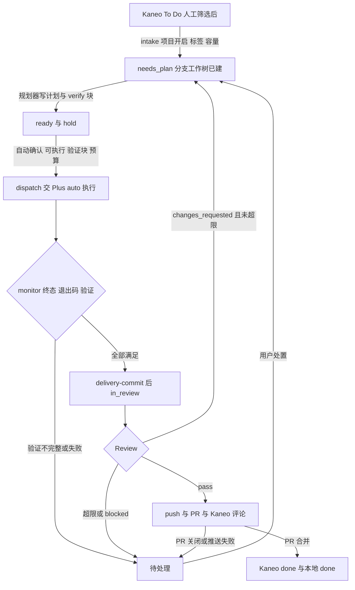

 > **已 superseded**：本计划内容已被 Phase 1 规格重写并入现行文档：
 > - 全自动反馈流水线 → `docs/automation-contract.md`、`docs/protocol.md` §5.27
 > - 状态模型与失败阶梯 → `docs/state-model.md` §7–§10
 > - 引擎命令 → `docs/protocol.md` §5.27
 > - UI 规格 → `docs/ui-spec.md`
 >
 > 保留本文件供审计；施工以现行规格为准。
 
# 全自动反馈流水线 实现计划

## 概要

让 KaneoPilot 成为 Kaneo 与 pi-desktop-plus（下称 Plus）之间无人值守的中继。用户在 Kaneo 完成人工筛选、把反馈移入 To Do 后，开启了「自动处理」的项目由调度台自动接收任务，在任务专用分支 `kaneo/<task_id>` 的工作树上，由 Claude Code CLI、Codex CLI 或 Plus 写计划。计划可执行就自动确认，交给 Plus 以 auto 权限执行。调度台确定性地核验轮次终态和验证命令，把改动提交到分支，再由 Plus、Claude Code 或 Codex 统一 Review。Review 要求修改时，在同一任务、同一分支上自动修复：最多 2 轮，并受时长和成本上限约束。Review 通过后推送分支、开 PR、把 PR 链接评论到 Kaneo，PR 合并后任务才算完成。正常流程全自动推进；异常一律停在「待处理」，写明原因和可用动作，不猜测、不自动重发。

本文件是独立施工交接件，站在主控（主 agent）的角度编排。主控独占规格、共享核心文件和集成工作，其余工作拆成 A–J 十个工作包交给子 agent。每个工作包都写明独占文件、必读材料、冻结接口、实现要点、易错点、测试、停止条件和完成检查。子 agent 只按本文件施工，发现本文件与代码或规格不一致时停下汇报，不自行发挥。本轮只写计划：不改源码、规格或数据，不启动服务，不提交。

**已定决策（用户 2026-10-05 确认，施工中不再询问）：**

| 主题 | 决定 | 对现有规格的影响 |
|---|---|---|
| dispatch/monitor 控制端 | 改为确定性 Python 流程，不再起 LLM 控制会话 | automation-contract §2 改写；prompt 文件保留，但不再路由 |
| Plus 会话挂接 | KaneoPilot 侧去掉 `pi_session_attach_mcp` 前置；Plus 不改，也不注入 kp_task 工具；由 runner 注入内容并完成全部状态转移 | 改写 protocol §5.25 与 AGENTS.md 架构句 |
| 后台运行 | 登录项 + 常驻菜单栏，调度不依赖窗口 | 改写 protocol §5.19「App 不常驻时不运行」 |
| 交付 | 提交到 `kaneo/<task_id>`；Review 通过后 push、开 PR、回写 Kaneo；PR 合并后才 done | 替换 protocol.md:677「合并回主仓库由人工完成，本系统不自动 merge/commit/push」 |
| 自动范围 | 按项目开关，可选标签过滤 | 新增项目级 automation 设置 |
| 计划门 | `status=ready` 的计划自动确认；needs_input 交给用户；可按项目关闭 | §5.22.2 的 hold 语义增加自动确认 |
| 修复轮 | 最多 2 轮自动修复，外加成本/时长上限；同一任务、同一分支，不新建 Kaneo 修复任务 | 自动化任务不走 create-review-fix |
| 反馈筛选 | 保留人工筛选列（如「待筛选」）；调度台只取 `TODO_SLUGS` | 不变，作为前提写入 §5.27 |
| Plus 执行权限 | `auto` | 前置检查要求执行配置为 auto |

**实施起点（本会话只读核查源码与规格；未运行测试，未访问远端）：**

| 编号 | 当前依据 | 后续工作 |
|---|---|---|
| F1 调度 | `ExecutorScheduler` 由 `AppViewModel`（113）创建，按分钟触发，App 退出即停。dispatch/monitor 是按 `dispatch.md`/`monitor.md` 运行的 LLM 控制会话（`executor_runner.run_stage` 130 起）；monitor 间隔默认 900s（settings `monitor_interval_seconds`） | 包 A 做确定性流程；包 I 做常驻调度；主控改路由 |
| F2 attach 门 | `runtime_client.py` 193–194 把 `pi_session_attach_mcp` 列为必需工具，287–288 拒绝向未挂接会话发 prompt；`dispatch_validate.py` 188–191 要求 `attachment_supported`。所查 Plus 分支都没有这个工具，因此所有 Plus 角色都在发送前被拦 | 包 B/C/H 去掉这道门，保留 MCP 就绪门 |
| F3 人工门 | 规划必须手动 start-plans（§5.22.2）；计划发布后带 `plan_execution_hold`，等 `enqueue confirm_plan`；Review 要求修改时 create-review-fix 新建 Kaneo 任务并停在 needs_plan；retry 只覆盖派发前失败 | 包 D 做 intake；主控做自动确认和同任务修复轮 |
| F4 交付 | 执行在 detached 工作树（`cmd_dispatch._ensure_worktree` 858）；规格明确不 commit/push/merge（protocol.md:677） | 包 C 做分支工作树与提交；包 F 做 push、PR 和合并同步 |
| F5 后端 | 规划 `PLANNER_BACKENDS=("codex","pi_desktop")`；Review `("pi","pi_desktop")`；没有 Claude Code 支持，也没有 Codex Review | 包 G 做 Claude 规划；包 H 做 Claude/Codex Review 和统一结算 |
| F6 规格分歧 | protocol §5.9 规定了被动同步对 `(in-review,in-review)`/`(done,done)` 与 `expected_current="done"`，monitor.md 也在用；但 `cmd_remote.cmd_advance_task` 143–160 拒绝它们 | 主控 Step 3 按规格补齐 |
| F7 发送状态 | dispatch-confirm 后 `send_state=sent` 永久保留；`_retry_target`（cmd_queue 189–204）和 `dispatch_validate` 第 6 步（send 冲突）都让同一任务无法再次派发 | 主控的 `start_fix_round_inline` 在开启修复轮时重置发送字段 |
| F8 工作区与数据 | master 约 96 个未提交文件（HEAD 43a4231）；正式库未迁到 schema 5；Feedback 本地库指向的 Kaneo 项目 id 与已映射的五个项目都不符；Kaneo 标签/评论接口形状只从 fork 源码推断；`sync-tasks` 当前没有任何调用方；tick 与 claim 已经跳过归档任务和 `auto_advance_paused` 任务（`db.task_schedulable`） | Step 0 先处理工作区；真实检查放在 Step 15-F |

代码目录：`/Users/developer/Documents/Code/Project/Personal Project/KaneoPilot`（下称 KP），master HEAD `43a4231`。工作区有大量未提交改动，其中包括本计划依赖的 schema 5、MCP 服务、Plus 适配器和 Goal 模式执行。不得重置、覆盖，也不得按旧 HEAD 重建。Plus（`~/Documents/Code/Project/Fork Project/PI-Desktop`）本计划不改；Kaneo fork（`~/Documents/Code/Project/Fork Project/Kaneo`）只读，仅用来确认接口形状。

**实施目录与既有规格：**

- 目录约定：
  - Python 模块默认在 `KP/core/kanpilot/`；
  - 原生代码在 `KP/macos/KaneoPilot/`；
  - 执行端 prompt 在 `KP/core/executor_prompts/`；
  - 测试按各包列出的路径，分布在 `core/tests/`、`tests/`、`macos/tests/`。
- 必读规格：
  - `KP/AGENTS.md`；
  - `docs/protocol.md` 的 §3、§4.4–4.11、§5.4–5.11、§5.18–5.19、§5.22–5.25；
  - `docs/state-model.md`、`docs/ui-spec.md`、`docs/automation-contract.md`。
- 主控在 Step 1 把本计划的冻结接口写入规格：新增 protocol §5.27「全自动反馈流水线（v5）」和 ui-spec §4.14。子 agent 以「本文件 + 已更新的规格」为准，两者不一致时停下汇报。
- 运行环境：
  - Python 3.9+ 标准库；
  - `claude`（`~/.npm-global/bin/claude`，原生可执行文件）；
  - `codex`（`~/.npm-global/bin/codex`）；
  - `gh` 2.97.0（`/opt/homebrew/bin/gh`）；
  - `git`（`/usr/bin/git`）。
- macOS 部署目标 14.0，可用 MenuBarExtra 和 `SMAppService.mainApp`。Xcode 工程不使用文件夹同步组，新 Swift 文件必须在 `project.pbxproj` 注册。

## 交付物

- 确定性控制端 `auto_dispatch.py`、`auto_monitor.py` 和验证证据解析 `verify_evidence.py`；`executor_runner` 新路由。旧 prompt 控制端保留，但不再使用。
- 任务分支交付链：
  - `git_delivery.py`：分支工作树、快照工作树、提交、推送；
  - 三个核心命令：`delivery-commit`、`delivery-publish`、`delivery-sync`；
  - `delivery` 阶段与执行器 `kaneo-delivery`；
  - `gh_client.py`、`delivery_runner.py`。
- 项目级自动化策略：开关、标签过滤、自动确认、修复轮上限、成本/时长上限、PR 目标分支。另有本机前置检查、成本记录 `record-cost`，以及自动接收 `auto_intake.py`。
- 核心状态机扩展：
  - 计划自动确认、同任务修复轮；
  - 被动同步对；
  - `resume`、`accept_verification` 两个处置；
  - 新的待处理原因和事件。
- Claude Code CLI 规划后端（`claude_cli.py`、`claude_planner.py`）；Claude/Codex Review 后端（`cli_review.py`）；统一 Review 结算（`review_settle.py`）。
- Kaneo 桥：读取任务标签、读写评论；以 `[kaneopilot:` 开头的标记评论不计入需求指纹。
- 常驻 App 与界面：
  - `AppRuntime` 持有调度器和本机 MCP 服务；
  - 菜单栏状态与操作、登录项、关窗不退出、子进程运行期间防止空闲睡眠；
  - 项目设置「自动处理」、待处理新动作、任务详情的交付与自动处理信息。
- 规格 v5（protocol、state-model、ui-spec、automation-contract、AGENTS.md）、全量隔离测试、原生夹具、端到端假流水线测试和有界真实验收记录。

## 全自动流水线行为

**开启。** 用户在「设置 → 项目与仓库」为某个项目打开「自动处理」，可以设置：

- 标签过滤：只处理带其中任一标签的任务；
- 是否自动确认计划；
- 修复轮上限：0–2，默认 2；
- 单任务时长上限：默认 240 分钟；
- 成本上限：默认 10 美元，可留空表示不限，只统计可计价的步骤；
- PR 目标分支：默认为远端默认分支。

保存时做本机前置检查：

- 仓库是 git 仓库；
- origin 指向 GitHub；
- `gh` 存在；
- 规划后端已配置；
- Review 后端是 Plus、Claude 或 Codex 之一；
- 执行后端是 Plus 且权限为 auto。

任何一项不满足，开关照样保存，但显示「未就绪：原因」，intake 跳过该项目。关闭开关只停止新的接收、自动确认和自动修复规划；已在执行、Review 或交付中的任务会走完当前步骤。

**正常一轮。** 常驻菜单栏的调度器每 5 分钟做一次 intake：拉取已开启项目的 To Do 列表，按标签过滤，在并发上限内（全局默认 2 个在途任务）按创建时间取最早的任务。对每个任务依次执行：

1. 准备规划材料。
2. 从 origin 最新的目标分支切出 `kaneo/<task_id>` 工作树。
3. 以 automation 身份提交规划请求。
4. 规划器以该工作树为只读目录写计划；计划必须包含一个 ```verify 代码块，写 1–5 条验证命令。
5. 计划发布后，同时满足以下条件时，调度台在下一次 tick 自动确认：项目开启了自动确认、计划可执行、验证块合法、预算未超。
6. 确定性 dispatch 把执行指令发给 Plus，以 Goal 模式、auto 权限执行。指令写明「只在此工作树内改动，不要提交」。
7. monitor 每 2 分钟读取一次轮次状态。以下三条同时满足才算完成：
   - 轮次终态为 completed，且退出码为 0；
   - 计划里每条验证命令在本轮最后一次运行时都退出 0。
8. 调度台把工作树改动提交到分支，提交带 KaneoPilot 标记。
9. Kaneo 状态推进到 in-review。
10. Review 后端在一个独立的只读快照工作树上审查本次 diff。

**修复轮。** Review 结论为 changes_requested 时，若修复轮未用完且时长/成本未超，调度台在同一任务上登记修复请求（标题、说明、优先级和 Review 报告）。任务回到 needs_plan 并标记 `plan_wanted`，下一次 intake 以 review_fix 方式重新规划。新计划仍落在同一分支工作树上，并带新的验证块；之后的确认、执行、提交和 Review 与首轮相同。超过上限则停在待处理（修复轮已用完或超出预算），用户可选「再修一轮」「重新规划」「转为人工处理」或「标记完成」。

**交付与完成。** Review 结论为 pass 时，任务停在 in_review 等待交付。delivery 阶段依次：

1. 推送分支（不强推）。
2. 查找或创建 PR：标题为 `[Kaneo] <任务标题>`，正文包含任务号、修复轮数、提交列表和验证命令。
3. 在 Kaneo 任务下评论 PR 链接。

此后定期同步 PR 状态：通过后的第一小时每 5 分钟一次，之后每 30 分钟一次。

- PR 已合并 → Kaneo 推进到 done，本地也标 done。
- PR 被关闭且未合并 → 进入待处理。
- PR 仍打开 → 继续等待。

用户在 Kaneo 上手动把任务标为 done，视为用户决定完成，本地同步为 done。分支和工作树一律保留，不自动删除。

**需要人处理时。** 以下情况停在「待处理」，写明原因和可用动作，不自动重试、不重发：

- 执行失败，或 Goal 审批门失败；
- 验证证据不完整（`verification_unconfirmed`），用户可以「接受验证结果」后继续；
- 修复轮用完，或超出预算；
- 工作树里有疑似密钥文件或超大文件；
- 提交钩子失败，或执行没有产生任何改动；
- 分支已存在，或目标分支未知；
- 推送被拒、`gh` 不可用，或 PR 被关闭；
- 远端状态或需求发生变化。

派发后新增的评论等内容没有经过人工筛选，因此不会被自动吸收；需求校验会把任务停给用户。用户选择「转为人工处理」后，该任务永久退出自动流程，原有手动功能照常可用。

**暂停、关闭与退出。**

- 暂停：菜单栏「暂停」等同全局暂停，不再领取新请求、不做 intake、不自动确认；正在运行的子进程和 Plus 轮次不会被打断。
- 关闭主窗口：App 留在菜单栏继续调度。
- 退出 App：停止调度和本机 MCP 服务，但不结束 Plus 会话；下次启动后 monitor 继续观察。
- 登录项：开启后开机自动启动。
- 睡眠：有子进程运行时阻止系统空闲睡眠。



## 关键设计决策

### 1. dispatch/monitor 改为确定性流程

两个新模块由 `executor_runner` 调用，入口签名与 `pi_desktop_controller.run_stage` 一致，只是去掉了 prompt；`sleep`/`clock` 可注入，便于测试：

```python
def run_stage(stage, *, conn, db_path, timeout, log_path, record_run,
              resume=False, sleep=time.sleep, clock=time.monotonic) -> int
```

实现约束：

- 只通过进程内 `cli.run(command, payload, db_path)`（cli.py:451）调用固定核心命令，捕获 `util.KanpilotError` 后按 `.code` 分支。
- 不直接读写 SQLite，不用 shell 调 CLI，不调用任何模型。
- 每一步写一行 JSON 日志到 `log_path`，内容为时间、步骤、task_id、request_id 和结果码；不写计划正文、凭据或完整远端 URL。
- `record_run` 在开始时记 pid、started_at、log，结束时记 exit_code、finished_at。
- 剩余时间不足 120 秒时不再领取新请求。
- 由 `resume` 参数接收旧调用，但不使用它。

**dispatch（执行器 `kaneo-dispatch`）：**

1. `claim {stage:"dispatch", executor:"kaneo-dispatch"}`。
   - `claimed:false`（含 reason=paused）→ 正常结束。
   - `context.backend` 不是 pi/pi_desktop → 不调用任何写命令，记日志后结束；lease 到期后按既有丢失流程处理。
2. `dispatch-prepare {task_id, run_id, evidence:{session_marker, repository, backend, config: context.exec_config}}`。任何失败 → 第 6 步，`not_sent`。
3. `dispatch-begin-send {task_id, run_id}`。任何失败 → 第 6 步，`unknown`：核心可能已迁移远端或已自行阻塞任务，dispatch-fail 对同一 run 幂等。
4. `dispatch-start {task_id, run_id}`：
   - 返回 deduplicated，或 started 且带 session_id → 第 5 步；
   - 返回 starting → 每 ≤30 秒 `get-session` 一次，最多等 5 分钟；拿到 session_id 就进第 5 步，否则进第 6 步 `unknown`，原因写「worker 会话未建立」；
   - 返回任何错误 → 第 6 步 `unknown`。
5. `dispatch-confirm {task_id, run_id, evidence:{session_marker, repository, backend, session_id, protocol_seen:true, config}}`。
6. `dispatch-fail {task_id, run_id, send_state, reason}`：
   - 只有在 begin-send 之前失败才用 `not_sent`；
   - begin-send 之后一律用 `unknown`；
   - 绝不把 unknown 改回 not_sent。
7. 整个过程（包括等待期间）每 ≤60 秒 `heartbeat` 一次。heartbeat 或任一命令返回 stale_run/not_found，说明请求已被他人接管：立即停止，不再做任何写操作。
8. 回到第 1 步继续领取，直到没有请求或剩余时间不足。

**monitor（执行器 `kaneo-monitor`）：**

1. 领取 monitor 请求，然后 `get-task` 取 `task.run_id`。这是被观察的执行轮次，**不是** monitor 请求自己的 run_id。
2. `recheck {task_id}` 读远端状态：
   - done → `advance-task {task_id, run_id:<monitor run>, target:"done", expected_current:"done"}`（被动同步对）→ report succeeded；
   - in-review，且任务不受自动化管理 → `advance-task (in-review, in-review)` 被动同步 → report succeeded；
   - in-review，且受自动化管理 → 不推进，继续第 3 步；完成时用 `expected_current="in-review"`；
   - 其他状态 → 继续第 3 步；完成时用 `expected_current="in-progress"`。

   调用 advance-task 时只传 `run_id`，**绝不传 request_id**：传了会触发 stage==review 的身份校验并失败。
3. `get-session {task_id, run_id:task.run_id}` 读 round_detail；`session-messages` 按 has_more 翻页，读完本轮全部消息，不用 preview。
4. 观察者缺席：backend=pi_desktop，且 observer_alive=false 或 detail 以 `heartbeat_failed:` 开头 → `round-observe {task_id, run_id:task.run_id, executor:"kaneo-monitor"}`。
   - 返回 observing/finished/settled → 重新读取；
   - 返回 deferred/exited/starting → report failed，note=observation_blocked；
   - 返回 `reopened:true` → 视为仍在运行。

   observer_alive=true 时绝不再拉起观察者。
5. 只认 `round_detail.terminal`。Plus Goal 审批期间规划轮次的 completed 不算完成。terminal detail 含 goal_contract_missing、goal_approval_failed 或 goal_execution_unstarted → report needs_user（failure_code=execution_failed）。
6. 完成判定，以下三条同时满足：
   - terminal.outcome=completed；
   - exit_code=0 且 run_status=finished；
   - 验证通过（规则见第 9 节），或 `extra.verification_override.execution_run_id == task.run_id`。

   验证不通过 → report needs_user（failure_code=verification_unconfirmed），note 逐条列出缺失和失败的命令。
7. 完成后，受 PR 交付管理的任务先调用 `delivery-commit {task_id, request_id, run_id, expected_execution_run_id: task.run_id}`：
   - outcome=blocked → report failed，note=`blocked:<failure_code>`（核心已把任务转入待处理）；
   - committed/already_committed → `advance-task` 推进到 in-review → report succeeded。

   advance-task 返回 remote_conflict（核心已阻塞任务）或 remote_unavailable → report failed，下轮重试；提交是幂等的。最后 `record-cost` 记一条 Plus 执行轮次（cost_usd=null，source=pi_desktop）。
8. 仍在运行 → heartbeat + report succeeded，progress 记录摘要。`terminal_superseded` 不算失败。
9. 明确失败（failed、非 0 退出、超时、截断、身份不符、send_state=unknown）→ report needs_user（execution_failed）。不重试、不重建、不重发。
10. 旧后端（dsh/headless/ATIF）轮次永远读不到 → report needs_user（failure_code=observation_blocked，note「旧后端轮次无法观察，请人工判断」）。其他读不到的情况 → report failed（observation_blocked），下轮再试。

**路由（主控 Step 14）：** `executor_runner.run_stage` 的新分流：

- dispatch → auto_dispatch，monitor → auto_monitor，不再看 controller_backend。
- review 按 Review 后端：
  - pi_desktop → pi_desktop_review；
  - claude/codex → cli_review；
  - pi → 原 `pi -p` 路径。
- delivery → delivery_runner。

dispatch.md、monitor.md、pi_desktop_controller.py 及其测试保留，但不再路由；`controller_backend` 只用于展示。

### 2. KaneoPilot 侧去掉 attach 前置

- runtime_client：
  - 193–194：去掉必需工具 `pi_session_attach_mcp`；
  - 287–288：去掉「未挂接会话拒绝发 prompt」。
- pi_desktop_planner:686、pi_desktop_worker:850、pi_desktop_review:543：去掉 attach 调用和其后的工具集校验。会话顺序固定为 create → configure → prompt。
- dispatch_validate：
  - 去掉 188–191 的 `attachment_supported` 门；
  - **保留** 176–187 的本机 MCP 就绪门（server.json initialize/ping）和 `exec_config.check_available`。
- 以下保留但不调用：
  - harness_plus_adapter 的 `attach_mcp`；
  - runtime_client 456 的 `_deny_write` 映射；
  - kp_runtime_attach_mcp 的工具实现。

  `attachment_supported` 只做展示，界面文案为「本版本不需要会话挂接」。
- Plus 会话不获得任何 kp_task 工具；所有状态转移由 runner 和确定性控制端经核心命令完成。规划、执行、Review 的 Plus prompt 里如有要求模型调用 kp_task_* 的文字，一并删除。

### 3. 任务分支与工作树

每个任务一条分支 `kaneo/<task_id>`；task_id 必须匹配 `^[a-z0-9]{8,64}$`（Kaneo 任务 id 由 cuid2 生成，为小写字母和数字），否则拒绝。工作树根沿用 `_ensure_worktree`（cmd_dispatch 858）的 `constants.worktrees_root(db.get_setting(conn, "worktrees_root") or None)`，可被 `KANPILOT_WORKTREES_ROOT` 覆盖，不另起新根。既有执行目录为 `<root>/<task_id>/<run_id>`，新目录与它并列：

- `<root>/<task_id>/branch`：执行工作树（检出分支）。Codex/Claude 规划器也以它为只读 cwd。
- `<root>/<task_id>/review-<sha12>`：Review 只读快照（detached HEAD）。
- `<root>/<task_id>/plan-<sha12>`：Plus 规划只读快照（detached HEAD）。

以上全部保留，不删除分支，也不删除工作树。对用户主检出只允许执行 fetch、worktree add、rev-parse、symbolic-ref、remote get-url，绝不在主检出上 checkout、reset、clean 或 stash。

**建分支工作树（`prepare_branch_worktree`）：**

1. `git -C <repo> fetch --prune origin`：超时 60 秒，环境变量带 `GIT_TERMINAL_PROMPT=0`。失败 → git_transient，intake 下轮重试。
2. 确定目标分支：
   - 优先用策略里的 `delivery_base`；
   - 否则取 `git -C <repo> symbolic-ref --short refs/remotes/origin/HEAD`，去掉 `origin/` 前缀；
   - 用 `git rev-parse --verify origin/<base>^{commit}` 取 base_sha。

   以上任一步取不到 → delivery_base_unknown。
3. 本地分支 `refs/heads/kaneo/<id>`、远端 `refs/remotes/origin/kaneo/<id>` 或目标路径，任一已经存在，且不是本任务 delivery 记录中的同一工作树 → branch_exists。不删除、不复用、不改名。
4. `git -C <repo> worktree add -b kaneo/<id> <path> <base_sha>`，不加 --force。
5. 返回 `{branch, worktree_path, base_branch, base_sha, head_sha: base_sha}`。

**核验工作树（`verify_branch_worktree`）：** 以下条件不满足时报 worktree_invalid：

- 路径存在且是目录；
- `git -C <wt> rev-parse --git-common-dir` 解析到主仓库的 common dir；
- `git -C <wt> symbolic-ref --short HEAD` 等于分支名；
- 给了 expected_head 时，`git rev-parse HEAD` 必须相等；
- require_clean 时，`git status --porcelain=v1 -z --untracked-files=all` 必须为空。

**派发指令（主控在 constants 定义 `DISPATCH_INSTRUCTION_BRANCH`）：** 原文照用；其中 `{plan_ref}` 在 pi 后端为「计划文件 {plan_path}」，在 pi_desktop 后端为「下面已核验的计划正文」。

```
任务标识：{marker}。当前目录 {worktree} 是本任务专用分支 {branch} 的工作树，直接在这里完整执行{plan_ref}。可以按计划使用 subagent，但所有改动必须落在本工作树；不要新建 worktree 或分支，不要 commit、push、reset、stash、rebase 或切换分支；提交与推送由调度台完成。按计划的 verify 命令逐条运行验证，最终答复逐条列出命令与退出码。
```

注入点：

- cmd_exec:389 的 claim 上下文（主控）；
- cmd_dispatch:472 的 pi 指令和 603–608 的 pi_desktop 内联指令（包 C）。

非交付任务仍用原 `DISPATCH_INSTRUCTION_PI`。

**各角色的工作目录：**

| 角色 | 工作目录 | 权限 |
|---|---|---|
| Codex/Claude 规划 | `<root>/<id>/branch`（请求载荷 `plan_cwd`） | 只读工具 |
| Plus 规划 | `<root>/<id>/plan-<sha12>`，sha 取载荷 `delivery_head_sha` | plan 模式 + ask |
| Plus 执行 | `<root>/<id>/branch` | auto |
| Review（三种后端） | `<root>/<id>/review-<sha12>`，sha 取 `delivery.head_sha` | 只读 |

建 Review 快照之前，先确认执行工作树 HEAD 等于 head_sha 且干净。

### 4. 项目策略与本机前置检查

策略存在项目映射设置的 `items[project_id].automation` 下，形状如下：

```json
{"enabled": false, "label_filter": [], "auto_confirm_plan": true,
 "max_fix_rounds": 2, "max_task_minutes": 240, "max_task_cost_usd": 10.0,
 "delivery_base": null, "policy_revision": 0, "updated_at": "..."}
```

字段校验：

- label_filter：≤20 个字符串，每个 ≤50 字符；去掉首尾空白后，按小写去重。
- max_fix_rounds：0..2。
- max_task_minutes：30..1440。
- max_task_cost_usd：null，或 0.5..100。
- delivery_base：null，或匹配 `^[A-Za-z0-9._/-]{1,100}$` 且不以 `-` 开头。

全局设置存在 settings `automation_global = {max_active_tasks: 2, updated_at}`，max_active_tasks 取值 1..5。

**命令：**

- `set-project-automation {project_id, automation, expected_policy_revision?}`：
  - 校验后整体替换 automation 对象，policy_revision 加 1；
  - 带了 expected_policy_revision 但不相等 → conflict。
- `set-automation-global {max_active_tasks}`。
- `get-project-mappings` 的每个条目增加 `automation`（合并默认值后的结果）和 `automation_preflight`。
- `set-project-mapping` 修改其他字段时，必须原样保留 automation。

**前置检查（`automation_preflight(conn, project_id) -> [{"code","message"}]`，空列表表示就绪）：** 只做本机检查，不访问网络，单项目耗时 <200ms。

| code | 检查 | message 示例 |
|---|---|---|
| repository_missing | 映射仓库路径存在 | 未配置仓库路径 |
| not_git_repo | `git -C <repo> rev-parse --git-dir` 成功 | 仓库不是 git 仓库 |
| origin_not_github | `git remote get-url origin` 仅接受 HTTPS、SSH URL 或 git@github.com:owner/name 的同一解析规则；HTTP/Git 协议在前置检查即拒绝，URL 不输出、不记录 | origin 不是 GitHub 仓库 |
| gh_missing | `constants.gh_bin()` 可执行 | 未找到 gh |
| planner_unconfigured | 规划后端已配置且可用（沿用 planner_config 的检查） | 规划后端未配置 |
| review_backend_unsupported | Review 后端属于 `AUTOMATION_REVIEW_BACKENDS` | Review 后端需为 Plus/Claude/Codex |
| exec_backend_not_plus | 执行后端为 pi_desktop | 执行端需为 Plus |
| exec_permission_not_auto | exec_config.pi_desktop.permission_mode 为 auto | Plus 执行权限需为 auto |

**生效规则：**

- 实时策略：intake、自动确认、修复轮上限、成本/时长上限这类新决策，每次都读当前策略。
- 交付方式：在 intake 接收时冻结进任务的 `delivery.mode`。
- 关闭开关：
  - 停止 intake、自动确认和自动修复规划；
  - 进行中的 monitor、Review、交付照常；
  - changes_requested 照常登记，但修复请求置为 held，任务进入待处理（原因 `automation_stopped`）。

### 5. 任务 extra 字段

`db.set_extra` 只合并顶层键，因此嵌套对象必须在同一事务里整体读出、修改、写回。主控在 core 中提供访问函数：

- `automation_of(task)`、`delivery_of(task)`；
- `update_automation(conn, task, now, **changes)`、`update_delivery(conn, task, now, **changes)`。

任何包都不得自己拼 extra_json。

```json
{
  "automation": {
    "policy_revision": 3, "adopted_at": "...", "fix_round": 0,
    "segment_started_at": "...", "segment_cost_base_usd": 0.0,
    "plan_wanted": false, "plan_attempts": 0, "manual_takeover": false,
    "cost_usd": 0.0, "cost_unknown_steps": 0,
    "cost_log": [{"request_id": "...", "run_id": "...", "stage": "plan", "cost_usd": 0.42, "source": "claude", "at": "..."}],
    "last_skip": {"reason": "budget", "at": "..."}
  },
  "delivery": {
    "mode": "pr", "branch": "kaneo/<id>", "worktree_path": "...",
    "base_branch": "main", "base_sha": "...", "head_sha": "...",
    "commits": [{"execution_run_id": "...", "sha": "...", "at": "...", "files": 3, "fix_round": 0}],
    "pushed_sha": null, "pr_number": null, "pr_url": null, "pr_state": null,
    "publish_failures": 0, "kaneo_comment_at": null, "merged_at": null,
    "last_sync_at": null, "next_sync_at": null
  },
  "fix_request": {
    "fix_round": 1, "title": "...", "description": "...", "priority": "...",
    "review_key": "...", "review_run_id": "...", "execution_run_id": "...",
    "report_path": "...", "report_sha256": "...", "head_sha": "...",
    "created_at": "...", "state": "open"
  },
  "review_history": [{"review_key": "...", "conclusion": "changes_requested", "report_path": "...",
    "report_sha256": "...", "execution_run_id": "...", "head_sha": "...",
    "registered_at": "...", "fix_round": 0, "fix": {"title": "...", "priority": "..."}}],
  "plan_verify": {"plan_sha256": "...", "commands": ["..."], "error": null},
  "verification_override": {"execution_run_id": "...", "actor": "user", "at": "...", "note": "..."}
}
```

字段规则：

- **数量上限：** `cost_log` ≤50 条，`review_history` ≤20 条，超出时丢最旧的。
- **无人值守段：** `segment_*` 记录当前无人值守段的起点。时长按 `now - segment_started_at` 计，成本按 `cost_usd - segment_cost_base_usd` 计。用户执行 resume、replan 或 accept_verification 时开启新段。
- **plan_verify：** 每个任务都写，不限自动化任务。
- **delivery.mode：** 只有 `pr` 或 `manual` 两个值；转为人工处理时改为 `manual`。
- **术语：**「受自动化管理」= 有 automation 对象且 `manual_takeover=false`；「受 PR 交付管理」= `delivery.mode=="pr"`。

### 6. 自动接收（intake）

入口：`python3 -m kanpilot.auto_intake [--dry-run]`，由调度器每 300 秒或菜单「立即检查」拉起。

**一轮流程：**

1. **单飞：** `executor_runs["intake"]` 记录的 pid 仍存活 → 直接退出。
2. **暂停检查：** 全局暂停，或 paused_stages 包含 plan → 写摘要后退出。
3. **项目筛选：** 逐个读取已开启的项目；前置检查不通过的项目跳过，并记入摘要。
4. **容量：**
   - 容量 = `max_active_tasks − 占用数`；
   - 占用数 = 受自动化管理、且状态不是 done/needs_user、也不在「pass 后等待合并」的任务数。
5. **先处理 plan_wanted 任务（不受容量限制）：**
   - 条件：状态为 needs_plan、`plan_wanted=true`、没有活动的 plan 请求、未转人工；
   - 若还没有 `delivery.branch`，先补建分支工作树；
   - 然后准备材料并提交规划。
6. **新候选：**
   - 来源：`fetch-todos` 的条目。
   - 条件：本地没有该任务；或本地状态为 needs_plan、从未有过 plan 请求、且没有 automation 对象。另外要求 save_state 为 active，且不是 auto_advance_paused。
   - 顺序：按远端创建时间升序（字段缺失时按任务号）。
   - 数量：每轮最多接收 3 个，且不超过容量。
7. **标签过滤：**
   - label_filter 为空 → 不过滤。
   - 列表条目自带 labels（由包 E 确认）→ 直接比较。
   - 否则逐个调用 `remote.get_task_labels`：每轮最多 20 次；不匹配的结果缓存 30 分钟，存在 settings `automation_intake_state.label_checked`。
   - 比较方式：大小写不敏感的精确匹配，命中任一标签即可。
8. **接收单个任务：**
   1. `cli.run("prepare-plan-input", {task_id, expected_requirements_sha256: <列表里的指纹>, local_paths: []})`。
   2. `git_delivery.prepare_branch_worktree`。
   3. `cli.run("start-plans")`，条目带内部字段 `automation`：`{authorized_by:"automation", policy_revision, delivery:{...第 3 节返回值, mode:"pr"}}`。核心在同一事务里完成：
      - 写入任务的 automation（`plan_attempts=1`，开启第一段）和 delivery；
      - 建 plan 请求：`requested_by="automation"`，`manual_authorized` 仍为 true，以便既有 claim 过滤放行；
      - 载荷增加 `authorized_by`、`plan_cwd`、`delivery_mode`、`delivery_head_sha`；
      - 记录事件 `automation_adopted`。
9. **plan_wanted 任务的材料准备：**
   - prepare-plan-input 传任务当前的 `requirements_sha256`；
   - 远端需求不符 → 任务进入 needs_user（failure_code=remote_conflict，note「远端需求已变化（新增内容未经筛选）」）。
10. **失败处理：**
    - 分支失败（branch_exists/delivery_base_unknown）→ 照常导入任务行，写入 automation（`plan_wanted=false`），然后转 needs_user 并带该 failure_code。
    - 确定性失败（validation_failed、bad_request、conflict）→ 清掉 plan_wanted，在 `last_skip` 记录原因，然后转 needs_user。
    - 瞬时失败（remote_unavailable、git_transient）→ 下轮重试。
11. **摘要：** 写入 settings `automation_last_intake`，形状为 `{started_at, finished_at, projects:[{project_id, ready, preflight, adopted, skipped:[{task_id, reason}]}], errors}`。
12. **dry-run：** 只做 fetch-todos、标签读取和前置检查，输出将会接收的候选；不调用 prepare-plan-input，不写任何东西。

**提交规划时的规则（由包 D 在 `_submit_one` 实现）：**

- **plan_kind 的确定：** `fix_request.state=="open"` 时为 review_fix（same_task），否则为 standard。same_task 分支放在旧 review_fix 分支（约 737 行）和 manifest plan_kind（445–449）之前。
- **same_task 载荷：** `{plan_kind:"review_fix", fix_mode:"same_task", review_source_task_id:<self>, fix_task_id:<self>, fix_round, review_report_path, review_report_sha256, review_key}`，值取自 fix_request。
- **手动提交的已收养任务：** 用户在规划面板手动提交受自动化管理的任务时，载荷同样带 `plan_cwd`/`delivery_mode`/`delivery_head_sha`，并且不清除 automation 对象。

### 7. 计划自动确认

主控在 tick 中实现，每次 tick 扫描一遍。

**确认条件（全部满足）：**

- 任务受自动化管理，状态为 ready，且带 `plan_execution_hold`；
- 项目已开启自动处理，`auto_confirm_plan=true`，前置检查通过；
- `plan_verify.plan_sha256 == task.plan_sha256`，且 commands 非空；
- 预算未超：本段时长 < max_task_minutes；本段成本 < max_task_cost_usd，或该上限为 null；
- `db.task_schedulable(task)` 成立；
- 未处于全局暂停，也未暂停 dispatch。

**动作：** `confirm_plan_inline(conn, task, now, expected_plan_sha256=task.plan_sha256, actor="automation", note="auto")`。该函数从 `cmd_enqueue` 24–111 中抽出，行为与 `confirm_plan` 完全相同。

**跳过时：**

- 不阻塞任务，只把 `automation.last_skip` 写为 `{reason, at}`；
- 原因与上次不同时才记一次 `auto_confirm_skipped` 事件；
- reason 取值：disabled、auto_confirm_off、preflight、verify_missing、verify_mismatch、budget、paused；
- 用户仍可手动确认。

needs_input 计划在既有流程中已经进入 needs_user，不在这里处理。

### 8. 同任务修复轮

**register-review 的 same_task 分支（主控，cmd_exec 815–905）：**

- **适用范围：** 只用于受自动化管理的任务，payload 带 `fix_mode:"same_task"`、`fix:{title, description, priority}`、`review_key` 和既有的 Review 身份字段。对这类任务，旧的 `fix_task_id`/create-review-fix 路径一律返回 conflict。
- **幂等：** `fix_request.review_key` 或 `review_history[-1].review_key` 已等于本次 key → 返回 `{already_registered:true}`。
- **未超上限**（`fix_round < max_fix_rounds`、本段时长和成本未超、项目仍开启）：调用 `core.start_fix_round_inline`，在同一事务内完成：
  1. 本次 Review 归档进 review_history；
  2. `fix_round += 1`；
  3. fix_request 写入并置为 open；
  4. `plan_wanted=true`，`plan_attempts=0`；
  5. 清空列 review_report_path、review_report_sha256、review_key，删除 extra 的 review_conclusion 和 review_registered_at；
  6. **重置发送字段**：`sent=0, send_state=NULL, sent_at=NULL, lock_retained=0, manual_recovery_required=0`；以 db.py 的 tasks 列为准，主控逐列核对；
  7. in_review → needs_plan；
  8. 记录事件 `fix_round_started`。
- **超出上限：** fix_request 写入并置为 held，任务进入 needs_user。failure_code 按触发原因取：
  - 修复轮用完 → fix_rounds_exhausted；
  - 时长或成本超出 → auto_budget_exceeded；
  - 项目已关闭 → automation_stopped。
- **pass 与 blocked：** 自动化任务的 pass 和 blocked 同样追加 review_history；pass 后把 fix_request 置为 null。

**publish-plan 的 same_task 分支（主控，cmd_exec 614–812）：**

- 核验元数据：`fix_mode=="same_task"`、`review_source_task_id==task_id`、`fix_round==automation.fix_round`；review_report_path、review_report_sha256、review_key 三项都与 fix_request 一致。
- 跳过 758–776 的跨任务检查，不执行 795–802 的修复回写，也不写 Review 列。
- 629 行的远端状态检查改用 `core.expected_remote_slugs(task)`。

**远端状态口径：** `core.expected_remote_slugs(task)` 的取值：

- 默认为 `TODO_SLUGS`；
- 受 PR 交付管理且已有提交时，再加上 `REVIEW_SLUGS`（修复轮开始时，远端停在 in-review）。

publish-plan:629 和 dispatch_validate:111 都改用它。begin-send 依靠 claim 时记录的 `original_todo_slug`（即 in-review），无需改动即可把远端从 in-review 迁到 in-progress。

**dispatch_validate 第 5 步（包 C）：** 先判断 `meta.fix_mode=="same_task"`。成立时：

- 报告必须在 `constants.review_reports_root()` 内，sha 与 fix_request 和计划元数据都一致；
- `review_source_task_id==task_id`；
- `fix_round==automation.fix_round`；
- `review_key==fix_request.review_key`；
- 不做 `REVIEW_MARKER_PREFIX` 标记和修复回写检查。

旧的跨任务 review_fix 检查保持不变。

**计划元数据（包 G）：** same_task 计划的 frontmatter 从请求载荷取 review_report_path/sha256、review_key 和 review_source_task_id（取自身），并增加 `fix_mode: same_task` 和 `fix_round: N`。这些字段由 runner 写入，不由模型生成。

**sync-tasks（主控）：** 受自动化管理的任务只更新元数据、kaneo_status 和事件，不做任何状态转移，也不改 requirements_sha256。这样需求变化会由 advance-task 和 dispatch_validate 的既有指纹校验拦下，停给用户处理。

### 9. 执行验证证据

**计划格式：**

- 计划正文恰好一个 ```verify 围栏块，含 1–5 条非空命令行。
- 允许 `#` 注释行。
- 不允许：行尾续行 `\`、heredoc `<<`；以 `git commit`、`git push`、`git reset`、`git checkout`、`git switch` 开头的命令；以 `gh ` 开头的命令。
- 解析规则：比较前把连续空白压成一个空格并去掉首尾空白；命令不做任何改写。

**解析与存储：**

- 解析函数：`verify_evidence.parse_verify_block(text)`（包 A）。
- 存储：publish-plan 发布时（主控 Step 14 接入）把结果写入 `extra.plan_verify`，形状为 `{plan_sha256, commands}` 或 `{plan_sha256, error}`。

**提取命令结果：** `verify_evidence.extract_command_results(messages)` 只认工具调用事件：`raw.tool.input` 中的 JSON 字段 `command`，以及整数 `exit_code`。消息形状以下面三处为准：

- dsh_events.py:196–208；
- pi_backend.py:142；
- pi_desktop_worker.py:505。

exit_code 缺失或不是整数时记为 None。

**匹配规则：**

- 每条声明的命令，在本执行轮次的结果里找「规范化后完全相等」或「可证明成功的顶层纯 `&&` 链中某段相等」的调用；
- 子段匹配必须识别引号和转义，仅允许顶层纯 AND 链；混合 `||`、`;`、管道、换行、注释、子 shell/替换及会终止或改变当前 shell 控制流的前置命令不作子段成功证据。不能确认时要求独立 exact 工具结果；保留普通 `cd <目录> && <验证命令>` 与普通验证命令纯 AND 链。
- 取最后一次匹配，exit_code 必须为 0；
- 只统计当前执行轮次（task.run_id）的消息。

**判定：**

- 有任一声明命令缺失、最后一次失败或 exit_code=None → verification_unconfirmed。
- 用户选 `accept_verification` → 写入 `verification_override{execution_run_id: task.run_id, actor:"user", at, note}`，任务回到 running，并新建 monitor 请求；monitor 仍要核验终态和退出码。
- 手动任务同样适用此规则；计划里没有 verify 块的旧任务完成后，由用户「接受验证结果」。
- 不做任何猜测：不从最终消息文字中推断「已验证」。Plus 工具事件如果不带 exit_code，停下汇报（见 Step 4 停止条件和 Step 15-F）。

### 10. 交付：提交、推送、PR 与合并

**delivery-commit（包 C，`cmd_delivery.py`）：**

- **调用：** `{task_id, request_id, run_id, expected_execution_run_id}`，由 monitor 在完成判定之后调用。
- **身份：** 用 `core.require_stage_identity(stages=("monitor",))`，并要求 expected_execution_run_id 等于 task.run_id。
- **三段式：**
  1. 第一段（事务）：核对身份和任务状态 running。
  2. 第二段（无事务）：执行 git 操作。
  3. 第三段（事务）：复核身份并确认 head 未变，然后追加 commits、更新 head_sha，记录事件 `delivery_committed`。
- **幂等：** commits 中已有该 execution_run_id → 返回 `{outcome:"already_committed", sha}`。
- **崩溃恢复：** HEAD ≠ head_sha，但 HEAD 的父提交等于 head_sha，且提交信息带有本次 run 的 `KaneoPilot-Run` trailer → 视为已提交，直接补记。其他 HEAD 漂移 → blocked，failure_code 为 delivery_commit_failed，note「分支被执行端或他人改动」。
- **候选文件：** 来自 `git status --porcelain=v1 -z --untracked-files=all`，需正确处理 rename 的双路径。被 .gitignore 忽略的文件本来就不进入候选。
- **拦截（delivery_blocked_files）：** 候选中出现以下任一 → 不提交，列出文件名：
  - `.env` 或 `.env.*`（`.env.example` 除外）；
  - `*.pem`、`*.key`、`*.p12`、`id_rsa*`；
  - 单文件 >5MB。
- **无改动：** 候选为空 → blocked，failure_code 为 no_changes。
- **提交：**
  - `git add -A`，然后 `git commit -F <临时消息文件>`；
  - 照常执行钩子，超时 300 秒，`GIT_TERMINAL_PROMPT=0`；
  - 不设置提交身份，不加 --no-verify，不加 --no-gpg-sign；
  - 失败 → blocked（delivery_commit_failed），note 附 stderr 末尾 ≤2KB（先脱敏）。
- **提交信息：**

```
kaneo(<task_id>): <标题，截断到 72 字符>

Kaneo-Task: <task_id>
KaneoPilot-Run: <execution_run_id>
Fix-Round: <fix_round>
```

- **返回：** `{outcome:"committed"|"already_committed"|"blocked", sha?, files?, failure_code?, message?}`。outcome=blocked 时，核心已在第三段把任务转为 needs_user 并写好 failure_code。只有协议级错误才 raise：bad_request、not_found、stale_run、validation_failed、conflict、internal。`ERROR_CODES` 不增加。

**交付请求的补建（主控，tick）：** 以下条件全部满足时，建 `delivery:<task_id>` 请求（requested_by=scheduler）：

- 任务状态为 in_review，`review_conclusion=="pass"`，且 review_history 最后一条的 execution_run_id 等于 task.run_id；
- 任务受 PR 交付管理，且未转人工；
- `merged_at` 为空；
- 没有活动的 delivery 请求；
- `now ≥ next_sync_at`，或 next_sync_at 为空；
- `db.task_schedulable(task)` 成立。

claim 守卫为 `{in_review}`；该阶段可被暂停。

**delivery-publish（包 F，`cmd_delivery_pr.py`）：** 与 advance-task 一样走三段式，网络操作一律不在事务内。

1. `git_delivery.push_branch`：命令为 `git push origin refs/heads/<branch>:refs/heads/<branch>`，不带 force。
   - 被拒（rejected/non-fast-forward/fetch first）→ blocked，failure_code=branch_diverged；
   - 其他失败 → `publish_failures += 1`，返回 retry。
2. 查找已有 PR：`gh pr list --repo <owner/name> --head <branch> --state all --json number,url,state,headRefOid,mergedAt,baseRefName,headRefName,isCrossRepository`。
   - 仅复用源仓库为当前 origin（非 fork）、head 分支/目标 base 分支均与交付快照相同且 headRefOid 等于本次 pushed_sha 的 OPEN/MERGED PR；已登记 PR 的编号也必须一致。身份/提交不匹配则 branch_diverged，不写评论或登记合并；缺少身份字段不能作为可信交付。
   - 只有 CLOSED 的 PR → blocked，failure_code=pr_closed。
3. 没有 PR → `gh pr create --repo <owner/name> --base <base_branch> --head <branch> --title "[Kaneo] <标题，≤100 字符>" --body-file <临时文件>`，再用 `gh pr view` 取 number 和 url。
   - 正文包括：任务标题、task_id、修复轮数、提交列表（sha12 + 标题）、verify 命令、「由 KaneoPilot 自动创建」；
   - 正文不含绝对路径、主机名或凭据。
4. Kaneo 评论：先用 `find_marker_comment(task, "[kaneopilot:delivery:<task_id>]")` 查找，不存在再 `post_comment`，内容为 `[kaneopilot:delivery:<task_id>] 已创建 PR：<url>`。
5. 第三段（事务）：写入 pushed_sha、pr_number、pr_url、pr_state、kaneo_comment_at，`publish_failures` 清零，`next_sync_at` 设为 now+5 分钟；记录事件 `delivery_pushed`、`pr_opened`、`kaneo_comment_posted`。

连续 3 次 retry → blocked，failure_code=gh_unavailable。gh 的环境变量为 `GH_PROMPT_DISABLED=1`、`GH_NO_UPDATE_NOTIFIER=1`、`NO_COLOR=1`、`GH_PAGER=`，每次调用超时 60 秒。

**delivery-sync（包 F）：**

1. 先读 Kaneo 任务（只读，无事务）：
   - 远端已 done → 返回 `{outcome:"kaneo_done"}`；
   - 否则执行 `gh pr view <number> --repo <owner/name> --json number,url,state,mergedAt,headRefOid,baseRefName,headRefName,isCrossRepository`。
2. 先核对 PR URL 所属 origin 仓库、编号、非 fork、head/base 分支以及 headRefOid=当前 pushed_sha=head_sha；不一致立即 branch_diverged，不登记合并、不推进 done。字段缺失不可作为可信证据。
3. 按 PR 状态处理：
   - MERGED → 第三段写入 merged_at 和 pr_state，记事件 `pr_merged`，返回 merged；
   - OPEN → 写入 last_sync_at 和 next_sync_at，返回 waiting。next_sync_at 的取法：距 review_registered_at 不到 1 小时为 +5 分钟，否则为 +30 分钟；
   - CLOSED → blocked，failure_code=pr_closed，记事件 `pr_closed`。

**delivery_runner（包 F）：**

1. 领取 delivery 请求。
2. 没有 PR，或 `pushed_sha≠head_sha` → 先调用 delivery-publish。
3. 调用 delivery-sync。
4. 按 sync 结果收尾：
   - merged → 调用 `advance-task {task_id, request_id, run_id, expected_execution_run_id, target:"done", expected_current:"in-review"}`；
   - kaneo_done → 同样调用，但 `expected_current:"done"`（被动）。
5. report：
   - 成功 → succeeded；
   - retry 或 waiting → succeeded，并在 progress 中说明；
   - blocked → failed，核心已转入待处理；
   - advance-task 返回 remote_conflict 或 remote_unavailable → failed。

**advance-task 的交付身份（主控 Step 3）：**

- 带 request_id 时用 `require_stage_identity(stages=("review","delivery"))`；
- 受 PR 交付管理的任务，非被动的 `target=done` 要求 `delivery.merged_at` 已记录，否则 conflict；
- 被动对 `(done,done)` 不受此限。

### 11. Claude/Codex 后端与统一 Review 结算

**Claude CLI（包 G，`claude_cli.py`，规划与 Review 共用）：**

```
claude -p --output-format stream-json --verbose --restricted --tools Read,Grep,Glob
  --strict-mcp-config --permission-mode dontAsk --no-session-persistence
  --json-schema '<内联 JSON>' --model <M> --effort <E> --max-budget-usd <X> [--add-dir <输入目录>]
```

- **调用方式：**
  - prompt 从 stdin 传入，cwd 为 plan_cwd 或 Review 快照；
  - 绝不使用 `--bare`；
  - 施工前用 `claude --help` 逐个确认参数存在。缺参数就停下汇报，不要改用其他参数凑。
- **事件解析：**
  - init 事件的 tools 必须是 {Read, Grep, Glob} 的子集，否则立即终止进程并失败（「Claude 工具集不符合只读要求」）；
  - result 事件读取 subtype、is_error、structured_output、total_cost_usd、session_id。
- **费用：**
  - 每次运行都调用 `record-cost`（source=claude）；
  - `--max-budget-usd` 取 min(5, 本段剩余预算)，不低于 0.5；上限为 null 时取 5。
- **路径：** 二进制由 `constants.claude_bin()` 解析，可被 `KANPILOT_CLAUDE_BIN` 覆盖。

**Claude 规划（包 G）：**

- planner_config 新增 `claude {model, effort}` 分组配置。`planner_config.BACKENDS` 直接引用 `constants.PLANNER_BACKENDS`，claude 已由主控在 Step 2 加入，G 不改 constants。
- `model_snapshot(conn, group, backend="claude")` 返回 publish-plan 期望的 `{planner_model, reasoning_effort}` 形状。
- planner_runner 529–541 新增 claude 分支，其输出走既有的 `parse_output` 和 publish 流程。
- Codex 的 `launcher_argv`（codex_planner 297）中，`cwd` 改为 `job.get("plan_cwd") or job.get("repository") or "."`。这个值就是 `-C` 工作根；只读沙箱 `-s read-only` 保持不变。
- Plus 规划在自动化任务上使用 `plan-<sha12>` 快照（第 3 节）。
- planner_prompt.md 和 pi_desktop_planner 的内联 prompt 改动：
  - 要求恰好一个 verify 块；
  - 不再指示「新建 worktree/分支/提交」；
  - 补充 same_task 修复指引：工作树已含前几轮提交，只修 Review 报告列出的问题，verify 要覆盖修复点。

**统一 Review 结算（包 H，`review_settle.py`）：**

结果 schema（所有键必填，additionalProperties=false）：

```json
{"conclusion": "pass|changes_requested|blocked", "report_markdown": "...",
 "fix": null 或 {"title": "...", "description": "...", "priority": "REVIEW_FIX_PRIORITIES 之一"}}
```

- **字段规则：** fix 在 changes_requested 时必须非空，其他结论必须为 null。fix 的可空写法先用 `"type":["object","null"]`；两种 CLI 的实际兼容性在 Step 15-F 核对，不兼容时停下汇报，不要把 fix 改成可选字段。
- **结算流程（`settle`）：**
  1. 把报告写到 `report_path(task_id, run_id)`，即沿用的 `<APP_SUPPORT>/reports/<task_id>/<run_id>.md`，并计算 sha256。
  2. 带 Review 身份（request_id、run_id、expected_execution_run_id）调用 register-review。
  3. 按任务类型分支：
     - 非自动化任务：保持原行为——pass → advance-task done；changes_requested → 先 create-review-fix，再 register；blocked → register 后 report needs_user。
     - 自动化任务：pass 只登记，不推进；changes_requested 用 same_task 方式登记；blocked 照常登记。
  4. 最后 report。
- **防重复：** `_registered_matches` 负责崩溃后重跑时避免重复登记：fix_request、review_history 或 Review 列中任一处已有同一 review_key，即视为已登记。
- **兼容：** pi_desktop_review 原有对外函数在 review_settle 中保留 re-export，旧测试照常通过。

**Claude/Codex Review（包 H，`cli_review.py`）：**

- 入口与 `run_stage` 同签名。
- 复用 claude_cli 和 codex_planner 的 `launcher_argv`/`child_env`/`map_event`；Codex 使用只读沙箱，cwd 为 Review 快照。
- 两者共用新 prompt `review_cli.md`。
- Codex 成本记为 null（source=codex），token 数只写日志。

**交付任务的 Review 材料：**

- `git diff --no-color <base_sha> <head_sha>`，以及 `git log --oneline base..head`；
- 有上一轮 Review 时，加上 `<review_history[-1].head_sha>..<head_sha>` 的增量 diff 和上一轮报告。

diff 超过 400KB 时只附 `--stat`，并注明「请在只读工作树中查看具体文件」。执行工作树 HEAD 与 head_sha 不符或不干净 → report needs_user（review_blocked，note「执行工作树与已提交版本不一致」），绝不审查未提交的内容。

**review_config（包 H）：** 新增 `claude {model, effort}`、`codex {model, reasoning_effort}`，并更新 snapshot 和 capabilities。

**Review 领取守卫（主控）：** claim(review) 领到受自动化管理的任务、但 Review 后端是 pi 时：该请求置为 failed，任务转 needs_user（review_backend_unsupported），然后继续看下一个候选。

**成本记录（包 D 实现 `record-cost`，主控注册命令）：**

- payload：`{task_id, request_id, run_id, stage, cost_usd|null, source}`。
- 以 (request_id, run_id) 去重；cost_usd 为 null 时 `cost_unknown_steps += 1`；记录事件 `cost_recorded`。
- 上限只在决策点检查：intake、自动确认、修复轮开始。pass 之后不再检查上限，也不中途打断正在运行的轮次。

### 12. 常驻调度与菜单栏

**AppRuntime（包 I）：** 单例，App 启动时（AppDelegate `applicationDidFinishLaunching`）创建，持有 `ExecutorScheduler` 和 `MCPServiceManager.shared`。

- 启动时依次执行：
  1. 恢复 MCP 服务，沿用 MCPServiceManager 现有的检查与启动入口；
  2. `LocalNetworkGate.probeAtLaunch()`（原先挂在窗口 `.task` 上）；
  3. 启动调度循环。
- 退出时沿用 `stopOwnedProcessForAppExit()`。

**调度循环（ExecutorScheduler 重写）：** 每 20 秒执行一轮，系统唤醒通知到达时立即执行一轮：

1. 调用核心 `tick`。
2. 调用 `executor-status`。
3. 交给纯函数 `SchedulerDecision.decide` 计算需要拉起的进程：
   - 对 plan/dispatch/monitor/review/delivery 中的每个阶段：未暂停、无存活进程、`claimable>0` → 拉起该阶段的进程；
   - intake：有已开启的项目、未处于全局暂停或 plan 暂停、无存活进程，且距上次 ≥300 秒或被强制触发 → 拉起。
4. 按决策拉起进程：
   - plan 用 planner_runner；
   - 其余阶段用 `executor_runner --stage <s>`；
   - intake 用 `python3 -m kanpilot.auto_intake`。

   子进程的环境变量和路径解析沿用现有实现（CoreLocator/CoreClient）。

**其他约束：**

- 有存活子进程时持有 `ProcessInfo.beginActivity(.idleSystemSleepDisabled)`，全部退出后释放。
- 保留 `runNow`、`LocalNetworkGate`、开发开关 `executorSchedulingEnabled`；为 SettingsView 保留静态的 `stages` 和 `nextFireDate(for:)` 兼容接口，直到包 J 更新设置页。
- 暂停和恢复只调用核心 `set-paused {stage:null, paused}`，不在 Swift 里另存状态。

**菜单栏（MenuBarView）：** MenuBarExtra 包含：

- 状态行：运行中/已暂停、在途任务数、待处理数、上次 intake 时间；
- 「打开 KaneoPilot」「暂停/恢复」「立即检查」「退出」。

关闭主窗口后，激活策略切到 `.accessory`；重新打开窗口时切回 `.regular`。

**登录项（LoginItem）：** 基于 `SMAppService.mainApp` 实现 register/unregister/status。状态为 `.requiresApproval` 时，界面提示用户去「系统设置 → 登录项」批准。

### 13. 待处理原因、处置与事件

| failure_code | 来源 | 自动化任务可用动作 |
|---|---|---|
| verification_unconfirmed | monitor | accept_verification（→ running + monitor）、replan、mark_done、dismiss |
| execution_failed | monitor | replan、mark_done、dismiss |
| fix_rounds_exhausted | register-review | resume（用户授权再修一轮：fix_round+1，fix_request 置为 open，plan_wanted，开新段）、replan、mark_done、dismiss |
| auto_budget_exceeded | register-review | resume（同上，在新预算段内进行）、replan、mark_done、dismiss |
| automation_stopped | register-review（项目已关闭） | resume（需先重新开启项目，同上）、replan、mark_done、dismiss |
| review_blocked | review | resume（→ in_review + 新 review 请求）、replan、mark_done、dismiss |
| review_backend_unsupported | claim(review) | resume（需 Review 后端已改为 Plus/Claude/Codex，→ in_review + review）、mark_done、dismiss |
| branch_exists、delivery_base_unknown | intake | resume（→ needs_plan + plan_wanted，重新准备分支）、dismiss |
| delivery_blocked_files、delivery_commit_failed | delivery-commit | resume（→ running + monitor，重新走完成判定与提交）、replan、mark_done、dismiss |
| no_changes | delivery-commit | replan、mark_done、dismiss |
| branch_diverged、gh_unavailable、pr_closed | delivery | resume（→ in_review + delivery，next_sync_at=now）、mark_done、dismiss |
| remote_conflict | advance-task、intake、begin-send | resume（接受远端当前需求和状态，回到被阻塞的步骤；派发中途不可用）、replan、mark_done、dismiss |
| planner_failed（自动重试一次后）、needs_input | plan | replan、dismiss；也可以在规划面板补充材料后手动提交 |
| dispatch_failed | dispatch | 沿用 retry/restore/accept_duplicate/mark_sent；另有 replan、dismiss |

**处置规则：**

- **resume / accept_verification：** 新增的 resolve 动作，只对上表列出的原因可用。核心校验 failure_code 后，按表中目标转移。
- **remote_conflict 的 resume：** 走三段式。
  1. 读取远端任务（不在事务内）。
  2. 远端状态必须是下一步所需的值：monitor 需要 in-progress、in-review 或 done；delivery 需要 in-review 或 done；plan 不限。不符 → conflict，提示「请先在 Kaneo 调整到 X 再继续」。
  3. 在事务内把 requirements_sha256 和 kaneo_status 更新为远端当前值，记录事件 `requirements_accepted`。
  4. 回到上一个失败请求对应的步骤：monitor → running + monitor；delivery → in_review + delivery；review → in_review + review；plan → needs_plan + plan_wanted；dispatch → 拒绝，改用既有的发送恢复动作。
- **replan：** 对自动化任务改为 needs_plan + plan_wanted，`plan_attempts=0`，开新段。如果远端需求有变化，用与上面相同的三段式先接受当前需求；用户点「重新规划」即视为已看过新内容。
- **dismiss：** 对自动化任务显示为「转为人工处理」：在原 dismiss 语义（needs_user → ready）之外，置 `manual_takeover=true`、`delivery.mode="manual"`，记录事件 `automation_stopped`。此后 intake、自动确认、交付补建、same_task 登记全部跳过这个任务，它按普通手动任务处理，但继续使用原分支工作树。
- **release_lost：** 释放丢失的自动化 plan 请求时，若 `plan_attempts<2` 则置 plan_wanted。
- **tick 自动释放：** 自动化任务的 monitor/delivery 丢失请求，由 tick 按 release_lost 的语义自动释放（actor=scheduler，事件 `lost_request_released`）。dispatch、plan、review 的丢失请求仍留给用户处理。
- **plan 失败：** 自动化任务第一次失败时置 plan_wanted，让 intake 自动重试一次；第二次失败转 needs_user，保留 failure_code=planner_failed。

**新事件：** automation_adopted、auto_confirm_skipped、fix_round_started、delivery_committed、delivery_pushed、pr_opened、kaneo_comment_posted、pr_merged、pr_closed、cost_recorded、requirements_accepted、automation_stopped、lost_request_released。

`BOARD_FAILURE_CODES` 不增加，新原因通过 failure_stage 归类。归类如下：

| failure_stage | failure_code |
|---|---|
| monitor | verification_unconfirmed |
| plan | branch_exists、delivery_base_unknown |
| review | fix_rounds_exhausted、auto_budget_exceeded、automation_stopped、review_backend_unsupported |
| delivery | delivery_*、no_changes、branch_diverged、gh_unavailable、pr_closed |

### 14. 规格变更清单（Step 1 执行）

**protocol.md：**

- §3：命令总表增加 set-project-automation、set-automation-global、record-cost、delivery-commit、delivery-publish、delivery-sync。
- §4.4：增加 delivery 领取守卫和 Review 后端守卫。
- §4.8：tick 增加自动确认、交付补建、丢失请求自动释放。
- §4.9：delivery 可暂停，intake 遵守暂停。
- §4.10：resolve 增加 resume、accept_verification，并写明自动化任务语义。
- §4.11：错误码不增加；写明 outcome=blocked 的约定。
- §5.4：sync-tasks 对自动化任务只观察。
- §5.6：publish-plan 的 same_task 分支和 plan_verify。
- §5.7：register-review 的 same_task 分支和上限。
- §5.9：advance-task 补齐被动对的实现说明、交付身份和合并守卫。
- §5.10：dispatch 使用分支工作树和 `DISPATCH_INSTRUCTION_BRANCH`。
- §5.18.4：完成判定改为确定性规则。
- §5.18.5：替换 677 行为「Review 通过后由调度台推送并开 PR，合并后完成；调度台不 merge」。
- §5.19：常驻菜单栏、登录项、关窗不退出。
- §5.22.2：automation 授权的 start-plans。
- §5.22.5：Claude 规划后端。
- §5.24.4/5：Review 后端增加 claude/codex，并采用统一结算。
- §5.25：去掉 attach 前置。
- §6：常量。
- 新增 §5.27「全自动反馈流水线（v5）」：收录第 3–13 节的全部冻结接口。

**state-model.md：**

- §2 转移：
  - in_review → needs_plan（修复轮）；
  - needs_user → running/in_review/needs_plan（resume、accept_verification）；
  - in_review → done（仅合并后或被动）。
- §4 事件：上节新事件。
- 新的 failure_code 及其 failure_stage。

**ui-spec.md：**

- §4.2 待处理：新动作和文案。
- §4.4 设置：后台运行区、Claude/Codex 后端、attach 文案。
- §4.11 项目：自动处理分组。
- 新增 §4.14「自动处理与菜单栏」：菜单内容、任务详情交付/自动处理信息、看板「自动」「等待合并」「修复 n/m」标记，沿用冻结度量。

**automation-contract.md（升到 v5）：**

- §2 dispatch/monitor 改为「确定性控制端」，内容取自第 1 节；删除第 57 行「monitor 不经 advance-task 直接 done」与被动对之间的矛盾。
- review 步骤改为统一结算。
- 新增 delivery 和 intake。

**AGENTS.md：**

- 架构句改为「执行端由 App 常驻调度器按固化后端拉起；dispatch/monitor/delivery 为确定性流程；Plus 轮次经本项目 MCP runtime 域控制，不挂接 task grant」；
- 常用命令增加 intake 和 dry-run。

## 子 agent 工作规范

### 派发模板

主控派发子 agent 时使用下面的模板，把对应 Step 的内容逐项填入。不要只给一句话任务，也不要让子 agent「自己看着办」。

```
你是 KaneoPilot 工作包 <X>（<标题>）的实现者，在 KP 根目录工作。只按本说明和计划文件 docs/plans/全自动反馈流水线_4c7e2a91.plan.md 的「关键设计决策」第 <n> 节施工。
1. 目标：<一句话>。
2. 独占文件：<列表>。只能修改或新建这些文件；需要动其他文件时停下汇报。
3. 必读（按顺序，读完再动手）：<列表>。动手前用 3–8 行写出你对现有代码的理解（入口、数据形状、调用方），附在最终汇报里。
4. 冻结接口：<签名、字段、错误码>。名称、参数、返回形状一字不改；觉得接口有问题就汇报，不要改。
5. 实现要点：<编号步骤>。
6. 禁止与易错点：<列表>，另加「共同禁令」全部条目。
7. 测试：<必须新增的用例>。只跑本包的定向测试：PYTHONDONTWRITEBYTECODE=1 python3 -m pytest -p no:cacheprovider <文件> -q。
8. 完成检查：<命令与期望结果>。
9. 停止并汇报：<条件>。遇到停止条件时保留已完成的部分，不要绕路实现。
10. 汇报格式：改动文件清单；每个冻结接口的实现位置；新增测试名与结果；未完成项；与计划的任何偏差及原因；你认为主控需要决定的问题。
```

### 共同禁令

- 不修改 `docs/`、AGENTS.md、本计划，以及其他包或主控独占的文件；不新增第三方依赖；不改 schema 版本；不重命名或删除既有公共函数（需要兼容时保留旧名转调）。
- 不执行任何 git 写操作：commit、push、stash、reset、checkout、branch、worktree add/remove。测试只能在临时目录的裸仓库或克隆里做 git 写操作。
- 测试不访问真实的 Kaneo、Plus、GitHub 或模型服务。全部使用临时的 `KANPILOT_DB`/`KANPILOT_APP_SUPPORT`/工作树根，以及共享夹具里的假 Kaneo 和假二进制（`KANPILOT_GH_BIN`、`KANPILOT_CLAUDE_BIN`、`KANPILOT_CODEX_BIN`）。涉及分支的测试，task_id 用 cuid2 形状（如 24 位小写字母和数字），否则会被分支名校验拒绝。
- 不读取任何凭据文件（如 `~/.pi-desktop-plus/mcp-control.token`、`~/.config/gh/hosts.yml`），不运行 `gh auth token`，不加 `--show-token`；日志、事件、PR 正文和评论中不出现令牌或带凭据的 URL（`https://user:token@` 一律脱敏）。
- 网络操作和子进程（git、gh、模型 CLI、Kaneo）不得在 `db.write_txn` 内执行；采用「事务读校验 → 无事务外部操作 → 事务复核写入」三段式。
- 嵌套 extra 对象只通过 core 的访问函数整体读改写；不直接拼 `extra_json`；不放宽任何既有校验（身份、指纹、状态守卫、发送状态）。
- 区分三种 run_id：monitor/delivery 请求自己的 run_id、被观察的执行轮次 `task.run_id`、Review 请求的 run_id。传参时逐个对照接口，不要互相代用。
- 不新增 `ERROR_CODES`；业务阻塞用 `outcome:"blocked"` 加 failure_code 返回。
- 发现计划与代码不符、接口不够用、测试需要改共享夹具、或需要改别人的文件时，停下汇报；不要猜测，不要绕开。

### 主控复核

每个波次开始前，主控记录 `git status --porcelain=v1` 和全部脏文件、未跟踪文件的 sha256。波次结束后做以下复核：

1. **改动范围：** 改动文件集合必须是该波次各包独占文件的子集；越界的改动退回。
2. **逐个 diff 对照：** 冻结接口签名和返回形状；必须新增的测试是否齐全；汇报里的理解是否与代码一致。
3. **机械检查**（任一命中即退回）：
   - `grep -rn -e "--force" -e "push -f" -e "reset --hard" -e "branch -D" -e "worktree remove" -e "clean -f" core/kanpilot/`：只允许出现在测试的临时仓库代码里。
   - `grep -rn -e "gh auth token" -e "show-token" -e "mcp-control.token" -e "hosts.yml" core/ macos/`：必须为空。
   - `grep -n "request_id" core/kanpilot/auto_monitor.py`：确认没有出现在 advance-task 的 payload 中。
   - `grep -n "extra_json" <新文件>`：必须为空。
   - 「事务内无外部操作」：看共享夹具的断言测试是否覆盖了该包的每个命令。
4. **测试：** 依次运行该包的定向测试、`cd core && python3 -m pytest tests -q -p no:cacheprovider`、`python3 -m pytest tests -q -p no:cacheprovider`，与 Step 0 基线对比，不允许出现新的失败。
5. **退回规则：** 不合格时写明具体问题（文件、行、期望），退回给原子 agent 返工；最多两次，之后主控亲自修。每个包的结论记入主控工作记录：通过、返工或接手。

## 实现步骤

主控独占：

- 本计划、AGENTS.md、`docs/*`；
- 共享核心：constants.py、cli.py、core.py、db.py、cmd_exec.py、cmd_queue.py、cmd_read.py、cmd_remote.py、cmd_config.py、derive.py、executor_runner.py；
- 原生共享文件：KaneoPilotApp.swift、AppViewModel.swift、Core/Models.swift、macos/tests/main.swift、KaneoPilot.xcodeproj/project.pbxproj、scripts/build_app.sh；
- 共享夹具：core/tests/helpers.py、tests/conftest.py；
- 主控测试：core/tests/test_automation_core.py、tests/test_auto_pipeline.py。

其余文件按各 Step 的「负责人/范围」独占，同一文件同一时间只有一个写入者。子 agent 与主控在同一个检出上工作，各写不相交的文件，不做 git 写操作。

工作包划分，以及每一步的输入和检查，都以「关键设计决策」为准。主控先做规格（Step 1），再冻结接口（Step 2）、实现核心语义（Step 3），然后分波次派发；每个波次结束先复核，再开下一波。

### Step 0（主控）：基线、工作区与授权确认

**负责人/范围：** 主控。不改任何文件。

1. 记录基线到仓库外的临时目录，不提交：
   - `git rev-parse HEAD`、`git status --porcelain=v1`；
   - 全部脏文件和未跟踪文件的 sha256；
   - `python3 --version`、`git --version`、`gh --version`、`claude --version`、`codex --version`。
2. 运行 `claude --help`，逐个确认第 11 节用到的参数，结果记入工作记录，供包 G 使用。
3. 运行基线测试：`cd core && python3 -m pytest tests -q -p no:cacheprovider`、`python3 -m pytest tests -q -p no:cacheprovider`、`bash macos/tests/run-fixtures.sh`。已有的失败记为既有失败，不要求子 agent 修复。
4. 用 AskUserQuestion 询问是否先把当前未提交的改动作为基线提交到新分支（如 `feat/auto-pipeline`），推荐选项放第一。只有得到明确同意才提交；不同意就保持未提交状态，在当前工作区施工。真实检查的授权留到 Step 15-F 逐项询问。

**完成检查：** 基线记录齐全；工作区未被改动。

### Step 1（主控）：先改规格

**负责人/范围：** 主控；独占 `docs/protocol.md`、`docs/state-model.md`、`docs/ui-spec.md`、`docs/automation-contract.md`、AGENTS.md。

按第 14 节逐条修改。新增的 protocol §5.27 收录：

- 第 3–13 节的全部字段形状、命令 payload、outcome 约定、错误与 failure_code、resolve 语义；
- 派发指令原文和 verify 块格式。

ui-spec §4.14 写明以下内容，度量沿用 13/18/11pt、8/12/16、1180×760/900×600：

- 各控件；
- 每种 failure_code 对应的中文标题、说明和按钮文案。resume 的文案：fix_rounds_exhausted → 再修一轮；branch_* → 重新准备分支；delivery_* → 重新提交；review_* → 重新 Review；其余 → 继续。
- 菜单栏内容；
- 交付信息区。

**完成检查：** 以下旧表述在规格中不再作为现行规则出现：

- `pi_session_attach_mcp` 为必需；
- 「本系统不自动 merge/commit/push」；
- 「App 不常驻时不运行」；
- 自动化任务走 create-review-fix；
- monitor 依「最终消息引用验证步骤」判定完成。

逐条 grep 确认；新增章节自洽，与本计划无冲突。

### Step 2（主控）：冻结接口与骨架

**负责人/范围：** 主控；独占上文主控文件。另外为各包创建桩文件，以及 I 的 Swift 占位文件。桩文件创建后，所有权立即移交对应的包。

1. **constants.py：**
   - 阶段与请求：`STAGES` 加入 "delivery"；`REQUEST_KINDS`/`KIND_STAGE` 加入 delivery；`CLAIM_GUARDS["delivery"]={"in_review"}`；`DELIVERY_EXECUTOR_ID="kaneo-delivery"`。
   - 时间：`DEFAULT_MONITOR_INTERVAL_SECONDS=120`（显式设置仍优先）；`DELIVERY_SYNC_FAST_SECONDS=300`、`DELIVERY_SYNC_FAST_WINDOW_SECONDS=3600`、`DELIVERY_SYNC_SLOW_SECONDS=1800`。
   - intake：`INTAKE_INTERVAL_SECONDS=300`、`INTAKE_MAX_ADOPT_PER_PASS=3`、`INTAKE_LABEL_LOOKUPS_PER_PASS=20`、`INTAKE_LABEL_RECHECK_SECONDS=1800`。
   - 策略默认值：`AUTOMATION_DEFAULTS`（第 4 节）、`AUTOMATION_GLOBAL_DEFAULTS={"max_active_tasks":2}`。
   - 交付：`KANEO_MARKER_PREFIX="[kaneopilot:"`、`DELIVERY_BRANCH_PREFIX="kaneo/"`、`DELIVERY_BLOCKED_PATTERNS`、`DELIVERY_ALLOWED_NAMES=(".env.example",)`、`DELIVERY_MAX_FILE_BYTES=5*1024*1024`。
   - 预算：`CLI_PLAN_DEFAULT_BUDGET_USD=5.0`、`CLI_REVIEW_DEFAULT_BUDGET_USD=5.0`、`CLI_MIN_BUDGET_USD=0.5`。
   - 指令与后端：`DISPATCH_INSTRUCTION_BRANCH`（原文见第 3 节）；`PLANNER_BACKENDS` 加入 "claude"；`REVIEW_BACKENDS` 加入 "claude"、"codex"；`AUTOMATION_REVIEW_BACKENDS=("pi_desktop","claude","codex")`。
   - 处置与原因：`VALID_RESOLVE_ACTIONS` 加入 "resume"、"accept_verification"；`AUTOMATION_FAILURE_CODES` 及其 failure_stage 映射。
   - 路径函数：`gh_bin()`、`claude_bin()`，分别支持 `KANPILOT_GH_BIN`、`KANPILOT_CLAUDE_BIN` 覆盖。
2. **core.py：**
   - 新增 `expected_remote_slugs(task)`；
   - 新增 `require_stage_identity(conn, payload, task, now, *, stages)`，校验逻辑照搬 `require_review_identity`，只把 stage 判断改成 `in stages`。`require_review_identity` 保留为 `stages=("review",)` 的包装。
   - 新增 `is_automation_managed(task)`、`is_pr_delivery(task)`；
   - 新增 `automation_of`、`delivery_of`、`update_automation`、`update_delivery`；
   - 先放桩：`start_fix_round_inline`、`automation_budget(task, policy, now)`，Step 3 实现。
3. **automation_policy.py：**
   - 已实现：`policy_for(conn, project_id)`（读 `items[pid].automation`，与默认值合并；未配置时返回 None）、`global_settings(conn)`；
   - 桩：`validate_automation`、`automation_preflight`、`cmd_set_project_automation`、`cmd_set_automation_global`、`cmd_record_cost`。
4. **桩模块：** 按各包的冻结签名创建，函数体为 `raise NotImplementedError("包 X")`：auto_dispatch、auto_monitor、verify_evidence、git_delivery、cmd_delivery、auto_intake、gh_client、cmd_delivery_pr、delivery_runner、claude_cli、claude_planner、review_settle、cli_review。remote.py 中先放 `get_task_labels`、`find_marker_comment`、`post_comment` 的桩。
5. **cli.py：** 注册六个新命令，指向对应模块的函数。
6. **cmd_config.cmd_executor_status：**
   - 每个阶段增加 `claimable`，计数口径与 claim 候选查询（cmd_exec 44–72）完全一致：SQL 过滤 not_before、save_state、auto_advance_paused；plan 请求缺 manual_authorized 时跳过；dispatch 请求在任务带 plan_execution_hold 时跳过；
   - 顶层增加 `intake{running,last}`、`paused{global,stages}`、`automation{enabled_projects, active_tasks, max_active_tasks, waiting_merge, last_intake}`。
7. **planner_config：** `model_snapshot(conn, group, *, backend="codex")` 增加 backend 参数；claude 分支先 `raise NotImplementedError`。cmd_config 中写死的后端枚举改为引用 constants。
8. **Swift：**
   - Models.swift 增加 DTO：executor-status 的新字段、`ProjectAutomationDTO`、`AutomationPreflightIssue`、`TaskAutomationView`、`TaskDeliveryView`、`ReviewHistoryEntry`；`macos/tests/main.swift` 增加相应的解码夹具。
   - AppViewModel 增加动作：`setProjectAutomation`、`setAutomationGlobal`、`resolve` 支持新动作、`runIntakeNow`、`loginItem` 状态绑定。
   - 新建占位文件 `Core/AppRuntime.swift`、`Core/SchedulerDecision.swift`、`Core/LoginItem.swift`、`Views/MenuBarView.swift`（最小可编译内容），并注册到 pbxproj。
9. **共享夹具（helpers.py/conftest.py）：**
   - 裸仓库工厂：origin.git 带初始提交和 origin/HEAD，外加一个克隆作为项目仓库；
   - 假二进制写入器：生成记录 argv、按场景输出的 python 脚本；
   - 隔离的工作树根环境变量；
   - `assert_no_external_io_in_txn` 辅助：在 `write_txn` 内拦截 subprocess 和 remote 客户端调用并报错；
   - Kaneo 标签和评论的假数据入口。

**完成检查：**

- 所有桩模块可以 import；
- 三套测试相对基线没有新增失败（monitor 间隔等常量变化导致的断言由主控同步修正）；
- `bash macos/tests/run-fixtures.sh`、`scripts/build_app.sh` 通过；
- 冻结签名逐项与本计划一致。

### Step 3（主控）：核心状态机与命令语义

**负责人/范围：** 主控；独占文件同上，测试写在 `core/tests/test_automation_core.py`。

1. **advance-task（cmd_remote）：**
   - 接受被动对和 `expected_current="done"`：跳过 update-status，只核验 projectId、状态和需求，然后做本地转移；
   - 带 request_id 时用 `require_stage_identity(stages=("review","delivery"))`；
   - 受 PR 交付管理的任务，非被动 done 需要 merged_at；
   - 其余逻辑不变，包括 remote_conflict 时的阻塞。
2. **confirm_plan_inline（cmd_queue）：** 从 cmd_enqueue 抽出，带 `actor` 参数；cmd_enqueue 改为调用它，原有测试必须不改即通过。
3. **tick（cmd_read）：**
   - 自动确认扫描（第 7 节）；
   - 交付请求补建（第 10 节）；
   - 自动化任务的 monitor/delivery 丢失请求自动释放；
   - 只处理满足 `db.task_schedulable` 且未转人工的任务。

   核心的 `automation_budget` 和 `start_fix_round_inline` 在这一步实现。
4. **claim（cmd_exec）：**
   - delivery 守卫；
   - Review 后端守卫（第 11 节）；
   - 交付任务的 dispatch 上下文指令改用 `DISPATCH_INSTRUCTION_BRANCH`。
5. **register-review、publish-plan：** 实现第 8 节的 same_task 分支和上限判断。publish-plan 的 verify 解析留到 Step 14。
6. **resolve：**
   - 实现第 13 节全部语义：resume、accept_verification、自动化任务的 replan/dismiss/release_lost；
   - 实现 remote_conflict 的三段式「接受远端」；
   - 动作不在该原因的允许列表中 → conflict。
7. **sync-tasks：** 自动化任务只观察，不做状态转移。
8. **report：** 自动化任务的 plan 失败自动重试一次。
9. **derive：**
   - task_detail/task_summary 增加 automation、delivery、review_history 视图：路径只给本机路径，不给远端 URL 凭据；
   - allowed_actions 按第 13 节的表输出；
   - 新 failure_code 按 failure_stage 归类；
   - delivery 请求增加显示名。

**测试：** 每条语义都要有正例和反例，至少覆盖：

- 被动对，以及合并守卫；
- 修复轮的上限三种情况，以及发送字段被重置后，可以再次通过 dispatch_validate 第 6 步；
- 自动确认的每个跳过原因，以及「原因不变时不重复记事件」；
- 交付补建的退避；
- 每个 resume 目标；
- 接受远端时，远端状态不符则拒绝；
- dismiss 后 intake 和自动确认不再处理该任务；
- 手动流程不受影响（原测试保持通过）；
- 事务内无外部 IO。

**完成检查：** 新测试全部通过，三套测试相对基线没有新增失败；规格 §5.27 与实现逐条对照一致。

### Step 4（包 A）：确定性 dispatch/monitor 与验证证据

**负责人/范围：** 子 agent A。独占：

- `core/kanpilot/auto_dispatch.py`、`auto_monitor.py`、`verify_evidence.py`；
- `core/tests/test_auto_dispatch.py`、`test_auto_monitor.py`、`test_verify_evidence.py`。

**必读：**

- 本计划第 1、9 节；
- protocol §4.4–4.7、§5.10、§5.18.4、§5.23.3、§5.23.7–5.23.9、§5.27；
- automation-contract §2，以及作为旧行为参考的 `core/executor_prompts/dispatch.md`、`monitor.md`；
- 代码：cmd_exec.py（claim/heartbeat/report 的 payload 与返回）、cmd_dispatch.py（prepare 28、begin-send 54、confirm 158、fail 242、start 415、round-observe 713 的输入输出）、cmd_session.py（get-session/session-messages 的形状与分页字段）、cmd_remote.cmd_recheck；
- 消息样例：dsh_events.py:196–208、pi_backend.py:142、pi_desktop_worker.py:505，以及 core/tests 中已有的 pi_desktop 消息夹具。

**冻结接口：**

```python
# auto_dispatch.py / auto_monitor.py
def run_stage(stage, *, conn, db_path, timeout, log_path, record_run,
              resume=False, sleep=time.sleep, clock=time.monotonic) -> int  # 0 正常，1 异常
# verify_evidence.py
def parse_verify_block(plan_text: str) -> dict        # {"ok":True,"commands":[...]} 或 {"ok":False,"error":"中文原因"}
def extract_command_results(messages: list) -> list   # [{"command","exit_code","message_id","index"}]，按时间升序
def match_verification(commands: list, results: list) -> dict  # {"ok","matched","missing","failed":[{"command","exit_code"}]}
```

**实现要点：**

- 严格按第 1 节的编号步骤写成小函数，每一步一个函数，主循环只做编排，便于逐步测试。
- 每次 `cli.run` 都带上 run_id/request_id 等身份字段，从 claim 返回值和 `get-task` 中取值，不要自己构造。
- 心跳由主循环在每次等待前后检查 `clock()`，不另起线程。
- verify 匹配只看当前 `task.run_id` 的消息；仅可证明成功的顶层纯 `&&` 链允许子段匹配；各段去首尾空白，混合控制符、引号内伪子段或控制流提前终止不能当通过证据。

**禁止与易错点：**

- monitor 调 advance-task 绝不传 request_id。
- get-session/round-observe 一律用 `task.run_id`，不用 monitor 请求的 run_id。
- begin-send 之后的失败一律 unknown。
- observer_alive=true 时不调 round-observe。
- 不把 Plus Goal 规划轮次的 completed 当作执行完成。
- 不用消息 preview。
- 不在 `exit_code` 缺失时按 0 处理。
- 不重发、不重建轮次。
- `stale_run` 出现后不再做任何写操作。

**测试（必须新增）：**

- dispatch：
  - pi_desktop 正常路径；
  - starting 后才出现会话；
  - 会话超时 → unknown；
  - prepare 失败 → not_sent；
  - begin-send remote_conflict → unknown 且幂等；
  - start validation_failed → unknown；
  - 心跳节拍（注入 clock）；
  - 心跳时 stale_run → 静默退出；
  - 不支持的后端 → 零写入；
  - paused → 正常结束。
- monitor：
  - 运行中；
  - 完成且验证通过 → in-review，断言 payload 中没有 request_id；
  - 缺命令、命令失败、先失败后成功；
  - 顶层纯 `&&` 分段匹配，以及混合控制符／引号内伪子段／提前结束 shell 的拒绝与旧成功证据失效；
  - 本轮 override 生效、旧轮 override 无效；
  - 交付任务的 commit 成功、blocked、already；
  - advance-task 遇到 remote_conflict/remote_unavailable；
  - 远端 done 被动推进；
  - 远端 in-review：非自动化任务被动推进，自动化任务等待终态；
  - 观察者缺席：deferred、reopened 两种返回；
  - Goal 门三种 detail；
  - 旧后端；
  - 多页消息。
- verify_evidence：每条格式规则的正例和反例；三种消息形状的提取。

**停止并汇报：**

- get-session、session-messages、dispatch-start 的返回形状与第 1 节描述不一致；
- 现有 Plus 消息夹具中，工具事件没有整数 exit_code；
- 需要改核心命令才能实现某一步。

**完成检查：** 三个测试文件全部通过；主控复核清单中的 grep 项通过；日志样例中没有计划正文、令牌或完整 URL。

### Step 5（包 B）：移除 Plus 运行器的 attach 前置

**负责人/范围：** 子 agent B。独占：

- `core/kanpilot/runtime_client.py`、`pi_desktop_worker.py`；
- `pi_desktop_planner.py`：本波次只改 attach 相关代码；
- 以下测试中与 attach 顺序相关的断言：`core/tests/test_harness_plus_adapter.py`、`test_plus_planner.py`、`test_mcp_review_regressions.py`、`test_plus_controller.py`、`test_pi_desktop_backend.py`。

**必读：** 本计划第 2 节；protocol §5.25；runtime_client.py 全文；pi_desktop_planner.py 686 附近和 pi_desktop_worker.py 850 附近的会话建立流程；harness_plus_adapter.py 的 `attach_mcp`。

**冻结接口：**

- runtime_client 的公共方法签名不变，只去掉对 attach 的要求；
- 会话顺序固定为 create → configure → prompt；
- MCP 就绪检查保留。

**实现要点：**

1. 去掉必需工具集合中的 `pi_session_attach_mcp`。
2. 删掉 `agent_prompt` 中拒绝未挂接会话的分支。
3. 删掉 planner、worker 中 attach 调用，以及调用后「核对本角色工具集」的步骤。
4. 检查这两个 runner 发给 Plus 的 prompt，删除要求模型调用 kp_task_* 的文字。如果发现某个 runner 的结果依赖 kp_task 工具回调，立即停下汇报。
5. 更新测试中的调用顺序断言，并新增断言：上述三个模块的运行路径不再调用 attach（用假适配器记录调用）。

**禁止与易错点：**

- 不删除 adapter 的 `attach_mcp` 方法，也不删除 `_deny_write` 映射（456）；
- 不改 pi_desktop_review.py（包 H）和 dispatch_validate.py（包 C）；
- 不放宽 MCP 就绪、身份、grant 相关的其他检查；
- 不碰 Goal 模式的审批流程（commit 87e5c0a 的行为保持不变）。

**测试：**

- 未挂接的会话可以正常 prompt；
- MCP 服务未就绪时仍然阻断；
- worker 在 Goal 模式下完整走通，用假 Plus；
- planner 走通；
- 五个受影响的测试文件全部通过。

**停止并汇报：** 去掉 attach 后，现有测试显示某条路径必须依赖 task grant 工具。

**完成检查：** `python3 -m pytest -p no:cacheprovider core/tests/test_harness_plus_adapter.py core/tests/test_plus_planner.py core/tests/test_mcp_review_regressions.py core/tests/test_plus_controller.py core/tests/test_pi_desktop_backend.py -q` 全部通过；`grep -n "pi_session_attach_mcp" core/kanpilot/runtime_client.py core/kanpilot/pi_desktop_planner.py core/kanpilot/pi_desktop_worker.py` 只剩注释或不再命中。

### Step 6（包 C）：任务分支、提交与派发校验

**负责人/范围：** 子 agent C。独占：

- `core/kanpilot/git_delivery.py`、`cmd_delivery.py`、`cmd_dispatch.py`、`dispatch_validate.py`；
- `core/tests/test_git_delivery.py`、`test_cmd_delivery.py`、`test_dispatch_branch.py`；
- 既有 dispatch 测试中，仅限因本包行为变化而需要更新的断言。

**必读：** 本计划第 2、3、8、10 节；protocol §5.10、§5.27；cmd_dispatch.py 全文（尤其 `_ensure_worktree` 858、pi 指令 472、pi_desktop 指令 603–608）；dispatch_validate.py 全文；core.require_stage_identity；共享夹具中的裸仓库工厂。

**冻结接口：**

```python
class GitDeliveryError(Exception):   # .code: git_transient / delivery_base_unknown / branch_exists /
    ...                              #   worktree_invalid / delivery_blocked_files / no_changes /
                                     #   delivery_commit_failed / branch_diverged / push_failed；.message 为中文且已脱敏
def git_env() -> dict                # 继承环境 + GIT_TERMINAL_PROMPT=0、LC_ALL=C
def origin_github_repo(repo: str) -> Optional[str]                    # "owner/name"，绝不返回 URL
def resolve_base(repo: str, preferred: Optional[str]) -> tuple        # (base_branch, base_sha)
def prepare_branch_worktree(repo, task_id, *, base_branch, worktrees_root) -> dict
def prepare_snapshot_worktree(repo, task_id, *, sha, purpose, worktrees_root) -> str   # purpose ∈ {"review","plan"}，已存在且一致则复用
def verify_branch_worktree(delivery: dict, *, require_clean: bool, expected_head: Optional[str]) -> None
def worktree_changes(worktree: str) -> list                           # [{"path","status","size"}]
def commit_worktree(delivery, *, task_id, title, execution_run_id, fix_round, timeout=300) -> dict  # {"sha","files"}
def push_branch(delivery, *, timeout=120) -> dict                     # {"pushed_sha"}
# cmd_delivery.py
def cmd_delivery_commit(ctx, payload) -> dict   # 返回见第 10 节
```

**实现要点：**

1. 所有 git 调用经同一个 `_git(args, cwd, timeout)` 包装：
   - 参数用列表，不用 shell=True；
   - 每次都设超时；
   - stderr 先脱敏再进入异常消息。
2. 按第 3 节的步骤实现 `prepare_branch_worktree`。
3. 快照工作树：`git -C <repo> worktree add --detach <path> <sha>`。
4. porcelain v1 -z 的解析：
   - 每条记录形如 `XY path`；
   - R/C 状态后面紧跟一条原路径，需要额外消费；
   - 已删除的文件不做大小检查。
5. 按第 10 节实现 `delivery-commit` 的三段式、幂等和恢复。
6. `_ensure_worktree`：
   - 交付任务先 `verify_branch_worktree(require_clean=True, expected_head=delivery.head_sha)`，然后返回分支工作树；
   - 失败 → validation_failed（并且在 begin-send 之前就失败）；
   - 非交付任务保持原样。
7. 交付任务的指令改用 `DISPATCH_INSTRUCTION_BRANCH`。
8. dispatch_validate：
   - 删除 188–191；
   - 111 行改用 `core.expected_remote_slugs`；
   - 第 5 步先判断 same_task；
   - 交付任务增加本机工作树核验（不访问网络）。

**禁止与易错点：**

- 不加 --force；
- 不在主检出上 checkout、reset、clean、stash；
- 不删除分支或工作树；
- 不设置 user.name/email；
- 不用 --no-verify/--no-gpg-sign；
- 不打印 origin URL；
- git 操作不在事务里执行；
- 不能只看 HEAD 就判定「已提交」，必须同时核对父提交和 trailer。

**测试（裸仓库）：**

- 新建分支工作树：base 分别取 origin/HEAD 和取策略值；
- delivery_base_unknown；
- branch_exists 的三种情况：本地分支、远端分支、路径已存在；
- 快照复用；
- verify 的各种不符情形；
- 提交：正常、幂等、崩溃恢复、HEAD 漂移；
- `.env`、`.env.example`、`id_rsa`、6MB 文件；
- 无改动；
- pre-commit 钩子 exit 1；
- 未配置提交身份（临时 HOME 下无 git config）→ delivery_commit_failed；
- rename 解析；
- push 成功和 non-fast-forward（先在另一个克隆推一个提交）；
- 交付任务派发使用分支工作树和新指令；
- same_task 校验的正例和反例；
- attach 门已删除，但 MCP 就绪门仍阻断；
- 事务内无外部 IO；
- 断言主检出的 HEAD 和 status 在全部测试前后保持不变。

**停止并汇报：**

- 现有工作树根或 `_ensure_worktree` 的布局与第 3 节冲突；
- dispatch-start 的流程无法在 begin-send 之前完成工作树核验；
- 需要改核心身份函数。

**完成检查：** 本包测试和既有 dispatch 测试全部通过；复核清单中的 grep 项通过。

### Step 7（包 D）：项目策略、成本记录与自动接收

**负责人/范围：** 子 agent D。独占：

- `core/kanpilot/project_config.py`、`automation_policy.py`（保留主控已实现的 `policy_for`/`global_settings` 语义）、`auto_intake.py`、`planner_inputs.py`；
- `core/tests/test_automation_policy.py`、`test_auto_intake.py`、`test_planner_inputs_automation.py`；
- 既有 project_config 测试中，因响应新增字段而需要更新的断言。

**必读：** 本计划第 4、5、6、11 节（成本部分）；protocol §5.22、§5.27；project_config.py 全文（`load_raw_mappings` 38、`get_project_mappings` 189、`set_project_mapping` 271）；planner_inputs.py（fetch_todos 189 附近、`prepare_plan_input` 269、`_import_task` 488、`_submit_one` 530–770）；cmd_exec claim 中 plan 请求的 manual_authorized 过滤；core 的访问函数。

**冻结接口：**

```python
# automation_policy.py
def validate_automation(raw: dict) -> dict          # 规范化结果；非法 → util.bad_request
def automation_preflight(conn, project_id) -> list  # [{"code","message"}]，第 4 节表格；只做本机检查
def cmd_set_project_automation(ctx, payload) -> dict  # → {"project_id","automation","policy_revision"}
def cmd_set_automation_global(ctx, payload) -> dict   # → {"max_active_tasks"}
def cmd_record_cost(ctx, payload) -> dict             # → {"recorded","cost_usd","cost_unknown_steps"}
# auto_intake.py
def run_once(db_path, *, dry_run=False, now=None) -> dict   # 返回本轮摘要（第 6 节第 11 步）
def main(argv=None) -> int                                  # python3 -m kanpilot.auto_intake [--dry-run]
```

`start-plans` 条目的内部字段 `automation`，以及 plan 请求载荷新增的字段，按第 6 节的形状实现。

**实现要点：**

1. 按第 4 节实现策略的校验、存储和 revision 冲突；`set-project-mapping` 保留 automation。
2. 按第 4 节表格逐项实现前置检查；origin 解析只返回 owner/name，失败不输出 URL。
3. 实现 record-cost：
   - 以 (request_id, run_id) 去重；
   - cost_log 保留 50 条；
   - 通过 core 的 `update_automation` 整体写回。
4. intake 严格按第 6 节编号顺序实现：
   - 所有命令都经 `cli.run`；
   - git 操作经 `git_delivery`；
   - 网络操作不在事务内；
   - 单飞经 `executor_runs["intake"]`，写法参考 executor_runner `_record_run`。
5. `_submit_one`：
   - 实现第 6 节的 plan_kind 判定、same_task 载荷和自动化载荷字段；
   - automation 授权的提交把 requested_by、事件 actor 都设为 automation；
   - 用户手动提交已收养的任务时，同样带上 plan_cwd 等字段，并保留 automation。
6. 核对 `_submit_one` 对已有任务行是否更新 requirements_sha256 和 source 指纹。automation 分支必须在同一事务里写入 manifest 的指纹（与 `_import_task` 同口径），否则后续派发会因旧指纹误判冲突。如果手动分支的现状与此不同，原样保留并汇报，不要顺手修改。

**禁止与易错点：**

- intake 不得接收 save_state 非 active、auto_advance_paused 或已转人工的任务；
- 不取 TODO_SLUGS 以外的列；
- 不把未授权的旧 plan 请求当作自动化请求；
- 不修改 manual_authorized 的含义；
- plan_wanted 任务的 prepare-plan-input 必须传当前指纹；
- dry-run 一律不写；
- 标签缓存只缓存「不匹配」，不缓存「匹配」。

**测试：**

- 策略：全部校验边界；revision 冲突；mapping 编辑保留 automation。
- 前置检查：每个 code 都有用例（假 gh、非 git 目录、非 GitHub origin 等）。
- record-cost：去重；unknown 计数。
- intake 的容量与选择：容量计算（含等待合并的任务不占容量）；排序和每轮 3 个的上限；暂停时不处理。
- intake 的标签：标签两种模式；20 次查询上限和缓存。
- intake 的任务路径：plan_wanted 优先且不受容量限制；补建分支；分支失败转 needs_user；确定性失败和瞬时失败；需求不符转 remote_conflict。
- intake 的运行控制：dry-run 零写入；单飞。
- start-plans：automation 分支的同事务写入；same_task 载荷；手动提交已收养任务时带 plan_cwd。
- 事务内无外部 IO。

**停止并汇报：**

- fetch-todos 没有创建时间，也没有可用的排序字段；
- start-plans 的结构无法在单事务内同时写 extra 和请求；
- project mappings 的存储形状与 `load_raw_mappings` 的理解不符。

**完成检查：** 本包测试与既有 planner_inputs、project_config 测试全部通过；dry-run 在假 Kaneo 上输出候选，且数据库没有变化。

### Step 8（包 E）：Kaneo 标签、评论与标记过滤

**负责人/范围：** 子 agent E。独占：

- `core/kanpilot/bridge.py`、`remote.py`；
- `core/tests/test_bridge_labels_comments.py`；
- 既有需求指纹 golden 测试中新增的用例（不改既有期望值）。

**必读：**

- 本计划第 6、10 节；
- bridge.py 全文，尤其 `requirements_hash` 190 和 `update_task_status` 314–330；
- remote.py 全文；
- Kaneo fork 源码（只读）：任务列表接口是否返回 labels、`GET /api/label/task/{taskId}`、`POST /api/comment/{taskId} {content}`、评论列表接口及其字段。

**冻结接口：**

```python
# remote.py
def get_task_labels(client, task_id) -> list                               # 标签名字符串列表
def find_marker_comment(client, task_id, marker_prefix) -> Optional[dict]  # {"id","content","created_at"}
def post_comment(client, task_id, content) -> dict                         # {"id"}
```

`fetch-todos` 的条目：如果列表接口本身已带标签，加上 `labels: [...]`；不额外发请求。

**实现要点：**

1. 先读 fork 源码，把各接口的路径、方法、字段写进测试夹具的注释，作为形状依据。
2. bridge 层新增低层方法，remote 层做包装和错误映射，沿用现有 BridgeError 体系。
3. `requirements_hash` 计算时跳过内容（去掉前导空白后）以 `[kaneopilot:` 开头的评论；其余规则不变。
4. fetch-todos 带 labels 时，通过既有的转换函数传递。

**禁止与易错点：**

- 不改变没有标记评论的任务的指纹：golden 期望值一个都不能改，只新增「含标记评论」的用例；
- 不在指纹里加入新字段；
- 评论内容不做任何拼接改写；
- 不输出凭据；
- 测试不连真实 Kaneo。

**测试：**

- 标签读取：正常、空、404；
- 评论查找：命中、未命中、多条时取最早；
- 发评论；
- 含标记评论的任务，指纹与去掉这条评论后的指纹相同；
- 既有 golden 指纹不变；
- fetch-todos 的 labels 透传。

**停止并汇报：**

- fork 中的接口形状与上面列出的不同；
- 读取标签需要每个任务多于 1 次请求；
- 列表接口带不带标签无法从源码确定。

**完成检查：** 本包测试与既有 bridge、remote 测试全部通过。

### Step 9（包 I）：常驻调度、菜单栏与登录项

**负责人/范围：** 子 agent I。独占：

- `macos/KaneoPilot/Core/ExecutorScheduler.swift`（重写）、`Core/AppRuntime.swift`、`Core/SchedulerDecision.swift`、`Core/LoginItem.swift`、`Views/MenuBarView.swift`（后四个由主控建好占位并注册）；
- `macos/tests/scheduler_main.swift`、`macos/tests/run-scheduler-fixtures.sh`。

如需最小生命周期钩子，可以改 `Core/MCPServiceManager.swift`，限于新增方法，不改既有行为。

**必读：** 本计划第 12 节；ui-spec §4.14；现有 ExecutorScheduler.swift 全文（拉起子进程的方式、env、单飞、LocalNetworkGate、`stages`、`nextFireDate`）；MCPServiceManager.swift 的 `checkExistingServer`/`start`/`stopOwnedProcessForAppExit`；KaneoPilotApp.swift 与 AppViewModel 中的使用点（只读）；Models.swift 中 executor-status 的 DTO；macos/tests/run-fixtures.sh 的写法。

**冻结接口：**

```swift
final class AppRuntime { static let shared: AppRuntime; let scheduler: ExecutorScheduler; func start(); func stop() }
struct SpawnRequest: Equatable { let kind: String /* plan/dispatch/monitor/review/delivery/intake */ }
enum SchedulerDecision {
  static func decide(status: ExecutorStatusDTO, now: Date, lastIntakeAt: Date?,
                     intakeInterval: TimeInterval, forced: Set<String>) -> [SpawnRequest]
}
enum LoginItem { static var isEnabled: Bool { get }; static var needsApproval: Bool { get }; static func setEnabled(_ on: Bool) throws }
struct MenuBarView: View
```

ExecutorScheduler 对外保留：`runNow`、`LocalNetworkGate`、`static stages`、`static nextFireDate(for:)`。

**实现要点：**

1. 决策逻辑全部放进纯函数 `SchedulerDecision.decide`，不涉及 IO，便于用夹具测试。
2. 调度器用一个串行队列跑一轮：tick → executor-status → decide → 拉起进程。拉起子进程的代码复用现有实现。
3. 订阅 `NSWorkspace.didWakeNotification`，收到后立即执行一轮。
4. 维护存活子进程集合；集合非空时持有 sleep activity，清空后释放。
5. 菜单栏：数据来自 executor-status；所有操作调用核心命令或 scheduler 的方法。
6. 关窗与重开窗时切换 activation policy；这部分由主控在 App 层接线（Step 14），I 只提供方法。

**禁止与易错点：**

- 不在 Swift 中复制暂停状态，也不复制业务判断（是否可领取一律以核心为准）；
- 不在主线程同步等待子进程；
- 不改 KaneoPilotApp.swift、AppViewModel.swift、pbxproj；
- 不硬编码正式路径；
- 不移除开发开关 `executorSchedulingEnabled`。

**测试：** scheduler 夹具（swiftc 编译 Models.swift + SchedulerDecision.swift + scheduler_main.swift）覆盖：

- 全局暂停；
- 单阶段暂停；
- 已有存活进程；
- claimable=0；
- intake 间隔未到、已到、被强制；
- 无已开启项目时不做 intake；
- 多阶段同时拉起。

**停止并汇报：** 现有子进程拉起代码与 executor-status 的耦合方式，导致无法在不改 AppViewModel 的前提下替换。

**完成检查：** `bash macos/tests/run-scheduler-fixtures.sh`、`bash macos/tests/run-fixtures.sh` 通过；`scripts/build_app.sh` 编译通过（主控已注册文件）。

### Step 10（包 F）：推送、PR 与合并同步

**负责人/范围：** 子 agent F。独占：

- `core/kanpilot/gh_client.py`、`cmd_delivery_pr.py`、`delivery_runner.py`；
- `core/tests/test_gh_client.py`、`test_delivery_pr.py`、`test_delivery_runner.py`；
- 测试专用的假 gh 脚本，放在本包测试文件内生成。

**必读：** 本计划第 10 节；protocol §5.9、§5.27；git_delivery.py（包 C 的成果）；remote.py 的评论接口（包 E 的成果）；cmd_remote.cmd_advance_task 的三段式写法；executor_runner `_record_run`；共享夹具。

**冻结接口：**

```python
# gh_client.py
class GhError(Exception):  # .kind ∈ {"transient","auth","not_found","rejected"}，.message 已脱敏
    ...
def gh_env() -> dict
def pr_list(repo_slug, head_branch) -> list          # [{"number","url","state","headRefOid","mergedAt","baseRefName","headRefName","isCrossRepository"}]
def pr_create(repo_slug, *, base, head, title, body) -> dict   # {"number","url"}
def pr_view(repo_slug, number) -> dict               # {"number","url","state","headRefOid","mergedAt","baseRefName","headRefName","isCrossRepository"}
# cmd_delivery_pr.py
def cmd_delivery_publish(ctx, payload) -> dict  # {task_id, request_id, run_id}，返回 outcome 见第 10 节
def cmd_delivery_sync(ctx, payload) -> dict
# delivery_runner.py
def run_stage(stage, *, conn, db_path, timeout, log_path, record_run, resume=False) -> int
```

**实现要点：**

1. 所有 gh 调用都用参数列表，并带 `--repo owner/name`（来自 `git_delivery.origin_github_repo`）、`gh_env()` 和 60 秒超时。输出一律用 `--json` 解析，不解析人类可读文本。
2. PR 正文写入临时文件，用 `--body-file` 传入；正文由模板函数生成，单独测试。
3. publish/sync 严格三段式；delivery 请求身份用 `require_stage_identity(stages=("delivery",))`。
4. 在 runner 中按第 10 节的顺序编排，并实现 report 的映射。

**禁止与易错点：**

- 不运行 `gh auth token`、`gh auth status --show-token`，也不运行任何会修改 gh 配置的命令；
- 不用 `gh pr merge`；
- 不强推；
- 不关闭或重开 PR；
- 正文和评论中不出现绝对路径或 URL 凭据；
- publish_failures 只在瞬时失败时累加，成功后清零；
- merged 之后由 runner 调 advance-task，不在 sync 命令里直接改任务状态。

**测试：**

- publish：push 成功和被拒；PR 复用 OPEN、复用 MERGED、仅 CLOSED；新建 PR 的 argv 和正文内容（不含路径）；评论先查后发，重复执行不重复发；连续 3 次瞬时失败 → gh_unavailable，中途成功则清零。
- sync：merged → advance done；Kaneo 已 done 时走被动推进；OPEN 时的退避时间（第一小时内 5 分钟、之后 30 分钟）；CLOSED → pr_closed。
- runner：编排顺序；advance-task 遇到 remote_conflict。
- 通用：URL 脱敏；事务内无外部 IO。

**停止并汇报：**

- gh 2.97 的 `--json` 字段名与上面的不一致；
- 需要改核心身份函数或 advance-task。

**完成检查：** 本包测试全部通过；复核清单中的 grep 项通过。

### Step 11（包 G）：Claude 规划后端与规划侧适配

**负责人/范围：** 子 agent G。独占：

- `core/kanpilot/claude_cli.py`、`claude_planner.py`、`planner_runner.py`、`planner_config.py`、`cmd_planner.py`、`codex_planner.py`、`pi_desktop_planner.py`（本波次）；
- `core/executor_prompts/planner_prompt.md`；
- `core/tests/test_claude_cli.py`、`test_claude_planner.py`；
- 既有 planner 测试中，因行为变化而需要更新的断言。

**必读：** 本计划第 3、8、9、11 节；protocol §5.22、§5.24.3、§5.27；planner_runner.py（`parse_output` 258、后端分支 529–541、needs_input 处理 902/1021）；codex_planner.py（`output_schema` 204；`launcher_argv` 297，其中 `cwd` 变量作为 `-C` 工作根）；planner_config.py；planfile.py（`expected_model_snapshot` 31–57、`check_plan_meta` 60）；pi_desktop_planner.py；Step 0 记录的 `claude --help` 结果。

**冻结接口：**

```python
# claude_cli.py
def build_argv(*, model, effort, schema: dict, budget_usd, add_dirs=(), tools=("Read","Grep","Glob")) -> list
def child_env() -> dict
def run(argv, *, prompt, cwd, env, timeout, log_path, on_event=None) -> dict
    # {"exit_code","is_error","subtype","structured_output","total_cost_usd","session_id","tools","error"}
def map_event(event: dict) -> Optional[dict]
```

claude_planner 的入口与 planner_runner 中 codex 分支的输入输出形状完全相同：G 读代码后照搬，不另造结果格式。

**实现要点：**

1. argv 严格按第 11 节构造，参数顺序固定，以便快照测试。
2. 逐行解析 stream-json，非 JSON 行写日志后忽略。init 事件中出现非只读工具 → 终止进程（先 terminate，再 kill）并失败。
3. 规划结果交给既有的 `parse_output` 和 publish 流程；每次运行都调用 record-cost。
4. 预算按第 11 节计算，剩余预算由核心 `automation_budget` 提供。
5. 计划元数据：claude 分支的 planner_model/reasoning_effort 来自请求载荷的 model_config；same_task 元数据按第 8 节由 runner 写入。
6. Codex cwd 按 plan_cwd 优先；Plus 规划在自动化任务上用 `git_delivery.prepare_snapshot_worktree(purpose="plan", sha=payload.delivery_head_sha)`。
7. prompt 修改：verify 块要求、禁止新建 worktree/分支/提交、same_task 指引；Codex、Claude、Plus 三处 prompt 保持一致。

**禁止与易错点：**

- 不使用 `--bare`；
- 不给 Claude 开 Bash/Edit/Write；
- 不让模型生成 frontmatter 身份字段；
- 不改 codex 已有参数的语义；
- 不碰 Review 文件；
- 新增的 prompt 契约要有对应测试（参照 test_executor_prompt_contract）。

**测试：**

- argv 快照；
- 流事件解析：成功、错误、预算超限的 subtype、缺少 structured_output、工具越权；
- 成本记录；
- cwd 等于 plan_cwd，prompt 从 stdin 传入；
- planner_runner 的 claude 分支走到 publish：用假 claude 输出带 verify 块的计划；
- needs_input 路径；
- model_snapshot claude；
- Codex cwd 优先级；
- Plus 规划快照路径；
- prompt 契约。

**停止并汇报：**

- `claude --help` 中缺少第 11 节的任一参数；
- result 事件中没有 structured_output；
- MCP scope 不接受快照工作树路径（mcp_scopes 不在本包范围内）。

**完成检查：** 本包测试与既有 planner、prompt 契约测试全部通过。

### Step 12（包 J）：原生界面

**负责人/范围：** 子 agent J。独占：

- `macos/KaneoPilot/Views/ProjectMappingsView.swift`、`SettingsView.swift`、`BoardView.swift`、`TaskDetailTabs.swift`、`PendingView.swift`、`PlanningView.swift`；
- 必要时 `Components.swift`；
- `macos/FakeCore/kanpilot-fake.py`。

**必读：** ui-spec 全文（尤其 §4.2、§4.4、§4.11、§4.14 和度量约定）；本计划第 4、12、13 节；Models.swift 和 AppViewModel 中主控新增的 DTO 和动作；上述视图的现有写法与草稿/保存模式。

**实现要点：**

- **ProjectMappingsView：** 每个项目一个「自动处理」分组，包括：
  - 开关；
  - 未就绪原因列表（preflight 的 message）；
  - 标签过滤：逗号分隔输入，转成数组；
  - 自动确认开关；
  - 修复轮步进器 0–2；
  - 时长：分钟；成本：美元，可空；
  - PR 目标分支：可空，表示默认分支。

  保存时带 expected_policy_revision；冲突时提示重新载入，并保留草稿。
- **SettingsView：**
  - 「后台运行」区：开机启动开关（需要批准时提示去系统设置）、全局在途上限 1–5、上次接收的时间与摘要；
  - 规划后端增加 Claude（model、effort），Review 后端增加 Claude 和 Codex；
  - 原 attach 状态改为「本版本不需要会话挂接」；
  - 调度区显示各阶段（含 delivery、intake）的运行状态和上次运行，不再显示固定的下次触发时间。
- **BoardView：** 自动化任务显示「自动」小标签；pass 后显示「等待 PR 合并」；修复轮显示「修复 n/m」。
- **PendingView：** 新 failure_code 的标题和说明按 ui-spec §4.14；按钮按 allowed_actions 渲染，resume 的文案按原因取，dismiss 对自动化任务显示「转为人工处理」。
- **TaskDetailTabs：**
  - 「交付」信息：分支、目标分支、提交列表、PR 链接与状态、Kaneo 评论时间、下次同步；
  - 「自动处理」信息：修复轮、时长、成本、未计价步数、上次跳过原因、Review 历史。
- **PlanningView：** 自动化任务显示「自动规划中」或「等待自动规划」；手动提交仍然可用。
- **FakeCore：** 为以上全部新字段返回样例：长分支名、长 PR URL、每种 failure_code、未就绪项目。

**禁止与易错点：**

- 视图里不做业务判断：可用动作只看 allowed_actions；
- 不改 Models/AppViewModel；缺少动作或字段时停下汇报；
- 遵循冻结度量：字号 13/18/11pt，间距 8/12/16，系统色；
- 不改布局体系和导航结构；
- 刷新不写库；
- 过期响应按既有的 generation 机制丢弃。

**测试：** `bash macos/tests/run-fixtures.sh`；`scripts/build_app.sh`；用 FakeCore 启动隔离 App，自查两种尺寸和浅/深色的截图，附在汇报里。

**停止并汇报：** 需要新的 DTO 字段或 AppViewModel 动作；ui-spec §4.14 与现有组件冲突。

**完成检查：** 编译和夹具通过；截图覆盖全部新增区域；没有越界改动。

### Step 13（包 H）：统一 Review 结算与 Claude/Codex Review

**负责人/范围：** 子 agent H。独占：

- `core/kanpilot/review_settle.py`、`cli_review.py`、`pi_desktop_review.py`、`review_config.py`；
- `core/executor_prompts/review_cli.md`；
- `core/tests/test_review_settle.py`、`test_cli_review.py`；
- 既有 Review 测试（含 `test_mcp_review_regressions.py`）中，因行为变化而需要更新的断言。

**必读：** 本计划第 8、10、11 节；protocol §5.7、§5.8、§5.24、§5.27；automation-contract 的 review 部分；pi_desktop_review.py 全文（结算、报告路径、543 附近的 attach）；review_config.py；cmd_exec.cmd_register_review 的 same_task 分支（主控已实现）；claude_cli.py 与 codex_planner.py（包 G 的成果）；git_delivery 的快照与核验函数。

**冻结接口：**

```python
# review_settle.py
RESULT_SCHEMA: dict
def validate_result(obj) -> dict
def report_path(task_id, run_id) -> Path
def settle(*, db_path, task, request, run_id, result, backend, cost_usd) -> dict
# cli_review.py
def run_stage(stage, *, conn, db_path, timeout, log_path, record_run, resume=False) -> int
```

**实现要点：**

1. 先把 pi_desktop_review 现有的结算逻辑原样搬进 review_settle，并保留 re-export，确认旧测试全部通过。
2. 再按第 11 节加入自动化分支：
   - automation 判断用 `core.is_automation_managed`；
   - 已转人工的任务走旧路径；旧路径中 pass → advance done 的行为保持不变。
3. 交付任务：
   - 先 `verify_branch_worktree(require_clean=True, expected_head=head_sha)`，再建快照；
   - 材料按第 11 节准备；
   - 三种后端的会话或进程都以快照为 cwd 或 project_path。
4. cli_review 用 RESULT_SCHEMA 作为 `--json-schema`（Claude）或 `--output-schema`（Codex）；输出经 `validate_result` 校验。Codex 复用 `launcher_argv` 时：
   - 传入 `{"plan_cwd": <快照>, "model_config": {"planner_model": <review 配置的 model>, "reasoning_effort": <review 配置的 reasoning_effort>}, "planner_method": "builtin"}`，字段名必须照此映射；
   - provider 的解析方式与 codex 规划相同；
   - RESULT_SCHEMA 先写入临时文件，再把路径作为 schema_path 传入。
5. pi_desktop_review 去掉 attach；最终 JSON 改为 RESULT_SCHEMA。
6. review_config 增加 claude、codex 分支的保存、读取、快照和 capabilities。

**禁止与易错点：**

- 不审查未提交的内容；
- 不给 Review 写权限；
- 非自动化任务的行为一字不变；
- `fix` 不能改成可选字段；
- 重跑时不能重复登记；
- 自动化任务 pass 后不调 advance-task；
- Codex 成本记为 null，不要伪造金额。

**测试：**

- settle：自动化/非自动化 × pass/changes_requested/blocked 的全部组合；崩溃后重跑幂等；schema 的正例和反例；
- 报告路径与 sha；
- cli_review：claude、codex 的 argv 与 cwd；
- 材料内容：首轮、修复轮的增量 diff、超大 diff；
- 工作树不一致 → review_blocked；
- pi_desktop_review：无 attach 时走通；
- review_config：claude、codex 分支；
- 事务内无外部 IO。

**停止并汇报：**

- 现有结算逻辑与 register-review 的 same_task 接口对不上；
- Codex 的只读沙箱参数无法从 `launcher_argv` 复用；
- MCP scope 不接受快照路径。

**完成检查：** 本包测试与既有 Review 测试全部通过。

### Step 14（主控）：集成接线与端到端

**负责人/范围：** 主控。

1. publish-plan 接入 `verify_evidence.parse_verify_block`，为所有任务写 `extra.plan_verify`。
2. executor_runner 按第 1 节完成路由，并确认 STAGES 已包含 delivery。
3. **Swift 接线：**
   - KaneoPilotApp：
     - 加入 MenuBarExtra scene（MenuBarView）；
     - AppDelegate 在 `applicationDidFinishLaunching` 中调用 `AppRuntime.shared.start()`，`applicationShouldTerminateAfterLastWindowClosed` 返回 false；
     - 退出时调用 `AppRuntime.shared.stop()` 和既有的 MCP 停止；
     - 关窗时切 `.accessory`，打开窗口时切 `.regular`；
     - 去掉窗口上 `.task { LocalNetworkGate.probeAtLaunch() }`。
   - AppViewModel：改用 `AppRuntime.shared.scheduler`，不再自行创建。
   - 如有新增 Swift 文件，补 pbxproj 注册。
   - build_app.sh：打包新的 Python 模块和 review_cli.md，并加入源码与包内 hash 核对。
4. **端到端假流水线 `tests/test_auto_pipeline.py`：**
   - 环境：假 Kaneo（conftest）；裸 origin 和项目克隆；假 claude（输出带 verify 块的计划和 Review 结论）；假 gh；执行端用现有夹具中的假 Plus（或假 pi worker，以已有夹具为准），在工作树写文件，并产生带 exit_code 的验证命令事件。
   - 驱动：按调度顺序直接调用各 runner 和 tick。
   - 断言全程：intake → 规划 → 自动确认 → 派发 → 完成判定 → 提交 → in-review → Review changes_requested → 修复轮 → 第二次提交 → pass → push → PR → 评论 → 合并 → done。
   - 再跑以下分支：验证不完整后「接受验证结果」；修复轮用完；转为人工处理；PR 被关闭。
5. AGENTS.md 的常用命令补上 intake 与调度说明（Step 1 已改架构句）。
6. 全量回归，并对 docs/§5.27 与实现做最终对照。

**完成检查：** 端到端测试通过；三套 Python 测试和两套原生夹具全部通过；`scripts/build_app.sh` 成功，包内 hash 一致。

**并行顺序：**

- **波次 0：** 主控串行完成 Step 0–3。
- **波次 1：** A、B、C、D、E、I 并行，文件互不相交。依赖：A 需要 Step 3 的被动对；C 需要 Step 2 的身份函数；D 需要 Step 2 的策略读取和 remote 标签桩；I 需要 Step 2 的 DTO 和占位文件。
- **波次 2：** F、G、J。依赖：F 需要 C 的推送和 E 的评论接口；G 需要 C 的快照工作树和 D 的请求载荷，并且 pi_desktop_planner 已在波次 1 由 B 改过；J 需要 D 的命令和 Step 2 的动作。
- **波次 3：** H，需要 G 的 claude_cli 和 Codex cwd 优先级，以及 C 的快照与核验。
- **波次 4：** 主控 Step 14，然后 Step 15、Step 16。

每个波次结束后，先按「主控复核」完成复核，再开下一波。某个包受阻时，只暂停依赖它的包；主控在工作记录中写明阻塞原因和替代顺序。

### Step 15：验证

本计划写成时，下列测试、构建、界面和真实检查都没有运行；已有测试文件的存在或过去的报告，不能当作本次通过。工作目录固定为 KP 根；隔离测试用临时库、临时目录、假 Kaneo、假二进制，调度器默认关闭。

**A 核心隔离测试。** `cd core && PYTHONDONTWRITEBYTECODE=1 python3 -m pytest tests -q -p no:cacheprovider` 全部通过；新增测试文件逐个单独运行；与 Step 0 基线对比，没有新增失败。

**B 集成与回归。** `python3 -m pytest tests -q -p no:cacheprovider`，重点看 test_desktop_contract、test_schema_v2、test_pi_config_contract、test_auto_pipeline。非自动化项目的手动流程（start-plans → confirm_plan → dispatch → monitor → review → create-review-fix）除验证改为确定性规则外，行为不变。

**C 控制端与验证证据。** auto_dispatch、auto_monitor 的故障注入矩阵全部通过：

- 每个命令的失败点；
- stale_run、超时、分页；
- 观察者缺席、Goal 门、旧后端。

verify 解析与匹配的表驱动测试通过。用测试断言加 grep 确认：monitor 从不向 advance-task 传 request_id；被观察的轮次一律是 task.run_id。

**D 交付链。** 在裸仓库加假 gh 上跑完以下场景：

- 首轮提交、修复轮第二次提交；
- 崩溃后恢复；
- 密钥文件拦截、钩子失败、无改动；
- 推送被拒；
- PR 复用、新建、仅关闭；
- 合并后 done、Kaneo 已 done；
- 连续失败转 gh_unavailable。

断言主检出的 HEAD 和 status 与基线一致，分支和工作树都保留。

**E 原生与 App。** 先跑 `bash macos/tests/run-fixtures.sh`、`bash macos/tests/run-scheduler-fixtures.sh`、`scripts/build_app.sh`。隔离 App 传入临时的 KANPILOT_DB、APP_SUPPORT、PLAN_ROOT、REPOS_ROOT、KANEO_CREDENTIALS_PATH，并去掉 KANPILOT_CORE 覆盖。

1. 先用 `-executorSchedulingEnabled NO` 检查界面：1180×760、900×600，浅色和深色。检查项目自动处理设置、未就绪原因、待处理新动作、任务详情交付信息、看板标记。
2. 再在隔离库开启调度，跑一遍假流水线。检查：
   - 菜单栏状态、暂停/恢复、立即检查；
   - 关窗后继续调度、重开窗口；
   - 退出后不留下孤儿子进程；
   - 登录项开关，包括需要批准时的提示。

**F 有界真实检查。** 每一项先用 AskUserQuestion 征得用户明确同意，再逐项执行，并记录结果：

1. 一次最小只读的 `claude -p` 调用：确认 stream-json 事件、structured_output、total_cost_usd 和工具清单断言；同时核对 RESULT_SCHEMA 的可空 fix 在 Claude 与 Codex 中都被接受。
2. 一次真实 Plus 小任务（隔离仓库）：确认工具事件中验证命令的 exit_code 可读。如果读不到，停止依赖这一点的发布，向用户说明，并另案在 Plus 侧补字段。
3. Kaneo fork 标签与评论接口的真实形状：只读 GET；评论写入只在用户指定的测试任务上做。
4. `gh auth status`（不加 --show-token，只看是否已登录），以及对用户指定测试仓库的一次完整 PR 流程：推送、开 PR、评论；是否合并由用户决定。
5. 正式库做一致性备份后，执行 `kanpilot migrate` 升级到 schema 5。
6. 对真实 Kaneo 运行 `python3 -m kanpilot.auto_intake --dry-run`（只读），核对候选、标签过滤和前置检查；Feedback 项目 id 不匹配的问题在这里如实记录。
7. 用户选定一个真实反馈任务，开启该项目的自动处理，端到端跑到 PR 打开；合并与否由用户决定。

**G 手动流程与旧数据。**

- 非自动化项目：规划、确认、派发、Review、create-review-fix 保持原样。
- 已在运行、没有 plan_verify 的旧轮次：完成后进入 verification_unconfirmed，可以「接受验证结果」。
- 没有 automation、delivery 字段的旧任务：核心和界面都显示为「未开启」，schema 不升版。

### Step 16：收尾与交付

- 汇总证据，并分别标明来源：源码、隔离测试、原生界面、真实模型、真实 Plus、真实 GitHub 与 Kaneo。完成适用的验证后标为「待体验」；只有用户明确确认后才标「已验收」。
- 提供 App 构建路径和包内 hash 核对结果。构建不等于已安装；替换 /Applications 中的 App、迁移正式库，都需要用户另行授权。
- 只停止本次启动的隔离进程，只清理本次生成的临时目录。保留全部项目改动、测试仓库中的分支和工作树、任务、会话和用户数据。
- 未经用户要求不提交、不推送。如果用户要求提交，按改动主题拆分提交，提交信息按仓库惯例写中文前缀（如 `feat(core):`）。
- 同一阻塞经过两次依据不同的尝试仍然失败时：记录预期、实际和证据，只暂停依赖它的部分，其余已授权的工作继续进行。

## 风险与规避

| 当前风险 | 本计划处理 |
|---|---|
| Plus 工具事件可能不带 exit_code，导致验证无法确定 | 缺失即 verification_unconfirmed，不猜测；包 A 用夹具先查，15-F-2 做真实核对；读不到就停下汇报 |
| Plus 的 auto 权限可能写到工作树之外 | 指令约束、人工筛选、修复与成本上限、PR 必须由人合并；不声称有沙箱隔离 |
| 派发后新增的评论未经筛选 | sync-tasks 对自动化任务只观察；指纹校验以 remote_conflict 停给用户，用户 resume 或 replan 即视为已阅 |
| Plus 和 Codex 的成本无法计价 | 只对 Claude 计价，界面显示未计价步数；时长上限兜底；`--max-budget-usd` 限制单次花费 |
| 发送状态残留，导致修复轮无法派发（F7） | `start_fix_round_inline` 在同一事务内重置发送字段，并有专门测试覆盖 |
| 规格与实现分歧（F6） | Step 1 先改规格，Step 3 补实现，Step 14 再逐条对照 |
| App 退出导致请求丢失、流水线停住 | monitor/delivery 丢失请求自动释放；dispatch/plan/review 丢失留给用户；常驻和登录项减少退出次数 |
| 提交钩子、提交签名需要交互，或未配置身份 | 失败转 delivery_commit_failed 并附上原因；不加 --no-verify/--no-gpg-sign，也不代设身份 |
| 工作树逐轮累积，占用磁盘 | 不自动删除；任务详情显示路径；清理工具另案 |
| 多个子 agent 在同一检出并行 | 文件独占、波次复核、只跑定向测试；越界改动退回 |
| Kaneo 接口形状只从 fork 推断 | 包 E 先读源码并在夹具中写明依据；15-F-3 做真实只读核对 |
| 正式库仍是旧 schema | 15-F-5 显式迁移并先备份；打包或启动服务不会偷偷升级 |
| 凭据或带凭据的 URL 外泄 | 不读令牌文件，不打印 URL 凭据，日志与正文脱敏，复核清单用 grep 检查 |

没有尚待用户决定的产品分支：自动化范围、门控、修复轮、交付方式、筛选和执行权限已在 2026-10-05 全部确认。施工期间只有两类事项需要征询用户：Step 0 的基线提交，以及 Step 15-F 的逐项真实检查授权。两者都属于执行授权，不是产品选择。只有完成适用的验证才标「待体验」，用户明确确认后才标「已验收」；文件、源码或测试夹具不能代替真实流水线的运行效果。


## 本次执行记录（2026-10-05）

- 已授权并完成本地基线分支 feat/auto-pipeline 与提交 dd3d822；原工作区 109 文件已保存，未推送。仓库外基线记录为 /var/folders/3f/d270m3fx56b4ff4x8l0xcn8m0000gn/T/kaneopilot-auto-baseline-rksmtyrn。
- 核心基线 575 passed + 31 subtests，原生夹具 86/86；集成初跑后段被施工污染，不能作为基线，从 dd3d822 仓库外不可变导出重新运行。
- 按依赖已就绪的模块提前并行 B/C/D/E，再 A/I；仍由主控独占共享文件、规格与集成。普通隔离测试不访问真实服务。
- 施工补齐两处计划遗漏：服务端 mcp_tools 的 prompt attach 门同步移除，保留 scope/session/权限/附件约束；pi_desktop confirm 需要 turn_id，控制端先 get-session 读取同任务当前轮次身份再传，不降低校验。
- 初期施工未执行真实模型、Plus、Kaneo、GitHub或正式库迁移；后续用户授权的有界检查见下文，不推定其他远端写授权。

- 全链隔离测试本次4 passed：真实本地Git、假Claude/gh、loopback假Plus与真实worker；包括两轮到合并、接受验证、修复轮用完转人工、PR关闭。快Goal确认改读startup_turn_id（启动session事件），避免与后续执行turn混用。
- 端到端发现gh二进制覆写未生效，导致本机gh只读PR查询尝试失败，未进入PR创建/评论；已改为constants.gh_bin并以PATH失败哨兵+真实假子进程验证覆写。后续全链完全隔离，不把初次尝试表述为未触网。
- 原生实测确认策略控件与未就绪原因可达，保存后revision递增；填值后placeholder消失导致标签/成本单位不可见的问题已补持续标签。

### 最终集成与恢复补修

- A–J 本地实现已接线；增加失败轮次显式重新规划恢复：unknown 不能清除、已发送轮次必须可核验终态、远端运行列仅在用户授权周期接受；冻结 partial 工作树材料、HEAD/branch/common-dir/内容指纹，材料或工作树变化即拒绝。自动修复轮不继承用户重新规划授权。
- 独立审查关闭发送状态 IO 竞态、缺执行索引放行、会话终态回填误拒绝、排队后 partial 副本篡改等缺口；三后端消费前统一检查路径/SHA，不调用模型处理失真材料。
- 本轮完整核心回归：1017 passed、82 subtests（/tmp/kaneopilot-auto-core-final-closure.log）；完整集成：301 passed（/tmp/kaneopilot-auto-integration-replan-final.log）。随后真实验收发现的 Claude/Bash 修正由定向回归覆盖，不能把此前全量表述为包含后来新增测试。
- 后续适配器与完整流水线回归：85 passed、7 subtests（/tmp/kaneopilot-auto-real-fixes-regression.log）；Bash 消息采集/真实 worker 隔离回归另有84 passed。全链现有5场景含失败→重新规划→保留partial→验证提交。
- 原生 Models 97/97、scheduler 13/13。本轮最终构建成功（/tmp/kaneopilot-auto-build-final.log），71 个包内 Python/prompt 文件逐一与源码 SHA 一致，codesign --verify --deep --strict 退出0。产物 dist/KaneoPilot.app；未安装。

### 用户授权的 Step 15-F 真实检查

用户明确授权：最小 Claude/Codex schema 调用、一次隔离真实 Plus 小任务、只读 Kaneo 标签/评论 GET、intake dry-run、gh auth status。未授权远端写或正式库修改。

- Codex CLI 0.157.0：只读、ephemeral、忽略用户配置的最小调用退出0，RESULT_SCHEMA 返回 conclusion=pass、fix=null。官方参数依据 https://developers.openai.com/codex/noninteractive 。证据 /tmp/kaneopilot-real-cli-20261005/codex-result.json。
- Claude Code 2.1.251：真实 init.tools 为 Read/Grep/Glob/StructuredOutput；适配器现仅在 --json-schema 时容许宿主 StructuredOutput，写/MCP 工具继续拒绝。早期修正后工具门通过，但受限模式曾返回 Not logged in；后续确认这是受限模式未继承全局认证配置所致，并已修复（见后续记录）。当前认证成功，但模型调用超时，不能声称 Claude schema 服务端验收完成。证据 /tmp/kaneopilot-real-cli-20261005/claude-result.json。
- Plus：启动已安装 App 后控制面就绪；沿正式配置 model_source=inherit，解析当时默认 gemini-3.7-flash-high/high（不是旧保存快照中的 DeepSeek）。在 /tmp/kaneopilot-real-plus-20261005/repo 仅发送一次小任务，经项目 MCP runtime 创建/配置/发送/批准 Goal；执行轮 completed，smoke.txt 字节为 ok 加换行，真实 Bash.toolResult.details.exitCode=0。
- 真实记录发现工具名 Bash 未匹配小写 shell 集合，已修正为不区分大小写并保留原名；原始消息经实际 _Collector→dsh_events.to_messages→verify_evidence 匹配通过。测试脚本观察曾误读嵌套 status、请求消息页超过200上限，后续只读同会话恢复证据，未重发模型任务。此项验证 runtime 传输与真实消息转换，完整 worker 本次仍仅为隔离测试证据。证据 /tmp/kaneopilot-real-plus-20261005/accepted-evidence.json。
- Kaneo：Feedback ID ryryo1reph1xfemqtwkjyiiz 匹配，当前 To Do=0；真实标签与评论 GET 各1条，数据形状兼容。gh auth=true/github.com，未输出token或评论正文。
- 正式库当前已为 schema5，无WAL，未迁移。mode=ro实际查询受无法打开辅助文件阻断；保留前后 SHA/mtime/inode 一致字节副本，immutable quick_check=ok，再在隔离副本切 DELETE（全 SQL dump 相等）完成只读dry-run。两次dry-run退出0，副本字节不变。当前自动化未开启；仅隔离副本开启 Feedback 时 preflight 阻断为 origin_not_github，候选0。证据 /var/folders/3f/d270m3fx56b4ff4x8l0xcn8m0000gn/T/kanpilot-step15f-readonly-z6qxuhqx/step15f-readonly.json。

### 原生实测与剩余验收

- FakeCore 隔离 App 已实测浅/深色、1180×760 主窗与720pt详情：项目策略/阻断原因/待处理动作/交付/自动处理/Review历史可见。详情重复标签挤成竖行的问题已修正并在深色实测。FakeCore 动作展示不作为真实业务状态推进证据。
- 去掉 KANPILOT_CORE 的包内真实核心隔离 App 已运行，临时库策略保存 r0→r1；登录项实际开/关并恢复关闭。首次并发初始化曾瞬时 database is locked，随后自动刷新恢复，保留这一观察记录。
- 早期 900×600 调整两次未成功，后续已修复原生外框尺寸并实测浅色 900×600；App 驱动假流水线也已完成（见后续记录）。菜单栏状态/立即检查/暂停恢复/关窗持续调度/重开/新版退出清理仍有原生实测缺口。适用验证未全齐，整体状态仍为「实现中」。
- 真实 Plus 验收 App 已退出；后续隔离 QA App/fixture 尚在运行，未执行最终清理。模型任务没有重发，Git分支/工作树/会话及所有证据保留。施工代码未提交，基线提交dd3d822未推送。
- 剩余真实验收需用户提供或完成：恢复当前 Claude HTTP/模型服务（无需重新登录）、手动解锁 Mac；指定GitHub测试仓库与Kaneo测试任务并授权推送/PR/评论；选定真实反馈任务并授权开启项目自动处理。当前Feedback无To Do且origin不是GitHub，不能自动选择任务或更改origin绕过前置。合并、安装App、正式库迁移另行授权。


### 最新生命周期、App 流水线与认证验收补充

- 修复 detached worker 脱离 stage runner 后的归属与退出清理：新增 executor-instance 固定核心命令，以 App UUID、真实 PID 与 kernel birth 身份登记；owner 关闭后拒绝新 bootstrap，按精确进程身份清理，失败时拒绝 App 退出。退出仅停本地观察，不向 Plus 发送 stop/abort；恢复 observer 不再发送 prompt 或审批，证据不足时 defer。Swift 防休眠覆盖 owned worker，先成功清理 scheduler 再停独占 MCP。用户数据和原有会话保留。
- 最新完整核心回归 1086 passed、87 subtests（/tmp/kaneopilot-auto-core-owner-final.log）；集成 301 passed（/tmp/kaneopilot-auto-integration-owner-final.log）。随后 Claude 认证继承修改由适配器、两 runner 与全链专项 56 passed、13 subtests 覆盖（/tmp/kaneopilot-auto-auth-final.log），不将此前全量称作包含这一后改动。
- Models 99/99；owner 原生夹具 10 场景（9 个隔离进程场景与真实核心空库 DTO）、scheduler 13 场景及 MenuBarView/AppRuntime typecheck 通过。证据 /tmp/kaneopilot-native-owner-final.wnLRgf/。最终构建 /tmp/kaneopilot-auto-build-owner-final.log；72 个 Python/prompt 包内 SHA 与源一致，codesign deep strict 通过，产物 dist/KaneoPilot.app，未安装。
- 真正原生浅色小窗口截图为 1800×1200 Retina，即外框 900×600；预算、保存、紧凑列表与失败详情/处置动作可用。修复内容 minHeight 造成外框 900×652，采用原生 window.minSize。900 深色与新版菜单/关窗/重开/退出仍待实测；最新 CUA 检查明确报告 Mac 锁屏，需用户手动解锁，不绕过。
- 包内真实核心（未设 KANPILOT_CORE）的隔离 App 自动驱动 intake→规划→派发→正常 2 分钟 monitor→提交→Review→推送本地 bare→假 PR #7→假 Kaneo 评论，最终 in_review 等待 merge。没有手动 claim/adopt/启动 runner；暂停恢复使用隔离 core 命令，不计作菜单点击证据。主检出 HEAD 等于 base_sha 且工作区干净，分支保留一提交。fixture 两处错误修复后正常退避恢复，旧失败证据保留。临时仓库缺少 .gitignore，验证 pycache 被提交，这一观察保留，不增加产品全局过滤。证据 /tmp/kaneopilot-app-pipeline-f2UIXa/app-pipeline-accepted.json。此 App 包早于 owner 补修，不替代新版生命周期原生验收；所有模型、Kaneo、gh 均为假服务，Git 仅允许临时目录及本地 bare。
- Claude 全局 auth status 其实已登录；受限模式忽略 user settings 导致早期误报。child_env 现仅从全局 CLAUDE_CONFIG_DIR/settings.json.env 继承固定认证/baseURL/model alias 白名单，进程 env 优先，不加载项目配置/hooks/MCP/团队或其他 env，不将凭据写入 argv/DB/日志。修复后 restricted auth status loggedIn=true、全局 settings SHA 不变（/tmp/kaneopilot-real-cli-20261005/restricted-auth-fixed.json）。
- 按已有授权执行修复后的最小只读 schema 调用：当前 sonnet alias 实际模型 grok-4.5，预算 0.5、low、120 秒；工具门通过，但 exit=143/timeout，无 assistant/result/structured_output/cost（/tmp/kaneopilot-real-cli-20261005/claude-result.json）。无凭据 HEAD 检查 15 秒超时；TCP 连接 0.01 秒成功（route-head.json/route-tcp.json）。只能确认 TCP 通而 HTTP/模型请求无响应，尚不能归因具体服务或路由；不重复付费调用、不自行改模型或全局 route。Claude 真实格式验收仍未完成。
- 整体仍「实现中」。已授权的只读/隔离真实检查已执行；剩余为 Claude 服务响应、Mac 解锁后的原生验收、用户指定测试 GitHub 仓库/Kaneo 任务后的远端写与真实自动流水线。正式库已 schema5，未迁移；施工源码未提交、未推送、未安装，QA 进程待最终有界清理，所有证据/分支/工作树保留。


### 新版 App 后台运行补验收

- 新独立根 /tmp/kaneopilot-app-owner-lsftcq，最新 dist 副本独立 Bundle ID local.kaneopilot.ownerqa20261005，签名 strict 通过，包内核心逐文件 SHA 与当前 dist 相同。未设置 KANPILOT_CORE；假模型/gh、loopback Kaneo/Plus、Git 只允许临时本地 bare；正式库、远端和旧 fixture 未动。
- 开始时开发调度开关 NO，App 接收了隔离任务但未派发；仅停止这一无活动 worker 的 QA 进程并以 YES 重开，不算原生正常退出验收。一次核心 set-paused 请求漏 stage 返回 bad_request，未改变状态；无重复 claim/手动 runner。
- 新版 App 自然规划和派发后，dispatch runner 退出、worker PPID=1，executor-instance 与 executor-status 均仍返回 App UUID 对应的 PID/kernel birth；与实时 libproc 身份一致。证据 owner-running-evidence.json。实际假 Bash unittest 先执行，假宿主通过文件门维持 running 以采集这一状态。
- 释放假宿主完成门后，App 依正常 monitor 周期自动提交→Review→推送本地 bare→假 PR #7→假 Kaneo 评论；任务 in_review，无 failure，等待 merge。主检出 HEAD=base_sha、status 空；完成后 owned_workers=[]。证据 latest-app-accepted.json、task-final-observation.json、verify-before-release.json。这是新版包实际后台调度证据，不能代替真实模型/远端或原生正常退出。
- CUA 一次 AX 返回小窗口详情，但后续截图与新版 App 绑定明确报告锁屏，不能因此宣称已解锁或完成视觉验收。App PID 6879/launcher session74949 与 fixture PID5743/session91560 保留，待解锁后菜单/关窗/退出检查及最终有界清理。


### 解锁后的原生补验收

- 用户已手动解锁，并明确「暂时不验收 claude」；Claude 真实格式验收改为暂缓，保留未完成证据，不重复调用模型或改 route。
- 最新 owner QA 1180×760 浅色主窗已截图；通过实际工具栏按钮暂停/恢复，界面提示与隔离核心 paused.global=true/false 一致。窗口通过 CmdW 关闭后，App 仍存活、从常规 App 库存消失（accessory）；不重新激活窗口时仍由 App 领取执行交付任务。
- 在假 gh 中模拟 MERGED。此前等待合并检查已退避到30分钟，因此经固定 enqueue(kind=delivery) 创建即时请求，不直接改库/claim/跑runner；关窗期间 App 自行同步并将任务置 done。证据 /tmp/kaneopilot-app-owner-lsftcq/closed-window-delivery-enqueue.json、closed-window-merge-result.json。重新打开 App 后原生看板显示「已完成」1项。
- 从原生 App 菜单点击 Quit KaneoPilot，launcher session74949退出0；App PID6879消失、owner stopped、owned_workers=[]，无本根 worker/executor/MCP 进程残留。证据 native-quit-evidence.json。这是空闲正常退出实测；在途 worker 退出仍另补。
- 最新包独立 FakeCore dark-v3 900×600（截图1800×1200）深色主窗和项目策略已实测，预算、目标分支、保存按钮滚动可达，标签/美元单位持续显示；通过CmdQ退出，launcher session64613退出0。未改全局外观。
- 系统状态菜单工具入口两次分别SystemUIServer/ControlCenter超时，ctrlF8无变化；菜单栏图标的展开、菜单内暂停/恢复/立即检查尚未实测。已请用户点开图标以辅助读取，不将工具栏或fixture证据替代菜单。


### 在途退出与只读观察恢复实测

- 新独立 fixture /tmp/kaneopilot-app-quit-zjfp4t，最新包独立 Bundle ID local.kaneopilot.quitqa20261005，默认调度开启，全部假模型/假服务/临时bare。App自然规划派发，worker PID29780真实running且已归属；主控通过原生CmdQ退出，launcher session16688退出0，App/worker均消失，owner stopped且workers空。假Plus调用记录没有stop/abort；job保留running、send_state=sent及原session/turn。证据 running-quit-accepted.json。
- 通过同一环境launcher重启App后，产生新App UUID并重新登记 observer-spec，保留原run/session/turn；新增Plus调用均为pi_turn_get/pi_agent_status/pi_session_get等只读调用，无新prompt/审批。恢复worker PID30659，App PID30089，系统pmset实际显示该App PreventUserIdleSystemSleep断言。证据 reopen-accepted.json/sleep-activity.txt。
- 正常空闲退出、在途退出、重启恢复、防休眠已有新版原生App运行证据。菜单栏内状态/暂停恢复/立即检查仍需可读取的展开菜单；系统状态UI工具两入口超时，已请求用户辅助点开图标。当前只保留这一个重启后的QA App及fixture（launcher42769、service92703），便于继续菜单验收；原来的pipeline/owner/light/darkQA均已正常退出，完成服务STOP，证据目录不删除。


### 用户辅助的菜单操作验收

- 用户看到菜单栏分叉图标并展开，但原生工具仅能捕获主窗，未捕获菜单本身。改由用户点击菜单，主控经隔离核心查询实际效果；不将用户操作误记为工具自动点击。
- 独立菜单验收临时库位于 /var/folders/3f/d270m3fx56b4ff4x8l0xcn8m0000gn/T/kaneopilot-menu-qa-tjwihr0k。用户点击「暂停自动处理」后 paused.global=true；点击恢复后 paused.global=false。空库第一次「立即检查」因enabled_projects=0跳过intake，与SchedulerDecision条件一致。
- 为验证实际强制检查，主控仅在临时库经核心配置一个无任务项目，并启动loopback假Kaneo（service88921）。后端未配置的preflight原因如实保留，未调用模型或真实远端；先自动intake退出0。
- 用户再次点击「立即检查」后，intake.started_at 从 2026-10-05T14:23:45.982592+00:00 变为 2026-10-05T14:25:14.969789+00:00，间隔 88.99 秒，小于300秒，exit_code=0。证据 before-enabled-menu-check.json / after-enabled-menu-check.json。这证明菜单动作触发强制intake检查；不证明就绪的真实任务自动处理。
- 菜单「打开KaneoPilot」仍待用户辅助操作确认；Claude验收依用户指示暂缓，真实远端写与真实反馈自动处理仍待用户指定对象和授权。当前菜单QA App launcher75720仍保持运行，正式库未动。


### 菜单重开确认与关窗复核

- 用户报告关窗后不在后台；主控重启同隔离环境并通过CUA真实红色关闭按钮复现。常规App库存中不再显示（accessory），但PID13052仍存活，launcher72157持续运行，没有触发退出。源码关闭路径仅切accessory，last-window delegate返回false；未发现证据支持此复现中进程退出，不作推测性修复。
- 用户随后明确确认「好的 可以打开」：关窗后通过菜单可重新打开窗口。菜单重开通过用户辅助实测；连同暂停/恢复核心状态和89秒内强制intake记录，菜单操作验收闭环。用户确认仅适用于这些交互，不扩展为整个项目「已验收」。
- 早先PID94867终止的原因仍无确切证据，不能将它归因为红色关窗或崩溃。现有原生实测支持关窗后台常驻、菜单重开；未新增源码修改。Claude真实验收依用户指示继续暂缓；真实GitHub PR/评论与反馈自动处理仍待指定目标和授权。


### 非 Claude 范围最终本地验收（2026-10-05）

用户要求先验收非 Claude 部分。本节为当前结论，前述时间顺序记录保留为历史证据。非 Claude 的本地实现与适用隔离／原生检查为「待体验」；真实远端 PR／反馈全链仍为「实现中」。Claude 真实服务验收依用户指示暂缓，不改模型／route，不重复调用模型。

本轮验收并修复：

1. 验证命令误判：任意字符串按&&拆分原本可把 false && echo ok || true、false && echo ok; true 或引号中的 false 字样判通过。现仅可信顶层纯 AND 链允许子段成功证据；复杂控制流降为未知，可识别的后一次模糊验证覆盖旧成功，独立 exact 成功可恢复。主控实际 /bin/sh 复现失败样例均不能通过，正常cd与纯AND保留。monitor回归断言不提交、不推进。
2. PR身份与提交：发布／复用／同步核对origin仓库、编号、非fork、head/base分支和pushed SHA，同步要求pushed_sha=head_sha；异常branch_diverged，不写评论／合并登记／done。GH新增三个结构化身份字段。异头MERGED、同名fork、错误base与URL／编号均有回归。
3. origin一致性：前置检查与交付共用纯解析，HTTPS／SSH／git@GitHub有效，HTTP／Git协议前置即拒绝，不再先自动执行后才交付失败。
4. 旧任务详情：nil automation/delivery现在沿既有样式分别显示「未开启」；主控在最新独立FakeCore App的900×600主窗与720pt详情实际截图／滚动核验，两个状态可见，无数据迁移。

| 验收项 | 当前证据与结论 | 真实边界 |
|---|---|---|
| Step 4–8：调度、验证、Plus身份、策略与标签桥 | 最新核心全量1172 passed、110 subtests，含本轮修复与协议矩阵 | 隔离夹具，不代表真实任务自动处理 |
| Step 6/10/13/14：分支／提交／PR／Review修复／合并 | 最新完整集成305 passed；受影响全链5场景再次通过 | Git真实临时仓库，模型／gh／Kaneo／Plus是假服务 |
| Step 15-G：旧手动流程 | 新4项通过；实际auto_dispatch/fake Pi worker/core→旧验证阻断→用户接受→monitor→Codex Review runner/fake CLI→done；automation/delivery始终空、schema5不变 | 隔离运行，不代表真实Codex Review调用 |
| Step 9/12/15-E：原生与生命周期 | 本会话原生菜单暂停／恢复／立即检查／重开、关窗后台推进、空闲／在途退出、观察恢复、防休眠；本轮旧任务未开启展示原生复测通过 | 菜单操作部分为用户点击＋核心状态核对；其余主控原生／系统进程证据，非源码推测 |
| Step 15-F-1（Codex部分）/F-2 | 既有真实Codex最小schema通过；一次真实Plus completed与真实Bash exitCode=0及转换匹配通过 | 真实Plus验收不等于真实端到端worker/交付；本轮没有额外模型调用 |
| Step 15-F-3/F-4只读部分/F-6 | 既有真实标签／评论GET形状与gh auth通过；dry-run只读、候选0 | 真实候选和标签筛选未在真实候选上验证；隔离覆盖不替代它 |
| Step 15-F-4/F-7写入部分 | 实现中：尚未进行真实push、PR、评论或项目自动处理 | 需用户指定测试仓库、Kaneo测试任务并明确授权；不能替用户选择真实目标 |
| Step 15-F-5/Step16 | 此前正式库只读核验schema5，无升级需要；本轮未改正式库。最新构建与72个核心／prompt SHA一致，codesign deep strict通过 | 未安装、未推送、施工未提交；正式操作另行授权 |

最终日志：/tmp/kaneopilot-nonclaude-core-final.log（1172/110）、/tmp/kaneopilot-nonclaude-integration-final.log（305）、/tmp/kaneopilot-nonclaude-build-final.log（成功）。机器可读汇总 /tmp/kaneopilot-nonclaude-acceptance-final.json。产物 dist/KaneoPilot.app。最新原生旧任务QA已经正常退出（launcher85557退出0）；证据、任务、分支、工作树均保留。没有将本地通过或用户确认菜单重開扩展为全项目已验收。
