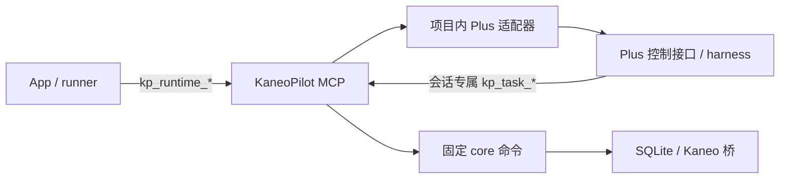

# 双向 MCP 与 Plus 接入 实现计划

## 概要

在 KaneoPilot 内连接 Plus 一次，后续自动创建角色会话、下发已确认的任务，并让对应 Plus 会话通过 MCP 读取材料、领取任务、心跳和回报。正常使用不重复填写服务商、模型、思考等级、连接地址或 MCP token。KaneoPilot 维护、测试并打包自己的标准 MCP 服务器；Plus 提供模型运行与必要的会话适配。

本文件是独立施工交接件，作为本次双向通信的执行入口。原角色环境总计划保留，不继续追加或改写；沿用已有 T7.1–T7.7 任务标识便于跟踪，但目标、接口、步骤和验收在本文件完整给出。本轮只创建计划和更新规划技能，不修改业务源码、用户数据或运行服务。

**实施起点（本会话前轮源码核查；本轮核对文件状态，未复测运行效果）：**

| 编号 | 当前依据 | 状态与后续工作 |
|---|---|---|
| T7.1 配置继承 | exec/planner/review 配置及 resolve_plus_default 已出现，dispatch_validate 已先生成快照再检查 | 实现中；补统一服务来源、事务外解析、只保留运行五字段及回归 |
| T7.2 设置简化 | SettingsView 已有 model_source、共享 Plus 表单和通用 MCP 服务区块 | 实现中；补一次连接、真实状态和保存/失败交互 |
| T7.3 运行器接入 | 既有 planner/controller/review/worker 仍直连 Plus，未使用 kp_runtime_* 创建角色会话 | 未开始；把实际运行链路接到项目服务 |
| T7.4 标准服务 | mcp_server/tools/scopes/stdio、mcp-serve CLI 和对应测试文件已存在 | 实现中；修协议/授权接缝并做独立客户端验收 |
| T7.5 Plus 双向适配 | harness_plus_adapter/mcp_client 已存在；适配器期待 pi_session_attach_mcp，但所查 Plus main 和两个 MCP worktree 均无此工具 | 实现中；补 Plus 会话挂接及服务端自动挂接步骤 |
| T7.6 App 生命周期 | MCPServiceManager 与手动启动/停止 UI 已存在 | 实现中；补持久启用、启动/退出、profile 隔离、就绪门 |
| T7.7 核心收据与验收 | schema 已声明 5、runtime_operations 与迁移代码已存在；当前开库仍自动升级 | 实现中；补显式迁移门、原子收据、claim 身份及双向验收 |

代码目录：`/Users/sakurasep/Documents/Code/Project/Personal Project/KaneoPilot`。Plus 只读基线：`/Users/sakurasep/Documents/Code/Project/Fork Project/PI-Desktop`，main HEAD `a395c6067`，两项目均有未提交改动。不得覆盖、重置或机械按旧 HEAD 重建。正式安装包/实时服务/正式库状态未在本轮重查，前轮 active=false 只作为历史记录。

**实施目录与既有规格：**

- KP：`/Users/sakurasep/Documents/Code/Project/Personal Project/KaneoPilot`；下文 Python 模块默认位于 `KP/core/kanpilot/`，原生页面位于 `KP/macos/KaneoPilot/`，测试按列出的 `core/tests/` 或 `tests/` 路径。
- PLUS：`/Users/sakurasep/Documents/Code/Project/Fork Project/PI-Desktop`；Plus 主进程模块位于 `apps/desktop/electron/main/`。实际修改前按其 AGENTS 创建或复用支持 Plus 身份的独立工作树，不默认在脏 main 施工。
- 必读 `KP/AGENTS.md`、`docs/protocol.md` §5.22–5.24、`docs/state-model.md`、`docs/ui-spec.md` §4.9、`docs/automation-contract.md`；新双向接口以本文件为施工依据，主控在开工时同步到新增 protocol §5.25。这些规格均在仓库可得，不依赖旧总计划中的多轮追加。
- 规划/Review 固定 ask，Plus 规划仅使用内置方式；Codex 的 spec_plan 插件路径和 Pi CLI 分支保留，MCP 服务器不负责把 Codex 插件移植到 Plus。

## 交付物

- 本仓库的 `mcp_server.py/mcp_tools.py/mcp_scopes.py/mcp_stdio.py`：标准 MCP 服务器、角色工具、作用域与 stdio 接入。
- `harness_plus_adapter.py/mcp_client.py` 和四类运行器：调度台通过项目 MCP 服务控制 Plus，所有新会话先完成回调挂接再发送任务。
- Plus 的受管理独立工作树：仅补会话专属 MCP 挂接、工具注入及调用路由；不把 KaneoPilot 服务器移到 Plus 维护。
- 原生设置与 `MCPServiceManager.swift`：一次连接、默认配置继承、服务自动恢复、断开/失败原因。
- 核心固定收据与 mcp-claim 入口、schema 5 显式升级门、隔离测试及真实双向验收记录；没有第二个任务库。

## 双向通信与连接行为

**首次连接。** 用户启动支持本计划挂接接口的 Plus，并在 Plus 启用本机控制接口；在 KaneoPilot 的「设置 → 通用 → 本机 MCP 服务」启用服务，点击「连接 Plus」。默认读取 `~/.pi-desktop-plus/mcp-control.json`，自定义路径折叠在高级设置。检测只握手、读工具与本地默认配置，不创建模型会话、不产生模型调用。显示本项目服务状态、Plus 控制接口状态、双向接口支持情况三项，不能把握手成功标成“真实任务闭环已验证”。

用户为规划、任务执行/控制、Review 各自选 Plus 并保存；新角色草稿默认“跟随 Plus 默认配置”，不自动把所有旧角色切到 Plus。执行权限保留显式选择，规划/Review 固定 ask。之后每轮的地址、grant、模型和思考值由调度台准备，不让用户为每个会话再添加 MCP 或手填 ID。

**自动运行。** 仍由原 ExecutorScheduler 拉 runner，人工启动规划、计划 hold 与确认后执行、执行后 monitor/Review 的流程不变。App 控制会话 → MCP 下发任务；Plus 模型 → 会话 MCP 工具领取/读取/回报；核心结果 → UI。Plus 空闲时能开始工作依赖调度台创建会话和 prompt，不依赖模型在空闲中自行轮询。

**离线与重复操作。** 可离线保存合法 inherit 配置；服务关闭、Plus 控制面关闭、缺挂接工具或型号无效时阻止新 MCP 轮次并显示具体原因。已运行轮次保留 session/turn 和发送证据，不能因断线自动重派。暂停调度只阻止新领取；关闭服务/退出 App 不等于远端任务已停止。重新连接只恢复服务和观察，不重发已发送任务。

## 关键设计决策

### 1. 一个项目服务器，两个权限域

服务器与工具契约由本项目维护，serverInfo.name=`kaneopilot`，应用契约版本 `kp-mcp-v1`。MCP 标准定义协议，不定义统一 harness 的创建会话/终态工具；因此这些语义由项目工具和适配器固定。首个后端为 pi_desktop，不新增 backend 枚举，不承诺其它 harness 已兼容。

选定 App 托管 loopback HTTP + stdio 桥：可复用现有模块，也便于 Plus 的现成 MCP client 连接。stdio 仅转发到同一服务，不另建队列。没有采用让所有 Plus 会话共享高权限全局 MCP 配置：它不能满足任务/角色隔离。也不采用模型 shell 调 CLI 冒充双向 MCP；旧 shell 包装器仅保留历史轮次与诊断兼容。

### 2. 标准协议与返回形状

权威协议参考：[Lifecycle](https://modelcontextprotocol.io/specification/2025-06-18/basic/lifecycle)、[Transports](https://modelcontextprotocol.io/specification/2025-06-18/basic/transports)、[Tools](https://modelcontextprotocol.io/specification/2025-06-18/server/tools)。本次读取的是源码与已有调研依据，以下兼容检查尚未运行。

- 首版协商 2025-06-18，兼容 2025-03-26；initialize → notifications/initialized → tools/list/call，并提供 ping。只声明 tools capability，固定有界工具清单，不声明尚未实现的 resources、sampling、elicitation、SSE 或 listChanged 推送。
- 绑定 127.0.0.1，随机端口，POST /mcp；JSON-RPC 2.0；Accept 包含 application/json 和 text/event-stream，正常响应 application/json，通知 202，GET 405。所有 HTTP 调用（包括 initialize）必须校验当前 Bearer、Host、存在时的精确 loopback Origin。
- transport session 与 harness session/turn 分开；Mcp-Session-Id 不能代替 Bearer。每次核对 token 所属 scope、epoch、协议版本与 transport session，旧 token/session 不能凭缓存恢复权限。重握手不自动重试写调用。
- 输入 schema 禁未知字段、校验类型/非空身份/枚举/页大小。成功 structuredContent 为 `{ok:true,data:{...}}`，失败为 `{ok:false,error:{code,message}}` 且 isError=true；outputSchema 必须描述整个 structuredContent，不能声明裸 data schema 却返回包装对象。content.text 同步相同 JSON。协议错误与业务执行错误分开。
- 请求上限 2 MiB；不截断计划/图片/转录。输出超限报明确错误，消息通过物理分页完整读取，不把 preview 当证据。
- stdio 用按行 UTF-8 JSON-RPC，stdout 纯协议，日志 stderr。已存在的 `kanpilot.py mcp-serve --transport stdio --connection-file <server.json> --scope-file <grant.json>` 入口须用实际包内 core 验证，不假定当前实现已经符合规范。
- HTTP 支持必要并发，每次核心调用独立 Context/SQLite connection。等待 Plus 时不持有全局锁/SQLite 写事务，覆盖“Plus 在 prompt 接收响应前回调本服务”场景，避免双向死锁。环境在服务启动时固定，不能逐请求改 os.environ。

本机授权采用显式 Bearer capability；首版不提供公网 OAuth 服务。标准兼容验收使用可配置该本机凭据的独立 MCP client，不声称支持所有客户端的自动认证发现。

### 3. 控制域与任务域的唯一工具契约

控制域只给 App/runner 的 runtime grant；task grant 无权调用，即使猜到工具名也拒绝。字段统一 snake_case，身份字符串非空，读写实际参数复用 Plus 真实 DTO；harness_id 固定 pi_desktop。

| 工具 | 必要输入与 data |
|---|---|
| kp_runtime_capabilities / catalog | scope_id、harness_id，catalog 可选 provider_id；返回连接/支持操作或脱敏本地 cache/fallback、resolved_default/default_detail |
| kp_runtime_session_create | scope_id、operation_id、mode、project_path、runtime_config；返回 session_id，路径/配置必须等于授权快照 |
| kp_runtime_session_configure | scope_id、operation_id、session_id、mode、permission_mode；返回 configured，不允许权限超过 scope |
| **kp_runtime_attach_mcp（待补）** | scope_id、operation_id、session_id；服务选本 scope 的 task grant 文件挂接，返回 attached/tool_names；caller 不传任意 bridge 路径 |
| kp_runtime_prompt | scope_id、operation_id、session_id、content，可选真实 attachments；返回 accepted/turn_id，只表示接受 |
| kp_runtime_status / turn_get | scope_id、session_id，turn_get 必须 turn_id；返回实际运行信息或 running/completed/error/aborted 持久状态 |
| kp_runtime_messages | scope_id、session_id，可选 before/limit；字符串 message ID、物理 start/end 与 has_more 标志，保留真实工具字段 |
| kp_runtime_stop / abort | scope_id、operation_id、session_id；返回 requested，须 turn_get 证明已停 |
| kp_runtime_proposals / proposal_resolve | scope_id、session_id、turn_id；resolve 再带 operation_id/proposal_id/version/action；严格匹配 Plan/Goal 身份与原审批策略 |

任务域按角色过滤 tools/list，并在调用时重验。只暴露固定语义，不提供 command(payload)、通用 Plus invoke、文件写或 shell。

| 工具 | 角色、参数与固定 core 映射 |
|---|---|
| kp_task_claim | dispatch/monitor；operation_id、可选 request_id；stage/executor 服务注入，返回原 claimed/context/reason |
| kp_task_get / plan | 该会话授权任务；task_id，plan 可选 expected_plan_sha256；get-task/get-plan |
| kp_task_request | dispatch/monitor 的当前 request_id；get-request，用于恢复 |
| kp_task_session / messages | 获授权 task_id、执行 run_id、可选消息 cursor/limit；get-session/session-messages |
| kp_task_heartbeat / report | dispatch/monitor；request_id/run_id，加原 progress/outcome/note/evidence/send_state/failure 等必要字段；heartbeat/report |
| kp_task_dispatch_prepare / begin_send / start / confirm / fail | dispatch 当前 task_id/run_id 与原 evidence/send_state/reason；对应 dispatch-*，启动进程由宿主核心完成 |
| kp_task_recheck / observe / advance | monitor 当前 task_id/执行 run_id 或 target/expected_current/evidence_note；对应 recheck/round-observe/advance-task |

monitor 仅允许原被动 done→done、in-review→in-review，或有证据的 in-progress→in-review；不直接推 done。monitor 请求 run_id 与被观察执行 run_id 不混用。

规划、Review、任务执行模型只读自己的任务材料；它们通过原 proposal/结构化最终输出和转录交付，由 runner 校验与登记。publish-plan、register-review、create-review-fix、Review advance/report 由 runner 持核心身份完成，不向模型授予自评 pass/放行 hold。dispatch/monitor 使用命名 MCP 领取和汇报。禁止向 task grant 暴露配置、迁移、resolve、enqueue(confirm_plan)、暂停、清理、批量远端写或凭据工具。MCP 权限不冒充 OS 沙箱，Plus 工具审批仍生效。

### 4. 会话授权与一次接入

`<APP_SUPPORT>/mcp/server.json` 保存服务 url/pid/epoch/protocol_version/active/token_file；服务 token 独立文件，目录 0700/文件 0600/owner-only/非符号链接。Plus 自己的 mcp-control.json 仍只保存其控制端连接，不与本项目文件混用。令牌不进模型 prompt、argv、DB、日志或工具返回。

沿现有 admin 路由定形：POST /admin/scopes 仅管理 Bearer 可用，body=`{scope_id,invocation_id,role,expires_at,request_id?,run_id?,task_id?,project_path?,runtime_config?,connection_file?}`，role=catalog/planner/dispatch/monitor/review/execution。服务器验证核心身份/目录/配置，生成 runtime/task grant 文件，仅返回其路径。DELETE /admin/scopes/<id> 撤销；POST /admin/scopes/<id>/renew 仅在有效核心身份与既有 timeout 边界内续期。管理路由不出现在模型 tools/list。

grant 文件的共享形状固定为 `{url,token,scope_id,role,domain,epoch,protocol_version,expires_at}`，domain 为 runtime/task；现有 grant writer 与两端 reader 同步补齐，Plus 只接收 task 域文件。过期、scope/epoch不符或没有该角色预期工具时挂接失败，文件内容不得成为模型材料。

scope_id 按 invocation 或 request/run 稳定派生，随机 token/epoch 不用于收据主键。创建任务前的 dispatch/monitor scope 仅允许固定阶段 claim，成功后绑定 request/run/task；同一 scope 同时只持一项有效 claim。不同 scope 配置不能沿同 ID 扩大权限。服务重启后旧凭据失效，有效 runner 根据核心身份重新注册，不能恢复过期 lease。

Plus 新增命名工具 `pi_session_attach_mcp({sessionId,bridgeFile,confirm:true})`，返回 `{sessionId,attached:true,serverName:"kaneopilot",toolNames:[...]}`。仅本机会话且无 active turn 可挂接；重复同 session/grant 幂等，active turn conflict。校验 grant 文件安全性、loopback/epoch/scope/工具清单，凭据只留 native MCP client 内存。工具只注入此 session；通过 session-launch 的 pluginTools 与 host.ts 的工具调用路由接入，不污染 UserMcpRuntime 全局/项目集合。

每个新角色会话严格 create → configure → attach → 校验该角色工具集 → prompt；缺 attach 时发前阻断，不能 shell 降级。日常无需用户手动为每个任务注册服务器。“一次接入”指一次安装支持该适配的 Plus 包、启用本机接口并保存连接；仅在原 Plus 的全局设置添加一个普通 MCP 条目，不能自动赋予调度台创建会话的能力，也不能满足上述角色隔离。

### 5. 默认配置与运行快照

设置继续三个 pi_desktop 块加 model_source=inherit/custom；旧五字段无 model_source 按 custom，不覆盖旧值。新 Plus 草稿 inherit；切换模式保留自定义值。inherit 离线可保存，不要求三模型字段；connection_file 缺省为用户 Plus 默认绝对路径。Plan/Review 固定 ask，执行/dispatch/monitor 权限仍由用户显式选择。

读取来源统一为本项目 kp_runtime_catalog 经 Plus 适配器；共享 catalog 解析与 CLI 复用，禁止“服务→CLI catalog→服务”递归。仅信有效明确默认：provider 未指定且唯一可取唯一，否则歧义/失效报错；model 使用所属 provider 的全局/绑定默认，未设置且目录唯一才取唯一，不取首项。只读 cache/fallback，不刷新远端目录、登录或凭据。

精确模型绑定的 defaultThinkingLevel/thinkingLevels，按 Plus `initialThinkingLevelForBinding/nearestSupportedThinkingLevel/highestSupportedThinkingLevel` 初始化：无默认取明确已启用最高档，默认不在梯级先向上再向下取最近档；未提供 binding levels 才用对应目录模型的明确元数据，明确空集合 off，完全未知则报不能确定。非法值不能被过滤成缺省；当前 Plus MCP 不表达 omit，遇到要保留 omit 的默认明确提示不支持，不转 off。运行时仍由 Plus 适配能力，不承诺请求等级是远端已实测等级。

settings 的 model_source 不进入运行快照。运行五字段仅 connection_file/provider_id/model_id/thinking_level/permission_mode（外围 backend 按原 consumer），不含 mode/model_source/token。计划在新 start-plans 时固化 runtime_config；任务执行在 claim 时一次解析并用同一快照验证；dispatch/monitor/Review 在新 invocation 落盘前固定。恢复只读旧快照。同材料已授权请求先幂等返回，不能因为默认值变化/离线创建另一请求。Plus 读不进 SQLite 写事务，写前复核输入/配置未变，变化 conflict、只失败本项。

### 6. 收据与迁移

沿已出现的 schema 5 runtime_operations 表修正收据：唯一键 scope_id+operation_id，参数规范 hash、工具、后端、prepared/unknown/accepted/rejected、安全返回与下游 session/turn/proposal 身份。所有控制写必传稳定 operation_id；分发前用短事务唯一地 prepared→unknown，之后调用 Plus，再持久 accepted/rejected。unknown 不自动重发；同 ID 同 hash 返回已有安全结果，不同 hash conflict。不得把异常后已可能发送的调用记回 prepared，不用 JSON-RPC id 当幂等键。

新增固定内部 mcp-claim 命令，复用原 claim 校验/远端准备，在同一核心提交事务保存领取与收据；先 claim 后另写 receipt 的空隙必须关闭。core 在实际写事务核验 task/request/run/lease/当前周期，不能只有服务分发前检查。report 响应丢失读 get-request 验同一结果，不能盲目重报或领下一项。

MCP handler 只调用固定 core 命令，不直接 SQL/调用 db mutation helper；必要内部 runtime-operation begin/mark/complete/get 由核心维护，tokens 不落表。现有 db._init_schema 自动迁移须改为：普通 Context/服务 require-current-schema，旧库 migration_needed；只有显式 migrate 允许升级，保留空隔离库初始化与现有升级链。正式库升级须对应授权和一致性备份，本轮不操作，不以开服务或 doctor 偷偷升级。

## 实现步骤

以下任务包用于后续施工。方案依据本会话前轮的 KP 模块/运行器与 Plus 挂接能力只读核查；本轮实际分派只读核查确认参考计划格式及技能的新建/局部修订行为，不将前轮调研或未来验证写成本轮重跑。只允许 Luna/Sol 子 agent；同一文件一名写入者，当前其它来源的改动必须合并保留。

主控独占本计划、AGENTS 架构说明以及 docs/protocol.md、state-model.md、ui-spec.md、automation-contract.md。开工先将本节双向契约同步到 protocol 新增 §5.25，并更新旧五字段/配置来源引用、schema 5、原生连接区块与 prompt 调用规则；不得让“协议已冻结”和实际文档缺这一节并存。Plus shared 协议与正式规格也由主控按其仓库规范唯一维护。

### Step 1（T7.7）：补核心迁移门与原子操作收据

**负责人/范围：** 主控；独占 db.py/constants.py/cli.py/cmd_exec.py/cmd_dispatch.py/cmd_remote.py/runtime_operations.py、必要内部命令与 tests/test_mcp_bidirectional.py。输入为上文收据契约及现有 schema 5，不再重复加第二张收据表或升到另一个 schema。

在 cli.Context/db.connect 增加显式迁移路径；复用当前 v4→v5 upgrade 与备份。固定内部收据命令实现原子状态转移，mcp-claim 在原领取提交中写 receipt。为 task 写动作接入事务内身份 guard，保留原 dispatch/monitor/Review 状态机。接口先冻结给 T7.4/T7.3，主控亲自落实，不拆同一事务链。
**完成检查：** 隔离 schema 4 普通读取不升级、migrate 一致性备份并保留数据；同 op 并发/丢响应/unknown 及 claim/report 恢复，见联合验收 B/C。

### Step 2（T7.4）：修现有 MCP 服务，落实双向授权

**负责人/范围：** 服务专家；独占 mcp_server.py/mcp_tools.py/mcp_scopes.py/mcp_stdio.py 及其 core/tests。依赖 Step 1 固定核心接口，可用 fake core 提前验证协议。

修 initialize 的认证与版本协商、禁止用 session id 代 Bearer、完整 input/output schema、Host/Origin、授予与撤销、epoch、每角色工具清单。mcp_tools 收据和业务写移至 core 固定入口，补 kp_runtime_attach_mcp 的工具契约，不允许传任意文件路径。处理并发/短锁与消息超限，不扩新RPC框架。
**分派：** 专家保留 HTTP/scopes/核心接入；可派 Luna 独占 mcp_stdio.py 与 stdio 测试，依冻结 HTTP 协议检查 stdout/连接关闭，不同时写这些文件。
**完成检查：** 联合验收 A/B 与嵌套回调，不把自有 client/server 同源互通算独立兼容。

### Step 3（T7.5）：补 Plus 会话级挂接，连上项目适配器

**负责人/范围：** harness 专家；独占 KP harness_plus_adapter.py/mcp_client.py/test_harness_plus_adapter.py。输入上文 attach/返回契约、现有 Plus client 与源码入口。

通过服务生成的 scope 关联 task grant，调用 pi_session_attach_mcp，严格验证 sessionId/attached/serverName/toolNames；当前适配器对缺 attached 的默认 true 必须去掉。复用真实 Plus client、分页/持久 turn/proposals DTO；grant/server 文件读取做 owner-only、非符号链接、loopback、epoch校验，不把错误正文原样泄漏。caller 用期望接口校验输出，不允许缺字段变成功。

**Plus 子任务（T7.5-P，未开始）：** 派 Luna 到受管理独立 Plus worktree；先读 Plus AGENTS 和最新基线、保留品牌/数据根/已有脏改动。独占 mcp-control.ts、必要 session-ipc.ts、runtime/session-launch.ts、runtime/host.ts、新会话 MCP 注册表模块与测试；shared 协议/规格由主控统一维护。复用 plugin-mcp client，不改全局 MCP 保存白名单。只让本会话发现/调用自己的 grant，处理删除/断开/退出。交回无模型工具发现、两会话隔离和真实包内 attach 工具证据，不替换 /Applications。

专家亲自核对端到端 mapping；所查 Plus 暂无此 API，不能假称当前包可用。无模型原型若不能在会话工具表和 host call 路由保留隔离，只暂停后续真实发送，报告证据，不改为共享全局 token。
**完成检查：** 联合验收 D；工具回调只调用本项目服务器，缺挂接发前阻断。

### Step 4（T7.1）：把继承配置统一到项目服务与五字段快照

**负责人/范围：** 配置专家；独占 pi_desktop_backend.py/cmd_config.py/planner_config.py/exec_config.py/review_config.py 与已有配置/backend测试。复用现有 model_source/resolve_plus_default，沿上文快照契约；不修改角色 UI/runner。

catalog 解析共享于 adapter/CLI，协调 Step 3 的函数输入输出，避免彼此编辑同文件。保留离线保存/custom 值与 Codex/Pi CLI 分支，明确从运行键排除 model_source。预览只读且不用当前值覆写旧轮。专家直接完成共用解析链，不按角色拆写入者。
**完成检查：** 默认 A 建请求、改 B 后旧轮仍 A，新轮 B；歧义/非法/omit/空/未知等级、固定 ask、旧自定义保留。见验收 C/E。

### Step 5（T7.3）：把实际运行路径接入双向 MCP

**负责人/范围：** 主控；独占 planner_inputs.py/dispatch_validate.py/planner_runner.py/executor_runner.py/pi_desktop_planner.py/pi_desktop_controller.py/pi_desktop_review.py/pi_desktop_worker.py，dispatch/monitor/_preamble prompt、运行链专属测试。输入 Step 1–4 接口及下述现有协议入口；队列、审批、身份与恢复规则沿 protocol §5.22–5.24。

每个新 invocation 注册 scope；用 runtime grant 初始化本项目 client；通过 kp_runtime_* 创建/配置/挂接/确认工具/prompt。控制端 prompt 使用 task 工具，不暴露旧 shell wrapper。规划/Review 结果仍由 runner 固化/登记，Goal 审批和 hold 不变：任务执行先协商 Goal 契约，按已确认计划由宿主核验/审批后才进入执行 turn；规划导入对应 Plan proposal 后 reject 关闭该生成会话，不在 Plus 批准执行。材料图片、哈希、独立 worktree 和 lease heartbeat 保留。

start-plans 的网络解析移出写事务；dispatch check 使用同一快照；新调用记录稳定 operation_id、session/turn、grant scope，恢复不再次 create/prompt。Collector 消费标准后的真实消息形状，完成后读完转录，task请求结果与harness turn分别核验。只有内部 adapter 直连 Plus，新角色 runner 不保留绕过服务器的默认分支。
**分派：** 主控亲自串行接入共享启动/恢复身份；协议/Plus模块由原负责人接收缺陷，避免多个 agent 在四运行器复制方案。
**完成检查：** 无服务/缺attach不发送；双向执行 trace；读取失败/审批冲突/响应丢失不重派；原 Codex/Pi CLI仍可用。见验收 C/D/F。

### Step 6（T7.2）：提供一次连接与简化的三个角色表单

**负责人/范围：** 原生专家；独占 SettingsView.swift/Core/Models.swift/AppViewModel.swift 及 UI草稿夹具。输入截图和当前 grouped Form、Step 7 状态 DTO/操作。

通用 MCP 区块调整为启用开关 → 本机服务状态 →「连接 Plus」/重新检测 → Plus接口状态/双向能力 → 折叠高级连接；不显示PID等内部实现作为正常配置要求。区分本机未启动、Plus未开控制面、版本缺接口、默认缺配置、权限等待与上次读取。

规划/执行/Review保留运行端选择、inherit/custom 与保存；inherit隐藏 provider/model/thinking 输入，仅显示只读摘要，custom沿现有候选；高级路径默认折叠。沿13/18/11pt、8/12/16间距、系统色、现有侧栏/四段导航和1180×760/900×600窗口，不换布局体系。刷新不存DB，generation丢弃过期响应；旧值保留、失败不抹草稿、离线合法保存。停止服务时显示正在运行会话的影响并确认，不自动停止远端。
**分派：** 直接完成集中的 SettingsView/Models接口，不按三个角色派同时写入者。
**完成检查：** 原生两尺寸浅/深色及连接/加载/失败/草稿晚响应；见验收 E。

### Step 7（T7.6）：服务随 App 生命周期运行并随包交付

**负责人/范围：** 生命周期专家独占 MCPServiceManager.swift 与专属夹具；主控独占 KaneoPilotApp.swift、ExecutorScheduler.swift、Xcode工程、scripts/build_app.sh 接入。输入 Step 2 服务manifest、Step 6状态与动作。

manager状态 DTO=`{enabled,running,url,error,harness_connected,harness_detail,attach_supported}`；动作 enable/start/stop/retry/probePlus，原生专家消费它。默认关闭，显式启用后持久恢复；服务就绪必须是真实握手而非Popen/PID。复用 CoreClient路径/Python解析，读 KANPILOT_APP_SUPPORT 与 profile隔离路径，不硬编码正式目录。启动失败有界报错/用户重试，无循环重启；同profile已有实例不杀进程/覆盖活跃连接文件。

App启动恢复服务，再允许新MCP轮；暂停调度不关服务，退出撤销grant并停本机子进程，不杀Plus会话。关闭/失败保留未知运行状态。build_app检查新模块导入与源码/包内hash，stdio用实际bundled core；不得以打包成功声称安装或迁移正式库。
**分派：** 专家自行完成单个生命周期链，可与设置UI并行，主控接入共享App/调度文件。
**完成检查：** 联合验收 E/F；实际App启停/重启恢复，独立profile不串正式路径。

**并行顺序：** 主控先冻结固定core/作用域/DTO与同步规格；服务/Plus适配/配置/原生可按独占范围先做fake接入，Plus挂接实现独立并行。Step 1–4就绪后主控接Step 5，再合Step 6–7和联合验收。Plus接口或真实包受阻时继续本项目可验证部分，不宣布完整双向接通。

### Step 8：验证双向通信与实际使用

本轮没有运行下列测试、构建、界面或服务验收。现有测试文件已存在，不能把其存在或过去报告当本次通过。工作目录固定 KP 根；使用tests/conftest临时DB/根目录/fake Kaneo及fake Plus，关闭调度器，不向正式服务创建任务。

**A 标准协议。** 定向运行 `python3 -m pytest -p no:cacheprovider core/tests/test_mcp_server.py core/tests/test_mcp_scopes.py core/tests/test_harness_plus_adapter.py tests/test_mcp_bidirectional.py -q`，补本次缺失的schema/版本/Bearer/Host/Origin/stdio/嵌套回调场景。用独立现成Plus MCP client通过HTTP与stdio真实发现/调用，验证JSON-only服务器互通；同源client互通不代替这项。

**B 权限与核心数据。** 两会话、两个task grants和一个runtime grant，跨角色/task/run/lease/epoch均拒绝；猜工具名、transport sid缺Bearer、任意DB/文件路径不能越权。Review模型不能登记pass或解hold。隔离schema4普通开库不升级、migrate备份与schema5保留数据；核心事务内身份失配无写入。测试新增文件沿原模块所有者补，主控统一集成。

**C 断线与快照。** 在下游接受create/prompt之后丢上游响应，重复operation不产生第二会话/提示；unknown保持需核对，service重启不得复活过期grant。claim+receipt原子、report丢响应核对同一请求结果。默认A→B、已授权同材料幂等、切换后端/模式、恢复旧轮与publish仍用旧快照。运行受影响既有配置/Plus planner/controller/review测试。

**D 两个方向都走实际链路。** 构建隔离Plus包（其HOME/数据/Electron profile全部独立，禁止读取用户会话与凭据），无模型建立两会话并挂接；只有目标会话见到其task工具。用真实Plus client调用本项目fake任务claim→heartbeat→report，核心/界面一致；App runtime调用穿过项目服务→Plus接口，核对session/turn。不能仅mock plus_attach_mcp成功，就写双向通过。

**E 原生使用。** `bash macos/tests/run-fixtures.sh` 与 `scripts/build_app.sh`；隔离App传临时KANPILOT_DB/APP_SUPPORT/PLAN_ROOT/REPOS_ROOT/KANEO_CREDENTIALS_PATH，`-executorSchedulingEnabled NO`，去除KANPILOT_CORE覆盖。1180×760、900×600浅/深色检查一次连接/三个角色inherit与custom/长名长路径/错误/保存/过期响应；启动、退出、再启动恢复启用且profile不串。服务online但Plusoffline时明确两层状态。

**F 有界真实闭环与现场交付。** 准备完成后，只有已有明确费用/服务授权才运行一次真实Plus角色任务，核对native MCP tool-call trace、request/run、完整消息与持久终态、核心报告，记录是否计划 hold、派发、monitor、Review 各符合既有审批和结果协议。未授权的真实模型、安装替换、正式库迁移、commit/push/发布保留相应门；不因这些门重复请求本地施工许可。部署新Plus时单列包身份/接口，正式库操作先一致性备份；不把构建产物当已安装。

### Step 9：收尾与交付

- 汇总新计划各任务的源码、隔离测试、原生界面、真实 Plus 和真实模型证据，分别标明；通过必要验证后为待体验，只有用户明确确认才标已验收。
- 提供本项目 App 和支持会话挂接的 Plus 构建路径，核对包内接口、核心文件哈希及应用身份；构建不代表已安装，正式数据迁移与外部发布按已有授权边界执行。
- 只停止本次启动的隔离进程、清理本次临时测试产物。保留项目改动、原应用、任务、会话和用户数据，不按参考计划的三文件要求清理本项目。
- 同一阻塞经过两次有不同依据的尝试仍失败，记录预期、实际和证据，只暂停依赖部分，继续其余已授权工作。

## 风险与规避

| 当前风险 | 本计划处理 |
|---|---|
| 工作区已有实现，原计划“未创建”失实 | 从当前源码继续修正/接线；本轮无测试，状态保留实现中，不回退现有改动 |
| 普通Context可自动迁正式库 | 显式迁移门先于新服务/运行包现场使用 |
| MCP已存在但runner绕过它、Plus工具只mock存在 | T7.3真实接线、T7.5真实挂接与D/F独立验收，不降级shell/全局高权限token |
| 断线或并发触发重复会话/领取 | 原子收据、unknown与核心事实恢复；写请求不盲目重试 |
| Plus版本缺挂接接口/本机控制未启用 | “连接Plus”区分原因；本项目其它工作继续，缺接口发前阻断 |

没有尚待用户决定的产品分支：用户已确认双向通信与项目维护服务器。Plus会话挂接、独立客户端及真实模型门是必要技术/验证依赖，不是可以省略的验收。只有适用验证完整才标待体验，用户明确确认后标已验收；文件/源码/测试夹具不能代替双向运行效果。
